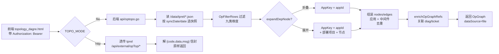
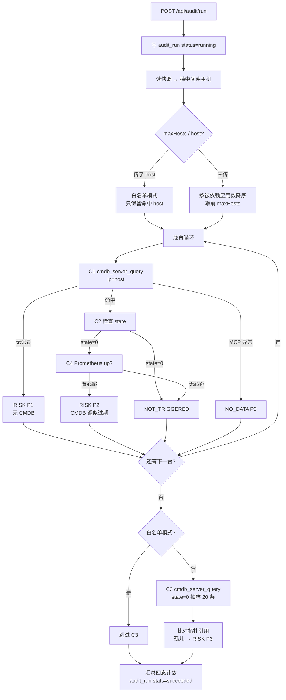
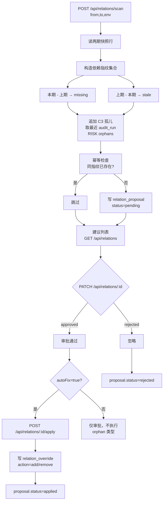
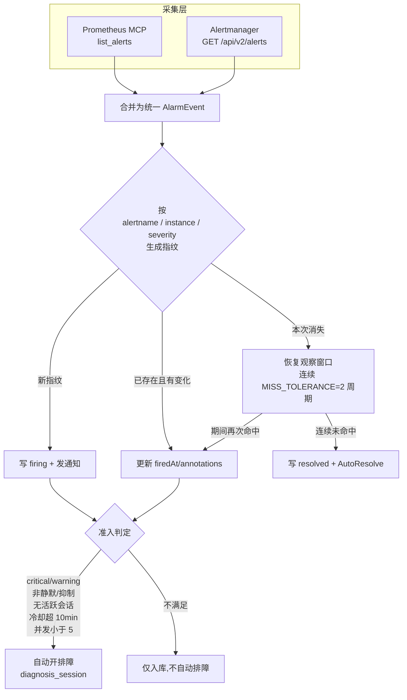
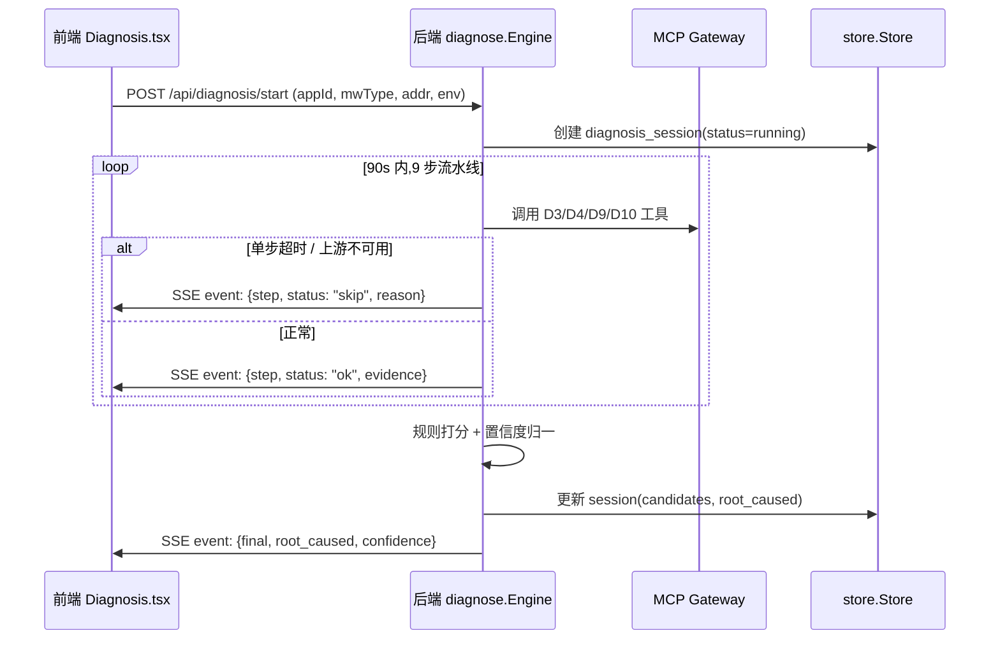
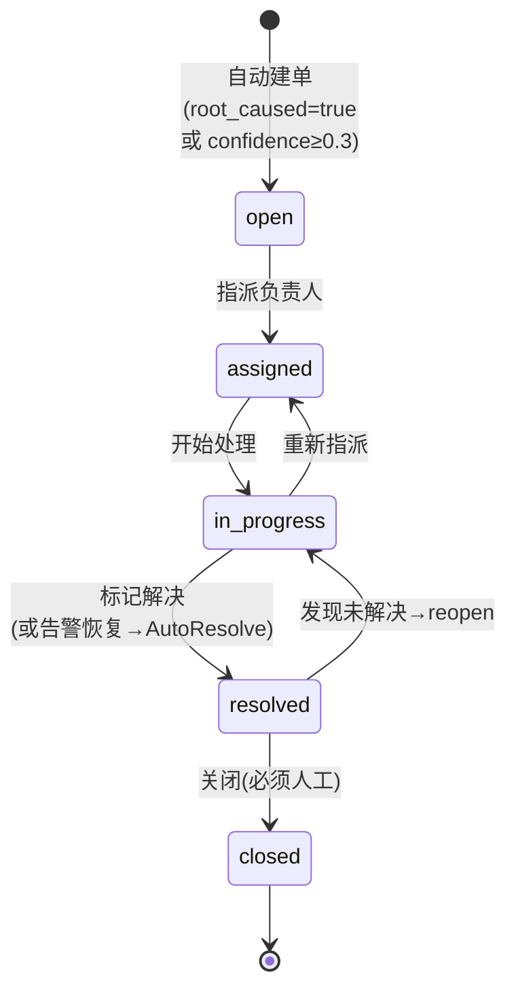
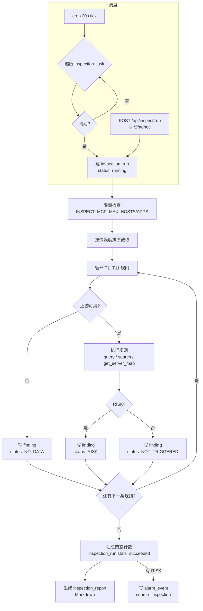
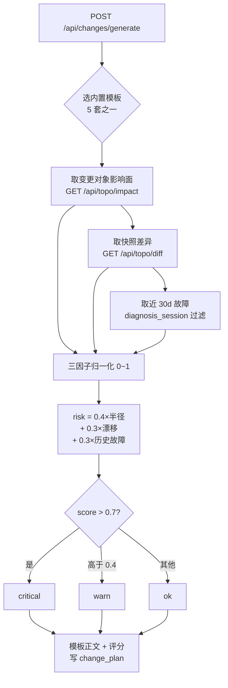
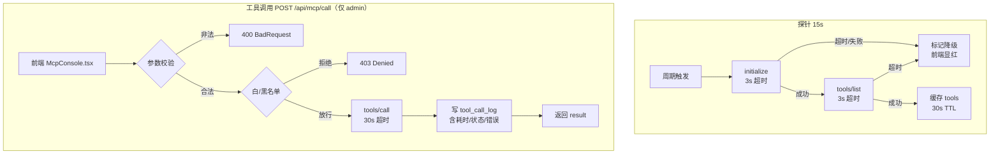
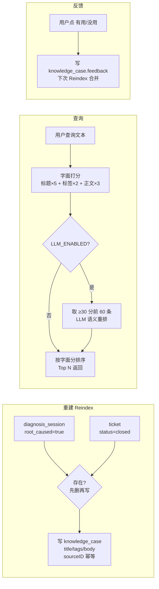

# 平台功能与实现说明

> **合并说明**：本文件由《平台功能与数据来源说明》《排障使用动线与实现逻辑说明》合并而成（2026-11-17），两篇正文原样保留。
> **编号口径**：文内 `§x` 默认指**所在篇**的编号；两篇编号各自独立（篇内 §4 与篇内 §4 互不相关），与《上游服务接入规范与实施》的分篇写法一致。
> **篇目**：第一篇 平台功能与数据来源（1 菜单与实现状态 → 6 代码索引）｜第二篇 排障动线与实现逻辑（1 文档目的 → 10 结论 + 附录 A 五步排障功能清单）。
> **已知口径冲突（原文未改，待裁决）**：
> 1. CMDB `state` 语义：第一篇 §3.1 写 `4=报废 / 6=待清退`，第二篇 §4.10 写 `4=未知 / 5=闲置`；
> 2. 排障步骤数：第一篇 §3.2 表格写「七步」、同节详解写「九步」，第二篇 §6 写「11 步 / 13 个调用点」；
> 3. 资源拓扑实现状态：第一篇 §1 写「已实现」，第二篇 §2.1 写「部分实现」。

# 第一篇 平台功能与数据来源

> 适用代码：`ai-ops/platform`；当前部署形态 `TOPO_MODE=file`（读本地拓扑快照），CMDB / Prometheus / Pinpoint / ES 走 `mock-mcp`。
> 全文统一按「**功能 × 数据来源 × 处理逻辑**」表格描述：数据来源工具/接口 → 处理逻辑 → 输出落盘。
> 第 4 章是云网数据治理的深度明细，其余页面在第 3 章按同一表格口径逐页给出。

## 1. 菜单与实现状态

| 分组 | 菜单 | 前端路由 | 状态 | 前端页面 | 后端模块 |
|---|---|---|---|---|---|
| 智能监控排障 | 总览 | `/dashboard` | 已实现 | `Dashboard.tsx` | `internal/api/router.go`、`internal/mcp` |
| 智能监控排障 | 告警中心 | `/alert-center` | 已实现 | `AlarmCenter.tsx` | `internal/alarm` |
| 智能监控排障 | 排障工作台 | `/diagnosis` | 已实现 | `Diagnosis.tsx` | `internal/diagnose` |
| 智能监控排障 | 日志分析 | `/log-analysis` | 已实现（嵌入外部服务） | `LogAnalysis.tsx` | `internal/api/logs_handler.go` |
| 智能监控排障 | 外部业务接口监控 | `/biz-monitor` | 已实现 | `BizMonitor.tsx` | `internal/alarm/{biz,external}.go` |
| 智能监控排障 | 隐患与工单 | `/tickets` | 已实现 | `Tickets.tsx` | `internal/tickets` |
| 智能监控排障 | 排障流程管理 | `/diag-flows` | 规划中（占位） | `Placeholder`（nav 内联） | — |
| 智能巡检 | 巡检任务与报告 | `/inspection` | 部分实现 | `Inspection.tsx` | `internal/inspect` |
| 智能巡检 | 巡检方案与脚本 | `/inspect-plans` | 已实现 | `InspectPlans.tsx` | `internal/inspect/rules.go` |
| 智能割接维护 | 变更方案 | `/change/plans` | 已实现 | `ChangePlans.tsx` | `internal/changes` |
| 智能割接维护 | 风险评估 | `/change/risk` | 已实现（同组件） | `ChangePlans.tsx` | `internal/changes` |
| 智能割接维护 | 执行与验证 | `/change/execution` | 规划中（占位） | `Placeholder`（nav 内联） | — |
| 云网数据治理 | 运维关系拓扑 | `/op-topology` | 已实现（内嵌 G6 原型页） | `public/tprel/topology_dagre.html` | `internal/api/optopo.go` |
| 云网数据治理 | 资源稽核 | `/audit` | 已实现 | `Audit.tsx` | `internal/audit/engine.go` |
| 云网数据治理 | 关系修正 | `/relations` | 已实现 | `Relations.tsx` | `internal/relations/engine.go` |
| 云网数据治理 | 资源拓扑与影响面 | `/topology` | 已实现 | `Topology.tsx` | `internal/topo`、`internal/api/router.go` |
| 云网数据治理 | 拓扑数据同步 | `/topo-sync` | 部分实现（file 模式降级） | `TopoSync.tsx` | `internal/api/optopo.go`（透传） |
| 云网数据治理 | 运维对象 | `/resources` | 占位页 | `Placeholder.tsx` | — |
| 网络及服务质量优化 | 质差分析 | `/quality` | 已实现 | `Quality.tsx` | `internal/alarm/quality.go` |
| 网络及服务质量优化 | 指标劣化 | `/degradation` | 已实现 | `Degradation.tsx` | `internal/alarm/degradation.go` |
| 运营指标 | 考核指标看板 | `/metrics` | 已实现 | `Metrics.tsx` | `internal/kpi` |
| 通用能力 | 数据与能力接口 | `/mcp` | 部分实现（仅 admin） | `McpConsole.tsx` | `internal/mcp` |
| 通用能力 | 历史故障库与知识库 | `/knowledge` | 已实现 | `Knowledge.tsx` | `internal/knowledge` |
| 通用能力 | 平台服务 | `/platform` | 占位页 | `Placeholder`（nav 内联） | — |
| 模型与算法 | 样本库 / 特征库 / 数据预处理 / 算法 / 训练 / 模型库 | `/samples` 等 6 个 | 规划中（占位） | `Placeholder`（nav 内联） | — |

## 2. 统一数据底座

| 编号 | 数据源 | 工具 / 接口 | 当前访问方式 | 主要用途 |
|---|---|---|---|---|
| D1 | 拓扑关系快照 | 本地文件 `operation_topology.json`、`app_dp_relation.json`、`deploy_pinpoint_relation.json` | `TOPO_DATA_DIR=/data/tprel`，挂载 `ai-ops/topo/tprel/data`（只读） | 所有拓扑类功能的行数据 |
| D2 | 拓扑服务（tprel） | `GET /api/external/operationTopology/{graph,list,detail,middlewareTypes,sync,sync/status,sync/logs,doc,prototype}` | `TOPO_MODE=http` 时后端透传；平台对外暴露 `/api/topo/op/*` | http 模式下的图/同步/文档 |
| D3 | CMDB 资产 | MCP 工具 `cmdb_server_query`（cmdb-mcp-server） | `CMDB_MCP_URL=http://mock-mcp:8061/mcp`（数据源 `backend/mockdata/cmdb/_db_servers.json`） | 资源稽核的账（CMDB 记录） |
| D4 | Prometheus 指标 | MCP 工具 `query`，PromQL `up{instance=~"^<host>(:[0-9]+)?$"}` | `PROMETHEUS_MCP_URL=http://mock-mcp:8090/mcp` | 稽核时校验主机是否有心跳 |
| D5 | 主机身份映射 | `identity.Registry`（`identity_host` / `identity_app`） | 本地 store，启动时按拓扑行重建 | 对齐拓扑 `ConnectAddr` 与 CMDB `ip/vip/publicIp/hostName` |
| D6 | 业务对象存储 | `store.Store`（文件主存 + Postgres 镜像） | `STORE_DIR=/app/data`，`POSTGRES_DSN` 可选 | `audit_run`、`audit_finding`、`relation_proposal`、`relation_override` |
| D7 | 上游调用网关 | `mcp.Gateway`（白名单、超时、`tool_call_log`） | 进程内 | 所有 MCP 调用的统一入口与审计 |
| D8 | 排障 / 工单 | 诊断会话 `diag.List()`、工单 `tickets.List()` | 本地 store | 拓扑节点按排障/工单状态着色 |
| D9 | Pinpoint 调用链 | MCP 工具 `get_server_map_tool`、`get_service_call_chain`、`get_agent_active_status` 等 | `PINPOINT_MCP_URL=http://mock-mcp:8888/mcp` | 排障证据、巡检 T5/T6/T7 类检查 |
| D10 | Elasticsearch 日志 | MCP 工具 `es.search`、`es.list_indices` | `ES_MCP_URL=http://mock-mcp:9201/mcp` | 排障日志证据、巡检日志类规则 |
| D11 | 告警推送与通知 | Alertmanager `GET /api/v2/alerts`；通知 webhook（飞书/钉钉/企业微信/自定义） | `ALERTMANAGER_URL`；`ALARM_NOTIFY_*` | 告警去抖、恢复通知 |
| D12 | 日志分析服务 | `GET {LOG_ANALYZER_URL}/api/logs/health` 与页面 iframe | `LOG_ANALYZER_URL=http://log-analyzer:8020`；前端 `VITE_LOG_ANALYZER_URL` | 日志分析页嵌入与可用性探测 |
| D13 | 可选大模型 | OpenAI 兼容 `chat/completions` | `LLM_ENABLED`、`LLM_BASE_URL`、`LLM_MODEL`、`LLM_API_KEY` | 知识库语义重排、排障结论润色（未启用则跳过） |

## 3. 功能 × 数据来源 × 处理逻辑（总表）

> 每张表列固定为「功能 | 主要输入 | 数据来源 | 处理逻辑（核心） | 输出 / 落盘」，与第 4 章云网数据明细同一口径。

### 3.1 云网数据治理

| 功能 | 主要输入 | 数据来源 | 处理逻辑（核心） | 输出 / 落盘 |
|---|---|---|---|---|
| 运维关系拓扑 | `env`、`date`、`middlewareType`、四维属性（部署项目/工程项目/机房节点/PP应用）、`apolloAppId/Name`、`apolloHostName`、`connectAddr`、`expandDepNode` | D1/D2 + D8 | 行过滤 → app 折叠或按部署点展开 → 应用节点 + 中间件地址节点 + 依赖边 → 附带排障/工单摘要 → 内嵌页渲染 G6 | 实时返回 `OpGraph`（nodes/edges/stats），不落盘 |
| 资源稽核 | `date`、`env`、`maxHosts`、`host`（可重复） | D1 + D3 + D4 + D5 | 抽取被依赖的中间件主机 → 逐台做 C1 存在性 / C2 状态一致性 / C4 指标佐证 → C3 反向孤儿抽样 | `audit_run` + `audit_finding` |
| 关系修正 | `from`、`to`、`env`；建议级 `status/kind` 筛选 | D1 + D6（C3 孤儿来自审计结果） | 两期快照 diff 生成缺失/失效建议 → 人工审批 → 执行写覆盖记录 | `relation_proposal`、`relation_override` |
| 资源拓扑与影响面 | `env`、`date`、`viewMode`、聚焦 `appId`；影响面按 `appId` 或 `mwType+addr` | D1 | 二部图构建；ego 网络；应用视角/中间件视角影响面；快照 diff | 实时返回 `Graph/Impact/Diff`，不落盘 |
| 拓扑数据同步 | 触发方式（手动/定时） | D2 | file 模式仅展示快照日期并提示不可触发；http 模式透传同步接口并轮询进度 | 同步结果由 tprel 服务落库并回写快照 |
| 运维对象 | — | — | 占位说明：已建模对象 / 未覆盖对象清单 | 无 |

#### 运维关系拓扑处理逻辑详解

**file 模式（当前）**：后端本地计算，链路为「读快照 → 过滤 → 折叠/展开 → 组装图 → 着色」。

1. **快照选择**：`syncDate` 优先于 `date`；都空时取目录中最新日期；返回 `dataSource=file` 让前端提示"本地快照"。
2. **过滤**：`OpFilterRows` 支持九类维度：环境、中间件类型、部署/工程/机房/PP 四维属性（维度内 OR、维度间 AND）、Apollo appId/name/hostname、依赖地址；过滤是**行级**操作，不做子图裁剪。
3. **折叠/展开**：
   - 折叠口径 `AppKey = appId`：同一 appId 的不同部署项目/部署点合成一个应用节点；
   - 展开口径 `AppKey = appId + 部署项目 + 节点`：同一 appId 在不同部署点拆成独立节点，适合看清"哪个部署点连了哪个中间件实例"。
4. **组装图**：中间件节点键为 `mw:<类型>|<地址>`；应用→中间件产生 `depend` 边；同一对节点去重。只有 `MiddlewareType` 与 `ConnectAddr` 同时非空的行才产生中间件节点/边。
5. **着色**：`enrichOpGraphRefs` 把应用（按 appId）和中间件（按 `类型|host`，去端口）关联到诊断会话/工单，前端据此着色。

**http 模式**：以上 2~5 步全跳过，后端直接透传 tprel 服务 `/api/external/operationTopology/*` 响应，只负责解 `{code,data,msg}` 信封。



#### 资源稽核处理逻辑详解

**先抽主机再逐台对账**，顺序是 C1 存在性 → C2 状态一致性 → C4 指标佐证 → C3 反向孤儿。C3 是可选的反向检查，仅非白名单模式执行。

1. **抽主机**：读 D1 快照，只保留 `MiddlewareType` 非空的行，`ConnectAddr` 去端口得 host；白名单模式按传入 host 过滤，否则按"被依赖应用数"降序取前 `maxHosts`（默认 20、上限 100）。
2. **C1 CMDB 存在性**：`cmdb_server_query(ip=host, pageSize=5)`，用身份映射匹配 `ip/vip/publicIp/hostName`；无记录 → `RISK(P1)`；MCP 异常 → `NO_DATA(P3)`。
3. **C2 状态一致性**：命中记录后检查 `state`；`0` 在线 → `NOT_TRIGGERED`；`4` 报废 / `6` 待清退 → `RISK(P1)`；其他非 0 → `RISK(P2)`。
4. **C4 指标佐证**（仅 C2 非在线时执行）：PromQL `up{instance=~"^<host>(:[0-9]+)?$"}`；任一采样 ≥1 → `RISK(P2)`「CMDB 状态疑似过期」；全为 0 → `NOT_TRIGGERED`「与 CMDB 一致」。
5. **C3 反向孤儿**（仅非白名单模式）：`cmdb_server_query(state=0, pageSize=20)` 抽样在线服务器，比对拓扑引用集合；未被引用 → `RISK(P3)`，最多输出 10 条。
6. **收尾**：四态计数写入 `audit_run.Stats` 并改 `status=succeeded`。



#### 关系修正处理逻辑详解

三源生成建议 + 两期 diff + C3 审计孤儿 → 人工审批 → 执行写覆盖。

1. **扫描**：按 `env` 读两期快照（空则取最近两期），构造依赖指纹（`appId + mwType + connectAddr`）集合；`本期 − 上期` → `missing`；`上期 − 本期` → `stale`。
2. **追加孤儿**：取最近一次稽核批次的 C3 `RISK` 发现项，类型为 `orphan`，`autoFix=false`（只能人工确认）。
3. **幂等**：同一指纹已存在 pending/approved 建议时不重复生成。
4. **审批**：只改状态（`approved` / `rejected`）和建议值；不涉及执行。
5. **执行**：仅 `approved` 且 `autoFix=true` 的建议可执行；写 `relation_override`（含 `action=add/remove`、来源、操作人、时间），建议置 `applied`。
6. **覆盖记录不回写**：覆盖记录仅用于后续对账/展示，不改拓扑快照或 CMDB，避免绕过上游变更流程。



### 3.2 智能监控排障

| 功能 | 主要输入 | 数据来源 | 处理逻辑（核心） | 输出 / 落盘 |
|---|---|---|---|---|
| 总览（仪表盘） | 无（自动轮询） | D1 快照 + D6 store 统计 + D7 MCP 探针 + `alarm_event` | `/api/health` 5s 探活；`/api/meta`、`/api/topo/mwtypes` 取规模信息；`/api/mcp/probe` 15s 探测四路 MCP 可用性；`/api/alarms/stats` 取告警计数 | 实时聚合指标卡 / 趋势图，不落盘 |
| 告警中心 | 环境、状态、级别、时间窗、关键词 | D4 Prometheus `list_alerts` + D11 Alertmanager `/api/v2/alerts` | 双通道拉取 → 解析为统一 `AlarmEvent` → 指纹 `alertname\|instance\|severity` 幂等入库 → 连续 `ALARM_MISS_TOLERANCE=2` 次未命中才判恢复 → 满足准入条件自动开排障 | `alarm_event`、`alarm_notification`，恢复时 AutoResolve |
| 排障工作台 | `appId`、`mwType`、`addr`、`env`、`symptom`，或从告警/拓扑/稽核带入 | D3 CMDB、D4 Prometheus、D9 Pinpoint、D10 ES、D12 日志分析服务 | 90s 七步流水线：拓扑影响面 → 指标异常 → 调用链 → 日志证据 → 宿主资源 → 变更/历史故障 → 规则打分；SSE 增量推送证据链 | `diagnosis_session`（证据链、候选根因、置信度、`root_caused`） |
| 日志分析 | 日志文件 / 服务选择（iframe 内操作） | D12 日志分析服务 `LOG_ANALYZER_URL` | 前端每 15s 探 `/api/logs/health`，可用则内嵌 iframe（`VITE_LOG_ANALYZER_URL`），不可用展示接入说明 | 不落盘；分析结果留在外部服务 |
| 外部业务接口监控 | 规则名、PromQL 模板、`{app}`、比较符、阈值、周期 | D4 Prometheus `query` | 按模板替换 `{app}` 生成 PromQL → 周期执行 → `gt/lt` 判阈值 → 空结果按 `keep` 保留 → 复用告警事件入库通道 | `biz_rule`、`biz_scan`、`alarm_event(source=biz)` |
| 隐患与工单 | 排障会话、工单状态/负责人/优先级 | D8 诊断会话 + D6 store | `SyncFromSessions` 扫描会话，`root_caused` 或候选根因且置信度 ≥0.3 自动建单，`sourceID` 幂等；状态机 `open→assigned→in_progress→resolved→closed`，`version` 乐观锁 | `ticket`；MTTA/MTTR 读取时计算 |
| 排障流程管理 | — | — | 占位页：当前为固定四步流水线，无流程定义/节点编排能力 | 无 |

#### 告警中心处理逻辑详解

**链路分三段：双通道采集 → 指纹去抖 → 自动处置准入**

1. **采集层**：后台循环拉取两路告警，Prometheus 走 MCP `list_alerts`，Alertmanager 走 REST `/api/v2/alerts`；两路合并为统一 `AlarmEvent`（字段含 `name/instance/severity/annotations/labels/generatorURL/firedAt`）。
2. **指纹去抖**：指纹 = `alertname | instance | severity`；同一指纹有新告警 → 更新 `firedAt` 与 `annotations`；上次有、这次消失 → 进入恢复观察窗口，连续 `ALARM_MISS_TOLERANCE=2` 个采集周期都没命中才写 `resolved`；首次出现且满足条件 → 写 `firing` 并触发通知。
3. **自动处置准入**：仅 `critical`/`warning` 且未被 Alertmanager 静默/抑制的告警才进入自动排障队列；准入前还会检查「同一主机是否已有活跃会话」「距上次自动排障是否超过 10min 冷却」「当前并发数是否 < 5」。
4. **通知**：`AutoResolve` 在告警恢复时自动触发，调用 webhook（飞书/钉钉/企业微信/自定义）；通知走异步通道，不阻塞采集循环。



#### 排障工作台处理逻辑详解

**九步流水线**（90s 总上限，单步超时则降级跳过，SSE 增量推送每步证据）：

| 步 | 数据源 | 产出 | 超时/降级 |
|---|---|---|---|
| 1 拓扑影响面 | D1 快照 / `topo impact` | 依赖中间件清单 + 兄弟应用（爆炸半径） | 无快照则跳过 |
| 2 指标异常 | D4 Prometheus `query_range` | 主机/应用 CPU/内存/延迟时序偏离 | Prometheus 不可用 → `NO_DATA` |
| 3 调用链 | D9 Pinpoint `get_service_call_chain` | 入口 span + 慢调用/错误 span 列表 | Pinpoint 不可用 → 跳过 |
| 4 日志证据 | D10 ES `search`（+ 兜底 D12） | 近 15min 错误日志摘要 | ES 不可用 → 兜底日志分析服务 |
| 5 宿主资源 | D3 CMDB + D4 | 机器规格、磁盘剩余 | CMDB 不可用 → 跳过 |
| 6 变更/历史故障 | D6 store | 近 24h 变更方案 + 近 30d 同 `appId` 的排障会话 | 无历史 → 跳过 |
| 7 规则打分 | 内存计算 | 候选根因按证据命中条数加权 | — |
| 8 置信度归一 | 规则打分 | 每个候选根因一个 `confidence ∈ [0,1]` | — |
| 9 结论输出 | 汇总 | 排序候选根因；`root_caused=true` 取置信度 ≥0.6 的 Top1 | 所有候选 < 0.6 → `root_caused=false` |



#### 工单处理逻辑详解

**自动建单**：后端 `SyncFromSessions` 定时扫 `diagnosis_session`，满足以下任一条件就自动建单：
- 会话 `root_caused=true`；
- 会话有候选根因且 Top1 `confidence ≥ 0.3`。

幂等：`ticket.sourceID = diagnosis_session.ID` 唯一约束，同一会话不重复建单。

**状态机**：`open → assigned → in_progress → resolved → closed`；`reopen` 可回到 `in_progress`；`AutoResolve` 在告警恢复时只自动把工单转到 `resolved`，`closed` 必须人工。

**乐观锁**：每条记录带 `version` 字段，`PATCH` 时后端比对 `version`，不一致返回 409，避免并发指派/解决覆盖。



### 3.3 智能巡检

| 功能 | 主要输入 | 数据来源 | 处理逻辑（核心） | 输出 / 落盘 |
|---|---|---|---|---|
| 巡检任务与报告 | 方案、环境、应用/主机范围、触发方式（手动/定时） | D1 快照 + D4 Prometheus（`query`、`host_metrics_realtime`）+ D9 Pinpoint `get_server_map_tool` + D3 CMDB + D10 ES（`list_indices`、`search`） | 按方案参数执行 T1~T11 规则，每条规则输出四态结论；MCP 失败记 `NO_DATA`；`INSPECT_MCP_MAX_HOSTS`/`INSPECT_MCP_MAX_APPS` 限量；cron 20s tick 调度 | `inspection_run`、`finding`、`inspection_report`（Markdown）；`RISK` 推送告警 |
| 巡检方案与脚本 | 规则选择、参数覆盖、cron 表达式 | 内置 `builtinRules`（11 条）+ D6 store | 方案保存到 `inspection_task`；`EffectiveParams` 把任务参数与内置默认值合并；`ValidateCron` 校验 5 段 cron；无独立脚本实体 | `inspection_task` |

#### 巡检处理逻辑详解

**调度器**：cron 20s tick，遍历所有 `inspection_task`，计算下次触发时间，到期则建一个 `inspection_run` 状态为 `running`。手动触发 `POST /api/inspect/tasks/:id/run` 或 `POST /api/inspect/run`（adhoc）走同一执行入口。

**限量**：`INSPECT_MCP_MAX_HOSTS`（默认 50）限制单次巡检最多扫描主机数；`INSPECT_MCP_MAX_APPS`（默认 20）限制应用数。超出时按"拓扑里被依赖最多的"优先截取。

**规则执行（T1~T11）**：每条规则独立调用上游（Prometheus / Pinpoint / CMDB / ES），上游不可用直接写 `NO_DATA`，不阻塞其他规则。11 条内置规则大致覆盖：

| 类型 | 典型编号 | 数据源 | 检查对象 |
|---|---|---|---|
| 指标阈值 | T1/T2/T3 | D4 Prometheus | 主机 CPU/内存/磁盘、应用 P99 延迟 |
| 调用链异常 | T4/T5/T6 | D9 Pinpoint | 入口接口错误率、慢调用 TopN、Agent 在线 |
| 拓扑一致性 | T7/T8 | D1 快照 | 中间件连通性、Apollo 配置匹配 |
| 日志关键字 | T9/T10 | D10 ES | ERROR/FATAL 关键字、依赖组件异常日志 |
| 外部接口 | T11 | D4 Prometheus（biz_scan） | 业务接口可用性 |

**四态结论**：每条规则输出 `RISK / NOT_TRIGGERED / NO_DATA / NOT_APPLICABLE`；整批巡检汇总四态计数写 `inspection_run.Stats`，状态改 `succeeded` 或 `failed`。

**报告 + 告警**：`inspection_report` 自动生成 Markdown 报告；任一规则判 `RISK`，自动推送一条 `alarm_event(source=inspection)`。



### 3.4 智能割接维护

| 功能 | 主要输入 | 数据来源 | 处理逻辑（核心） | 输出 / 落盘 |
|---|---|---|---|---|
| 变更方案 | 模板、环境、变更对象（应用/中间件地址）、时间窗 | D1 快照 + D8 排障历史 + D6 store | 选内置 5 套模板 → 取变更对象的影响面与快照差异 → 汇总近 30 天相关故障 → 生成方案正文与检查清单 | `change_plan` |
| 风险评估 | 变更对象、环境、评估窗口 | D1 快照 + D8 `diagnosis_session` | 风险分 = 0.4×爆炸半径 + 0.3×快照漂移 + 0.3×近 30 天故障；>0.7 判 `critical`；页面与变更方案共用 `ChangePlans.tsx`，无独立风险接口 | 随 `change_plan` 返回，不单独落盘 |
| 执行与验证 | — | — | 占位页：无割接执行编排、拨测验证与自动回退能力 | 无 |

### 3.5 网络及服务质量优化

| 功能 | 主要输入 | 数据来源 | 处理逻辑（核心） | 输出 / 落盘 |
|---|---|---|---|---|
| 质差分析 | `appId`（必填）、指标模板、时间窗（`QUALITY_WINDOW_MIN`） | D4 Prometheus `query_range` | 按三指标模板取时序 → 计算基线偏离与劣化程度 → 选影响面最大的对象作为根因 → 生成质差结论 | `alarm_event(source=quality)`；Overview 展示近 50 份 |
| 指标劣化 | 指标名（默认 `node_load1`）、阈值/窗口（`DEGRADATION_*`）、扫描周期 | D4 Prometheus `query_range` | 周期扫描指标时序 → 与基线比较判定劣化 → 可选自动触发排障 | `degradation_scan`、`alarm_event(source=degradation)` |

#### 变更方案 + 风险评估处理逻辑详解

**两页面共一个后端接口** `POST /api/changes/generate`，前端用同组件 `ChangePlans.tsx`，只是入口参数不同（变更方案可编辑模板字段，风险评估只读侧重评分）。

1. **选模板**：内置 5 套模板（应用发布、中间件升级、配置变更、机房切换、回滚预案），每套有固定章节（变更背景、影响评估、操作步骤、回滚、验证）。
2. **取影响面**：调 `/api/topo/impact` 拿变更对象的依赖兄弟应用数与依赖中间件清单 → 作为"爆炸半径"因子。
3. **取快照漂移**：调 `/api/topo/diff` 对比变更前后的拓扑差异 → 新增/消失依赖数作为"变更范围"因子。
4. **取近 30 天故障**：扫 `diagnosis_session`，找同 `appId` 或同中间件 `mwType+addr` 的会话 → 数量作为"历史稳定性"因子。
5. **风险评分**：`score = 0.4×爆炸半径 + 0.3×快照漂移 + 0.3×近30d故障`，三分都归一化到 [0,1] 再加权 → score > 0.7 判 `critical`，> 0.4 判 `warn`，否则 `ok`。
6. **写方案**：模板正文 + 影响面摘要 + 风险评分一起存 `change_plan`。



#### 质差分析处理逻辑详解

1. **取时序**：`appId` 必填；后端按三套指标模板（入口 P99、依赖中间件慢查询、错误率）拼 PromQL，用 `Prometheus query_range` 在 `QUALITY_WINDOW_MIN`（默认 60min）窗口取时序。
2. **算基线**：基线 = 过去 7 天同时段 P50；用当前窗口 P99 和基线比较，偏离度 = `(当前 − 基线) / 基线`。
3. **定根因**：按影响面大小排序（依赖兄弟应用数 × 偏离度），取 Top1 作为本次质差的根因对象。
4. **出结论**：写 `alarm_event(source=quality)`，字段含 `qualityLevel / rootCause / metrics`。
5. **Overview**：`GET /api/alarms/stats?source=quality` 拉最近 50 份质差事件，前端分组展示。


#### 指标劣化处理逻辑详解

**后台周期任务**（由 `DEGRADATION_SCAN_INTERVAL` 控制，默认 15min），循环所有已配置的劣化规则：

1. 调 `Prometheus query_range` 拉当前窗口时序；
2. 算滑动基线（过去 24h P50），判定偏离是否超过阈值（`DEGRADATION_THRESHOLD`）；
3. 命中阈值 → 写 `degradation_scan`（存完整时序 + 基线 + 偏离度）+ 写 `alarm_event(source=degradation)`；
4. 规则配置里 `autoDiagnose=true` 时，自动开排障，`symptom="指标劣化: <metric> 偏离基线 X%"`。

**与质差的区别**：质差是**手动**、应用级、入口指标为主；劣化是**自动周期**、指标级（可任意指标）、支持自动排障联动。

### 3.6 运营指标

| 功能 | 主要输入 | 数据来源 | 处理逻辑（核心） | 输出 / 落盘 |
|---|---|---|---|---|
| 考核指标看板 | 统计天数 `days` | D6 store：`alarm_event`、`diagnosis_session`、`ticket`、`inspection_run` | `Compute(days)` 纯内存聚合：P50/P90 发现-定位时延、工单达标率、自动化处置率、数据来源分布、每日趋势 | 实时返回，不落盘 |

### 3.7 通用能力

| 功能 | 主要输入 | 数据来源 | 处理逻辑（核心） | 输出 / 落盘 |
|---|---|---|---|---|
| 数据与能力接口（MCP 控制台） | 上游地址、启用开关、黑白名单、工具名与参数 | D7 `mcp.Gateway` + 4 路上游 MCP（8888/8090/8061/9201） | `MCP_ENABLED` 总开关；探针 15s（initialize + tools/list，3s 超时），工具列表 30s 缓存；调用链路：参数校验 → 白名单 → `tools/call` → 审计；工具说明来自前端静态 `src/data/mcpToolDocs.ts` | `tool_call_log`；`POST /api/mcp/call` 仅 admin |
| 历史故障库与知识库 | 查询文本、场景、反馈 | D6 `knowledge_case`（由 `diagnosis_session` / `ticket` Reindex 重建）+ D13 可选 LLM | Reindex 幂等重建案例；字面打分（标题 5 / 标签 2 / 正文 3）；可选 LLM 语义重排（分 ≥30、前 60 条）；人工反馈覆盖根因 | `knowledge_case` |
| 平台服务 | — | — | 占位页：已有 REST + SSE、网关审计、文件 + PG 存储；缺鉴权细分、租户配额、OpenAPI 文档、运行指标埋点 | 无 |

#### 考核指标看板处理逻辑详解

**纯内存聚合，无上游调用**：后端 `kpi.Compute(days)` 一次性拉取近 `days` 天内的四张表（`alarm_event` / `diagnosis_session` / `ticket` / `inspection_run`），在内存里分组排序后输出五大指标：

| 指标 | 口径 | 说明 |
|---|---|---|
| 发现-定位时延 P50/P90 | `diagnosis_session.diagnosedAt − alarm_event.firedAt` | 仅统计自动排障（`source=alarm`），排除手工发起 |
| 工单达标率 | `ticket(closed).resolvedWithinSLA / ticket(closed).total` | SLA 窗口由工单 `priority` 映射：P0=1h / P1=4h / P2=24h / P3=72h |
| 自动化处置率 | `ticket(autoResolve=true).count / ticket.total` | 告警自动恢复 → 工单自动转 resolved → 计自动化 |
| 数据来源分布 | `alarm_event.source` 分组计数 | 区分 Prometheus / Alertmanager / biz / quality / degradation / inspection |
| 每日趋势 | 按日分组的告警/排障/工单/巡检计数 | 直接用于看板折线图 |

#### MCP 控制台处理逻辑详解

**探针（15s 周期）**：对 4 路已启用的上游分别执行 `initialize` → `tools/list`，两步各 3s 超时，任一步超时视为该上游降级；结果在前端页面展示绿/黄/红状态。

**工具列表（30s 缓存）**：探针成功后缓存上游的 `tools/list` 响应，30s 内复用；前端工具说明文档来自静态 `src/data/mcpToolDocs.ts`（因为部分上游不返回 tools 的 description）。

**调用链路**：
1. 参数校验：工具名是否已注册、入参 JSON 是否合法；
2. 白名单：`MCP_ALLOW_TOOLS` 非空则仅允许白名单；`MCP_DENY_TOOLS` 命中则拒绝；
3. 实际调用：路由到对应上游的 `tools/call`，工具级 30s 超时；
4. 审计：调用前后各写一条 `tool_call_log`（含工具名、入参、耗时、状态、错误）。

`POST /api/mcp/call` 受 `RequireRole(admin)` 保护，viewer/ops 无权限。



#### 知识库处理逻辑详解

**Reindex（重建）**：知识库不单独存案例，`knowledge_case` 由 `diagnosis_session` 和 `ticket` 幂等重建：
- 取 `diagnosis_session(root_caused=true)` 或 `ticket(closed)`；
- 字段映射：`title = 根因摘要`、`tags = 应用 + 中间件 + 根因类型`、`body = 证据链摘要 + 处置步骤`；
- 每次重建先 `DELETE WHERE source IN (...)` 再全量写，保证幂等。

**查询**：
1. **字面打分**（必走）：匹配查询关键词在标题（×5）、标签（×2）、正文（×3）出现次数，加权求和；
2. **LLM 语义重排**（可选，`LLM_ENABLED=true` 时走）：取字面分 ≥30 的前 60 条，传给 LLM 做语义相关性重排；
3. 合并两轮结果返回给前端。

**反馈**：用户点"没用/有用"反馈写入 `knowledge_case.feedback`，下次 Reindex 会把反馈覆盖的根因文本合并进 `body`。



### 3.8 模型与算法

| 功能 | 主要输入 | 数据来源 | 处理逻辑（核心） | 输出 / 落盘 |
|---|---|---|---|---|
| 样本库 / 特征库 / 数据预处理 / 算法管理 / 模型训练 / 模型库（6 页） | — | — | 均为规划占位页：无接口、无数据、无模型训练与发布链路；当前异常检测与根因定位全部为规则实现 | 无 |

## 4. 云网数据治理分功能明细

### 4.1 运维关系拓扑

**功能能力**

| 能力 | 说明 |
|---|---|
| 三种布局 | 两层（应用→中间件）、实例（实例粒度）、力导（G6 力导向） |
| 粒度切换 | 应用折叠 / 按部署点展开 |
| 密度控制 | 控制画布节点疏密，避免大图不可读 |
| 属性筛选 | 部署项目 / 工程项目 / 机房节点 / PP 应用四维，维度内 OR、维度间 AND；另支持中间件类型、Apollo 应用、主机名、依赖地址 |
| 搜索与召回 | 节点搜索定位、按条件召回子图 |
| 节点详情 | 应用/中间件详情（依赖应用数、地址、类型等） |
| 归聚弹窗 | 把选中节点的关联子图抽到独立画布渲染 |
| 手动同步 | 调用同步接口并轮询进度（http 模式） |
| API 对接文档 | 在线文档 + 8 个接口的在线调试面板 |
| 稽核联动 | 从节点发起针对该主机的资源稽核（白名单模式） |
| 排障联动 | 从应用/中间件直接开排障，带 `appId / mwType / addr / env / symptom` |

**接口**

| 接口 | 说明 |
|---|---|
| `GET /api/topo/op/graph` | 拓扑图（file 模式本地组装；http 模式透传 tprel） |
| `GET /api/topo/op/list` | 关系明细分页 |
| `GET /api/topo/op/detail?id=` | 节点详情 |
| `GET /api/topo/op/middlewareTypes` | 中间件类型枚举 |
| `GET /api/topo/op/mwTargets` | 中间件目标枚举（类型 + 地址候选） |
| `GET /api/topo/op/sync/status`、`/sync/logs` | 同步进度与日志 |
| `POST /api/topo/op/sync` | 触发同步（http 模式） |
| `GET /api/topo/op/doc`、`/prototype/*` | 对接文档与原型包下载；由 tprel 服务提供，file 模式下后端未注册，文档面板会提示读取失败 |

**处理逻辑**

| 步骤 | 逻辑 |
|---|---|
| 1 | 前端加载 `topology_dagre.html`，脚本把 `/api/external/operationTopology/*` 重写为 `/api/topo/op/*`，并把平台裸 JSON 包成 `{code:0,data}` 信封 |
| 2 | 鉴权复用平台登录态：读 `localStorage["aiops-auth-token"]`，发送 `Authorization: Bearer <token>`；同源时 `API_BASE` 为空 |
| 3 | 后端取 `syncDate/date`，缺省用最新快照；`env` 缺省按全量行 |
| 4 | `OpFilterRows` 过滤：环境、中间件类型、部署项目、工程项目、机房节点、PP 应用、Apollo appId/name、主机名、部门/负责人、依赖地址 |
| 5 | 折叠口径 `AppKey = appId`；展开口径 `AppKey = appId + 部署项目 + 节点`，据此生成应用节点 |
| 6 | 中间件节点键为 `mw:类型|地址`，应用→中间件生成 `depend` 边；同一对节点去重 |
| 7 | `enrichOpGraphRefs` 把应用（按 appId）和中间件（按 `类型|host`，去端口）关联到诊断会话/工单，供前端着色 |
| 8 | http 模式跳过 3~7，直接透传 tprel 服务响应并解 `{code,data,msg}` 信封 |

**关键口径**

| 口径 | 说明 |
|---|---|
| 快照日期 | `syncDate` 优先于 `date`；都为空取目录中最新日期 |
| 中间件节点 | 只有 `MiddlewareType` 与 `ConnectAddr` 同时非空的行才产生中间件节点/边 |
| 端口归一 | 与排障/工单匹配时去掉 `:port`，避免 `host:6379` 与 `host` 匹配失败 |
| 数据源标识 | file 模式返回 `dataSource=file`，前端据此提示“本地快照” |

### 4.2 资源稽核

**接口**

| 接口 | 说明 |
|---|---|
| `POST /api/audit/run?date=&env=&maxHosts=&host=` | 执行一次稽核；`host` 可重复（白名单模式） |
| `GET /api/audit/runs?limit=` | 批次列表（默认 20） |
| `GET /api/audit/runs/:id` | 批次详情 |
| `GET /api/audit/runs/:id/findings` | 批次发现项 |
| `GET /api/topo/dates` | 可选快照日期 |

**检查项（四类）**

| 编号 | 检查项 | 判定方式 | 等级 | 结论 |
|---|---|---|---|---|
| C1 | CMDB 存在性 | `cmdb_server_query(ip=host, pageSize=5)` + 身份映射匹配 `ip/vip/publicIp/hostName` | P1 | 无记录 → `RISK`；调用异常 → `NO_DATA`（P3） |
| C2 | 状态一致性 | 命中后检查 `state`：`0` 在线；非 0 异常 | P2；`4` 报废 / `6` 待清退 → P1 | 在线 → `NOT_TRIGGERED`；非在线 → `RISK` |
| C4 | 指标佐证 | 仅在 C2 非在线时查 Prometheus `up`，任一采样 ≥1 视为仍有心跳 | P2 | 有心跳 → `RISK`「CMDB 状态疑似过期」；无心跳 → `NOT_TRIGGERED`「与 CMDB 一致」 |
| C3 | 反向孤儿 | 非白名单模式：`cmdb_server_query(state=0, pageSize=20)` 抽样在线服务器，比对拓扑引用集合 | P3 | 未被任何拓扑引用 → `RISK`（最多 10 条）；白名单模式 → `NOT_APPLICABLE` |

**执行流程**

| 步骤 | 逻辑 |
|---|---|
| 1 | 参数：`date` 空取最新快照；`env` 空默认 `PRO`；`maxHosts` 默认 20、上限 100；传了 `host` 时 `maxHosts` 强制等于 host 数 |
| 2 | 先写一条 `audit_run(status=running)`，保证执行中可在列表看到 |
| 3 | 读快照行，`collectHosts`：只保留 `MiddlewareType` 非空的行，`ConnectAddr` 去端口得 host，聚合依赖它的 Apollo 应用集合 |
| 4 | 白名单模式只保留命中 host；否则按“被依赖应用数”降序，取前 `maxHosts` 台 |
| 5 | 逐台执行 C1 → C2 → C4，生成 `audit_finding`（含结论、等级、证据、关联应用、中间件类型、地址、环境） |
| 6 | C3 抽样补充孤儿发现项（非白名单模式） |
| 7 | 汇总四态计数写入 `run.Stats`，状态改 `succeeded`，消息为「稽核完成：对账 N 个中间件主机，发现 M 项风险」 |
| 8 | 前端批次列表展示耗时与计数；详情抽屉按需拉 findings；带 `middlewareType` 的风险项可一键开排障 |

**结论枚举**

| 结论 | 含义 |
|---|---|
| `RISK` | 账实不符，需处理 |
| `NOT_TRIGGERED` | 校验通过（含 C2 一致、C4 佐证一致） |
| `NO_DATA` | 上游无数据/调用异常，无法判定 |
| `NOT_APPLICABLE` | 该检查项在本模式下不适用（如白名单模式的 C3） |

### 4.3 关系修正

**建议类型**

| 类型 | 生成方式 | 含义 | 可否自动修复 |
|---|---|---|---|
| `missing` | `from`/`to` 两期快照 diff | 上期没有、本期新增的依赖 | 是（`autoFix=true`） |
| `stale` | 两期快照 diff | 上期有、本期消失的依赖 | 是（`autoFix=true`） |
| `orphan` | 取最近一次稽核批次的 C3 `RISK` 发现项 | 拓扑里没有、CMDB 在线的孤儿资源 | 否（`autoFix=false`，仅人工确认） |

**状态机**

| 状态 | 进入方式 | 可执行操作 |
|---|---|---|
| `pending` | 扫描生成 | 通过 / 忽略 / 编辑 |
| `approved` | 人工审批通过 | 执行（仅 `autoFix` 类型） |
| `rejected` | 人工忽略 | 仅查看 |
| `applied` | 执行完成 | 仅查看；覆盖记录可查询 |

**接口**

| 接口 | 说明 |
|---|---|
| `POST /api/relations/scan` | 入参 `{from,to,env}`；`from/to` 为空时取最近两期快照，`env` 空取 `DefaultEnv` |
| `GET /api/relations?status=&kind=` | 建议列表 |
| `GET /api/relations/stats` | 各状态计数（页面顶部卡片） |
| `GET /api/relations/overrides` | 已执行的人工覆盖记录 |
| `PATCH /api/relations/:id` | 审批：`approved` / `rejected`，可改建议值 |
| `POST /api/relations/:id/apply` | 执行：仅 `approved` 且 `autoFix` 可执行 |

**处理逻辑**

| 步骤 | 逻辑 |
|---|---|
| 1 | 扫描时按 `env` 读两期快照行，构造依赖指纹（应用 + 中间件类型 + 地址）集合 |
| 2 | 仅在本期的集合 − 上期集合 生成 `missing`；上期 − 本期 生成 `stale` |
| 3 | 追加 C3 孤儿建议（来自最新审计批次），并给出建议动作/证据 |
| 4 | 同一指纹幂等：已存在同指纹建议时不重复生成 |
| 5 | 审批只改状态与建议值；执行时写 `relation_override`（`action=add/remove`、来源、操作人、时间），建议置 `applied` |
| 6 | 覆盖记录用于后续对账/展示，**不回写**拓扑快照或 CMDB，避免绕过上游变更流程 |

### 4.4 资源拓扑与影响面

**能力与接口**

| 能力 | 接口 | 说明 |
|---|---|---|
| 拓扑图 | `GET /api/topo/graph?env=&date=&viewMode=&appId=` | 应用→中间件二部图；`appId` 非空时返回该应用 ego 网络 |
| 影响面 | `GET /api/topo/impact?appId=&viewMode=&date=&env=`（中间件视角改传 `mwType=&addr=`） | 传 `appId` 为应用视角；传 `mwType+addr` 为中间件视角，两者至少提供一组 |
| 快照对比 | `GET /api/topo/diff?from=&to=&env=` | 新增/消失的依赖 |
| 枚举/明细 | `/api/topo/mwtypes`、`/api/topo/apps`、`/api/topo/rows` | 中间件类型、应用清单、行数据 |

**处理逻辑**

| 对象 | 口径 |
|---|---|
| 应用节点 | `viewMode=folded` 按 `appId` 聚合；`expanded` 按 `appId + 部署项目 + 节点` 拆分 |
| 中间件节点 | `mw:<类型>|<地址>`，同时统计 `DepApps`（依赖应用数）与 `Degree` |
| ego 网络 | 目标应用 + 其依赖中间件 + 共享这些中间件的兄弟应用（看清爆炸半径） |
| 应用视角影响面 | 自身依赖的中间件 + 依赖同一中间件的兄弟应用 |
| 中间件视角影响面 | 指定地址（类型可选）被哪些应用依赖 |
| 快照对比 | 同 4.3 的指纹 diff，按 `env` 过滤，输出 `added/removed` |
| 共同点 | 全部为**实时内存计算**，直接读 D1 行数据，不落盘 |

### 4.5 拓扑数据同步

**模式对比**

| 模式 | 条件 | 页面行为 |
|---|---|---|
| file（当前） | `TOPO_MODE=file` | 展示 `dataSource=file`、快照日期；「立即同步」提示不可用，需由 tprel 侧定时任务/脚本产出快照 |
| http | `TOPO_MODE` 指向 tprel 服务 | 透传 `/api/topo/op/sync`，轮询 `/sync/status`、`/sync/logs` 展示阶段进度 |

**tprel 同步链路（上游实现）**

| 阶段 | 内容 |
|---|---|
| 1 | 通过 EasyOps Apollo 代理全量采集 Apollo 实例 → 应用 |
| 2 | 解析各应用 namespace 配置，提取中间件连接关系 |
| 3 | 落库 MySQL 拓扑主表 + 跳①/跳② 关系表（部署项目↔应用、部署点↔PP 应用） |
| 4 | 回写本地文件镜像 `operation_topology.json`（平台 file 模式读它） |
| 5 | 定时任务每日 01:30 自动执行，页面也可手动触发 |

**同步结果字段**

| 字段 | 含义 |
|---|---|
| `insertCount` / `newCount` / `lostCount` | 入库行数 / 新增依赖 / 消失依赖 |
| `typeStats` | 按中间件类型统计的连接数 |
| `noMiddlewareApps` / `unfinishedApps` | 无中间件配置的应用 / 未完成解析的应用 |
| `partial` / `prevDate` | 是否部分成功 / 上一期快照日期 |

### 4.6 运维对象

| 维度 | 现状 |
|---|---|
| 已建模 | 业务应用（Apollo 应用）、中间件（类型 + 实例地址）、应用→中间件依赖关系 |
| 未覆盖 | K8S 容器与系统组件、主机/OS/存储/网络/机房资产属性、环境与责任人标签维护、CMDB 编码映射 |
| 说明 | 当前为占位页，仅说明底座边界；对象主数据仍以 Apollo + CMDB 为准 |

## 5. 关键口径与限制

| 项 | 说明 |
|---|---|
| 快照只读 | file 模式挂载为只读，平台不改快照；关系修正只写覆盖记录 |
| 稽核规模 | `maxHosts` 默认 20、上限 100；整批同步串行调用上游，耗时随主机数线性增长 |
| 孤儿抽样 | C3 每次仅抽样 20 条在线记录，最多输出 10 条发现项，非全量对账 |
| 端口口径 | 主机维度统一去端口；中间件节点展示仍保留 `host:port` |
| 告警前置 | 稽核、排障、巡检、质差、劣化等依赖 MCP 的功能，未配置上游时返回 503 或对应检查记 `NO_DATA` |
| 告警去抖 | 告警指纹 `alertname\|instance\|severity`；连续 `ALARM_MISS_TOLERANCE=2` 次未命中才判恢复 |
| 自动排障准入 | 仅 `critical`/`warning` 且非静默/抑制；同一主机无活跃会话；冷却 10min；并发上限 5 |
| 工单自动化 | 仅自动建单与自动转 `resolved`（AutoResolve），`closed` 必须人工操作；`version` 乐观锁防并发覆盖 |
| 巡检调度 | cron 20s tick 检查到期任务，可通过开关关闭；MCP 限量由 `INSPECT_MCP_MAX_HOSTS`/`INSPECT_MCP_MAX_APPS` 控制 |
| 大模型可选 | `LLM_ENABLED=false` 时知识库仅走字面打分，排障结论不调用 LLM，功能不阻塞 |
| 占位页 | 排障流程管理、执行与验证、平台服务、模型与算法 6 页均无接口与数据，仅保留入口与规划说明 |
| 权限 | 所有业务接口需登录（JWT 8h）；`viewer` 只读；`/api/mcp` 控制台仅 `admin`；稽核执行、关系审批/执行属写操作，需 `admin/ops` |

## 6. 代码索引

| 功能 | 前端 | 后端 | 数据 |
|---|---|---|---|
| 总览 | `frontend/src/pages/Dashboard.tsx` | `backend/internal/api/router.go`（health/meta）、`backend/internal/mcp/gateway.go` | D1/D6/D7 + `alarm_event` |
| 告警中心 | `frontend/src/pages/AlarmCenter.tsx` | `backend/internal/alarm/{loop,parser,alertmanager,notify}.go` | D4/D11 + `alarm_event` |
| 排障工作台 | `frontend/src/pages/Diagnosis.tsx` | `backend/internal/diagnose/{engine,logevidence}.go` | D3/D4/D9/D10/D12 + `diagnosis_session` |
| 日志分析 | `frontend/src/pages/LogAnalysis.tsx` | `backend/internal/api/logs_handler.go` | D12 |
| 外部业务接口监控 | `frontend/src/pages/BizMonitor.tsx` | `backend/internal/alarm/{biz,external}.go` | D4 + `biz_rule`/`biz_scan` |
| 隐患与工单 | `frontend/src/pages/Tickets.tsx` | `backend/internal/tickets/engine.go` | D8 + `ticket` |
| 巡检任务与报告 | `frontend/src/pages/Inspection.tsx` | `backend/internal/inspect/{engine,rules,scheduler,metric_rules,trace_rules,log_rules,mcp_rules}.go` | D1/D3/D4/D9/D10 + `inspection_run`/`finding` |
| 巡检方案与脚本 | `frontend/src/pages/InspectPlans.tsx` | `backend/internal/inspect/rules.go` | `inspection_task` |
| 变更方案 / 风险评估 | `frontend/src/pages/ChangePlans.tsx` | `backend/internal/changes/{engine,templates}.go` | D1/D8 + `change_plan` |
| 质差分析 | `frontend/src/pages/Quality.tsx` | `backend/internal/alarm/quality.go` | D4 + `alarm_event(quality)` |
| 指标劣化 | `frontend/src/pages/Degradation.tsx` | `backend/internal/alarm/degradation.go` | D4 + `degradation_scan` |
| 考核指标看板 | `frontend/src/pages/Metrics.tsx` | `backend/internal/kpi/kpi.go` | D6 store 聚合 |
| 数据与能力接口 | `frontend/src/pages/McpConsole.tsx`、`frontend/src/data/mcpToolDocs.ts` | `backend/internal/mcp/{gateway,client}.go` | D7 + `tool_call_log` |
| 历史故障库与知识库 | `frontend/src/pages/Knowledge.tsx` | `backend/internal/knowledge/{engine,rank}.go` | D6/D13 + `knowledge_case` |
| 运维关系拓扑 | `frontend/public/tprel/topology_dagre.html`、`frontend/src/pages/OpTopology.tsx` | `backend/internal/api/optopo.go`、`backend/internal/topo/optopo.go` | D1/D2/D8 |
| 资源稽核 | `frontend/src/pages/Audit.tsx`、`frontend/src/api.ts` | `backend/internal/audit/engine.go`、`backend/internal/api/audit_handler.go` | D1/D3/D4/D5/D6 |
| 关系修正 | `frontend/src/pages/Relations.tsx` | `backend/internal/relations/engine.go`、`backend/internal/api/relation_handler.go` | D1/D6 |
| 资源拓扑与影响面 | `frontend/src/pages/Topology.tsx` | `backend/internal/topo/compute.go`、`backend/internal/api/topo_handler.go` | D1 |
| 拓扑数据同步 | `frontend/src/pages/TopoSync.tsx` | `backend/internal/api/optopo.go` | D2 |
| 运维对象 | `frontend/src/pages/Placeholder.tsx` | — | — |


# 第二篇 排障动线与实现逻辑

> 文档版本：v1.1（2026-11-10 同步稽核入口与拓扑 `postMessage` 联动、状态着色）  
> 编写日期：2026-11-06  
> 适用代码：`platform/backend`、`platform/frontend`  
> 关联文档：《视联AI运维平台-总体架构与实现方案》《上游服务接入规范与实施》

---

## 1. 文档目的

本文从**前端业务菜单**出发，说明平台当前的排障使用过程，并进一步拆解两条最核心的实现链路：

1. **身份映射链**：解决同一个应用/主机在拓扑、Apollo、Pinpoint、Prometheus、CMDB 中命名不一致的问题；
2. **排障证据链**：从拓扑影响面到多源证据采集、根因排序、问题单与结论状态机的完整实现。

目标是让产品、前端、后端、运维都能用同一套语言理解“一次排障到底发生了什么”。

---

## 2. 前端菜单中的排障动线

### 2.1 菜单结构

前端菜单按《附件4.1 计划任务书》分为 5 大维护场景 + 通用能力，定义见 `platform/frontend/src/nav.tsx`（L65-L113）。

与排障直接相关的菜单如下：

> 本节菜单表与第一篇 §1 同源，状态口径以第一篇 §1 为准。

| 菜单分组 | 菜单项 | 状态 | 在排障中的职责 |
|---|---|---|---|
| 智能监控排障 | 排障工作台 | 已实现 | 人工发起会话、实时查看证据链与结论 |
| 智能监控排障 | 日志分析 | 已实现 | 独立日志体检，辅助确认异常类型 |
| 智能监控排障 | 排障流程管理 | 规划中 | 当前为固定流水线，尚不支持流程编排 |
| 智能监控排障 | 外部业务接口监控 | 已实现 | 业务接口指标异常 → 告警 → 排障 |
| 智能监控排障 | 告警中心 | 已实现 | 告警采集、去重、静默、自动排障准入 |
| 智能监控排障 | 隐患与工单 | 已实现 | 排障问题单的处置与状态流转 |
| 智能巡检 | 巡检任务与报告 | 部分实现 | 巡检 RISK 结论发布到告警中心 |
| 智能巡检 | 巡检方案与脚本 | 已实现 | 配置巡检规则与任务 |
| 智能割接维护 | 变更方案 / 风险评估 | 已实现 | 变更前评估影响面与历史故障 |
| 智能割接维护 | 执行与验证 | 规划中 | 割接执行、拨测验证尚未建设 |
| 云网数据治理 | 运维关系拓扑 | 已实现 | 应用/中间件视角查看依赖关系，跳转排障 |
| 云网数据治理 | 资源拓扑与影响面 | 部分实现 | 影响面分析、爆炸半径核对 |
| 云网数据治理 | 拓扑数据同步 | 部分实现 | 拓扑快照与数据质量 |
| 云网数据治理 | 资源稽核 / 关系修正 | 已实现 | 账实核对与关系治理 |
| 网络及服务质量优化 | 质差分析 / 指标劣化 | 已实现 | 质量类告警生产 |
| 运营指标 | 考核指标看板 | 已实现 | 排障准确率、发现/定位时长等 KPI |
| 通用能力 | 数据与能力接口（数据源控制台） | 部分实现 | 数据源探针、工具调用审计 |
| 通用能力 | 历史故障库与知识库 | 已实现 | 排障结论归档、相似案例检索 |

### 2.2 四类排障入口

| 入口 | 典型操作 | 前端跳转/动作 |
|---|---|---|
| 告警中心 | 查看 firing 告警，打开关联排障或等待自动排障 | 告警自动准入后生成 `diagnosis_session`，并回写 `diagSessionId` |
| 巡检任务与报告 | 查看 RISK finding，进入对应告警/排障 | 巡检 RISK 通过 `SetRiskPublisher` 发布到告警中心（`source=inspection`） |
| 运维关系拓扑 / 资源拓扑与影响面 | 选中应用或中间件，点击“从这里开排障” | 原型页经 `postMessage('aiops-open-diagnosis')` 回到 SPA，跳转 `/diagnosis?appId=...` 或 `/diagnosis?mwType=...&addr=...` |
| 资源稽核 | 查看风险发现项，点击“开排障” | 携带 `mwType / addr / env / symptom` 跳转 `/diagnosis`；C3 孤儿类无实例地址，按钮置灰 |

此外还有两个辅助入口：

- **排障工作台**本身支持直接选择应用或中间件发起；
- **日志分析**页面可独立分析日志文件，不创建排障会话。

### 2.3 人工排障动线

```text
┌────────────┐  ┌────────────┐  ┌──────────────┐  ┌────────────┐
│  告警中心  │  │ 巡检风险   │  │ 拓扑影响面   │  │ 资源稽核   │
└─────┬──────┘  └─────┬──────┘  └──────┬───────┘  └─────┬──────┘
      └───────────────┴────────┬───────┴────────────────┘
                               ▼
              ┌─────────────────┐
              │   排障工作台    │  选择应用 / 中间件
              │  创建排障会话   │  填写现象、环境、时间窗
              └────────┬────────┘
                       ▼
              ┌─────────────────┐
              │   证据链采集    │  验真 → 拓扑/告警/资产/基线
              │                 │  调用链 → 日志 → 工单 → 定因
              └────┬───────┬────┘
                   ▼       ▼
          ┌────────────┐ ┌────────────┐
          │ 结论与置信度│ │ 工单与处置 │
          └────┬───────┘ └─────┬──────┘
               └───────┬───────┘
                       ▼
              ┌─────────────────┐
              │ 历史故障库/知识库│
              └─────────────────┘
```

#### 步骤说明

1. **定位目标**
   - 应用视角：选择 `appId`，平台通过身份映射解析出应用名、Pinpoint 应用名。
   - 中间件视角：选择中间件类型 + 地址；可先点“反查预览”，只调影响面接口，不创建会话。
2. **发起排障**
   - 填写现象描述、环境（默认 `PRO`）、拓扑口径（默认 `folded`）、观测时间窗、可选日志路径。
   - 提交 `POST /api/diagnose/sessions`，后端异步执行，立即返回会话对象。
3. **实时观察**
   - 顶部横幅：当前目标相关的 firing 告警。
   - 数据源验真卡：Prometheus / ES 的可用性与主机纳管情况。
   - 问题单卡：实体、信号来源、时间窗、影响面、严重级别、置信语义。
   - 结论卡：会话状态、置信度、根因结论、根因候选表。
   - 证据链时间轴：按 `Step` 增量展示，步骤包含来源、工具、状态、耗时、原始参数与结果。
4. **人工确认与处置**
   - 人工回填“结论是否准确 / 真实根因 / 备注”，写入会话并更新 KPI 准确率。
   - 需要跟进的隐患进入“隐患与工单”页面处理。
5. **沉淀复用**
   - `root_caused` 会话归档到“历史故障库与知识库”，后续按应用、现象、根因检索相似案例。

前端实现集中在 `platform/frontend/src/pages/Diagnosis.tsx`：表单 L619-L722、会话创建与 SSE 订阅 L430-L487、证据链时间轴 L908-L940。

### 2.4 自动 / 半自动排障动线

#### 告警驱动

```text
Prometheus / Alertmanager
        │
        ▼
alarm 采集（轮询 + Webhook）
        │
        ▼
指纹幂等入库 → 恢复检测 → 准入检查
        │
        ├─ 拒绝：严重级别不符 / 静默 / 抑制 / 冷却期 / 同 host 活跃会话
        │
        ▼
diag.Start 自动创建会话
        │
        ▼
工单创建 + 通知
        │
        ▼
告警回写 diagSessionId / ticketId
```

自动准入检查位于 `platform/backend/internal/alarm/loop.go`（L270-L310）：

1. `severity` 必须是 `critical` 或 `warning`；
2. 手动静默期内不自动开排障；
3. 上游 Alertmanager 的 `silenced` / `inhibited` 不再开排障；
4. 冷却期内跳过；
5. 同一 host 已有活跃会话则跳过；
6. 已关联 `diagSession` 的告警不重复创建（死灰复燃场景除外）。

#### 巡检驱动

巡检任务产出 `RISK` 结论后，通过 `SetRiskPublisher` 写入告警中心（`source=inspection`），复用告警中心的去重、自动排障与通知能力。

#### 质量类驱动

指标劣化、外部业务接口、质差分析共用同一张告警表；命中后与普通告警一致进入告警中心，并按准入规则决定是否自动排障。

### 2.5 页面职责边界

| 页面 | 负责 | 不负责 |
|---|---|---|
| 告警中心 | 发现、去重、静默、分诊、自动排障准入 | 深度证据采集 |
| 排障工作台 | 人工发起、证据链展示、定因、人工标注 | 告警生命周期管理 |
| 隐患与工单 | 处置、状态流转、闭环 | 证据采集 |
| 历史故障库 | 归档、检索、相似案例 | 实时排障 |
| 运维关系拓扑 | 影响面核对、入口跳转 | 定因 |
| 数据源控制台 | 数据源探针、工具调用审计 | 业务结论 |

> 当前“排障流程管理”仍是规划项。排障流程是硬编码的固定流水线，不支持流程模板、条件分支、人工介入节点。完整的目标五步法与当前实现覆盖对比见 §6。

---

## 3. 身份映射链的实现逻辑

### 3.1 目标

同一个应用/主机，在以下数据源中可能出现不同标识：

- 拓扑：`ApolloAppID`、`ApolloAppName`、`PPApplication`、`ConnectAddr`、`ApolloHostAddr`
- Pinpoint：`applicationId`、`applicationName`
- Prometheus：`instance`（可能是 `ip:port` 或域名）
- CMDB：`ip`、`vip`、`publicIp`、`hostName`
- Apollo：`appId`、应用名

身份映射链要把这些标识收敛为两条规范身份：

- `identity_app`：应用统一身份
- `identity_host`：主机统一身份

实现文件：`platform/backend/internal/identity/identity.go`。

### 3.2 数据结构

#### 应用身份 `App`

| 字段 | 含义 |
|---|---|
| `Key` | 规范主键，默认取 `ApolloAppID` / `ApolloAppName` / `PPApplication` 中第一个非空值并小写 |
| `ApolloAppID` / `ApolloAppName` | Apollo 应用标识 |
| `PPApplication` | PP 应用名 |
| `PinpointAppID` / `PinpointAppName` | Pinpoint 回填的应用标识 |
| `PromAppID` | Prometheus 侧应用标识 |
| `Env` / `Dept` / `Owner` | 环境、部门、负责人 |
| `Nodes` / `DepProjects` | 节点、部署项目 |
| `Aliases` | 额外别名 |

#### 主机身份 `Host`

| 字段 | 含义 |
|---|---|
| `Key` | 归一化后的主机标识，默认取 `NormalizeHost(ConnectAddr)` |
| `Host` | 规范主机名 |
| `Addrs` | 拓扑中的连接地址 |
| `IPs` | IP 列表 |
| `HostNames` | 域名/主机名列表 |
| `CMDBIDs` | CMDB 资产 ID |
| `Node` | 机房 |
| `MiddlewareTypes` | 该主机承载的中间件类型 |
| `Apps` | 依赖该主机的应用 Key |

#### 别名索引

Registry 在内存中维护两张反查表：

- `appAlias: alias -> canonical Key`
- `hostAlias: normalized alias -> canonical Key`

读多写少，`Rebuild` 时整体替换。

### 3.3 构建流程（`Rebuild`）

入口在 `platform/backend/cmd/server/main.go`（L55-L68）：服务启动时异步执行，90 秒超时，失败不阻断启动。构建逻辑在 `identity.go` L160-L409。

```text
topo.Rows(date, env)
        │
        ├─ 应用行 → appKey → identity_app
        │             └─ 应用别名索引
        │
        ├─ 主机行 → NormalizeHost(ConnectAddr) → identity_host
        │             ├─ ApolloHostAddr 按 IP / 域名分流
        │             └─ 主机别名索引
        │
        ├─ Pinpoint list_applications（best-effort）
        │     └─ 精确别名 → 弱匹配 → 回填 Pinpoint ID/Name
        │
        ├─ CMDB cmdb_server_query（分页，best-effort）
        │     └─ ip/vip/publicIp/hostName 命中 → 回填 IP/机房/资产 ID
        │
        └─ DNS 正反解（可选，默认关闭）
              │
              ▼
        先落盘 identity_app / identity_host
              │
              ▼
        锁内整体替换内存索引
              │
              ▼
        删除本轮不存在的旧 Key
```

#### 详细步骤

1. **确定快照**
   - `date` 为空：取 `topo.Dates()` 中最后一个日期。
   - `env` 为空：取默认环境。

2. **读取拓扑行**
   - file 模式直读 `operation_topology.json`。
   - 同时读取 `app_dp_relation.json`、`deploy_pinpoint_relation.json`，补齐部署项目、节点、PP 应用、机房。
   - 实现见 `platform/backend/internal/topo/file_provider.go`（L65-L80）。

3. **生成应用主键**
   - `appKey = lower(firstNonEmpty(ApolloAppID, ApolloAppName, PPApplication))`。
   - 同一主键的拓扑行合并：字段先到先得，`Nodes`、`DepProjects` 累加去重。

4. **建立应用别名**
   - `ApolloAppID`、`ApolloAppName`、`PPApplication` 全部写入 `appAlias`，指向同一个 Key。

5. **生成主机主键**
   - `Host.Key = NormalizeHost(ConnectAddr)`。
   - 归一化规则：去 scheme、路径、userinfo、端口，统一小写，去掉首尾空格与点；IPv6 保留 `[]` 内地址本体。

6. **拆分主机别名**
   - `ApolloHostAddr` 可能是逗号分隔的 IP 列表，也可能是 VIP/域名。
   - 用 `IsIP` 判断：IP 进入 `IPs`，其余进入 `HostNames`。
   - 合并 `ApolloHostName`、`MiddlewareType`、所属应用 Key。

7. **Pinpoint 回填**
   - 调 `list_applications_tool`，返回 `PinpointApplications`。
   - 三层匹配：
     1. 用 Pinpoint ID / 名称精确查 `appAlias`；
     2. 用 `appMatches` 做包含匹配；
     3. 忽略 `- _ . 空格` 后做 token 相等匹配。
   - 命中后回填 `PinpointAppID`、`PinpointAppName`，并把这两个值加入别名表。

8. **CMDB 回填**
   - 按 `IdentityCMDBPages` 分页拉取，默认每页 200 条。
   - 先用拓扑主机建 `ipIndex`。
   - `mergeCMDBRecord` 用 `ip`、`vip`、`publicIp`、`public_ip`、`privateIp`、`hostName` 命中已有主机。
   - 命中后补 `IPs`、`HostNames`、`CMDBIDs`、`Node`。
   - 注意：**CMDB 只补齐拓扑已有主机，不会把拓扑未出现的主机新建为身份**。

9. **DNS 回填（可选）**
   - 默认关闭，由 `IDENTITY_DNS_RESOLVE` 控制。
   - 对 IP 做反解，对域名做正解；每个查询 2 秒超时。

10. **落盘与替换**
    - 先把所有身份写入 `identity_app` / `identity_host`。
    - 再在写锁内整体替换内存 `apps`、`hosts`、`appAlias`、`hostAlias`。
    - 最后删除本轮不存在的旧 Key，避免半态读。

11. **启动加载**
    - `New` 时先从 store 读取已有身份，恢复别名索引；`Rebuild` 成功后覆盖。

### 3.4 解析流程

| 方法 | 逻辑 |
|---|---|
| `ResolveApp(input)` | 精确 Key → 别名表 → 模糊包含；多个命中取 Key 最短，保证确定性 |
| `ResolveHost(input)` | 先 `NormalizeHost` → 精确 Key → 别名表 → 模糊包含 |
| `HostAliases(host)` | 返回 Host / Addrs / IPs / HostNames 的归一集合 |
| `MatchRecord(recs, host)` | 用别名集合匹配 CMDB 记录的 `ip/vip/publicIp/hostName` 等字段 |

关键设计：**别名索引是双向收益的**。拓扑侧建立主键，Pinpoint/CMDB 回填后继续把新名字加入索引，后续排障无论用户输入哪个名字，都能命中同一条身份。

### 3.5 消费点

| 消费点 | 用途 |
|---|---|
| `diagnose.resolveAppIdentity` | 把请求输入统一为 `appId + appName + pinpointId + pinpointName` |
| `diagnose.candidateHosts` | 把请求地址、影响面中间件地址、主机别名展开为候选主机（最多 20 个） |
| `identity.UpQuery` / `PromQLInstanceRegex` | 生成 `up{instance=~"^(host1|host2)(:port)?$"}` |
| `diagnose.collectCMDB` | 用 `MatchRecord` 把 Prometheus/拓扑主机传导到 CMDB 资产 |
| `audit` / `topo` / 影响面 | 复用同一 Registry，保证应用/主机口径一致 |

### 3.6 边界与风险

1. **不是硬依赖**
   - 未启用或未命中时，排障直接使用原始输入，不会阻断流程。

2. **主键可能漂移**
   - 应用主键优先 `ApolloAppID`，缺失时才退到应用名/PP 名。
   - 如果同一应用在不同快照中字段完整度不同，主键可能变化，需要靠别名兜底。

3. **CMDB 只补不建**
   - 拓扑未出现的主机不会被 CMDB 新建为身份。
   - 账实不符会以 `unmatched` 出现在证据链中，而不是自动扩表。

4. **模糊匹配可能误命中**
   - 包含匹配是兜底策略；用“最短 Key”降低随机性，但不能保证语义正确。

5. **全量重建**
   - 当前没有增量更新与版本管理。
   - 多副本部署下仍是进程级锁，尚未替换为分布式锁。

### 3.7 跨服务对齐现状与缺口

身份映射链并非所有跨服务关联都已打通，当前对齐情况如下：

| 对齐目标 | A 侧 | B 侧 | 对齐方式 | 现状 |
|---|---|---|---|---|
| 应用 ↔ Pinpoint | 平台 `appId` / `ApolloAppName` | `applicationId` / `applicationName` | ID 精确 → 名称精确 → 名称包含 | 已实现，模糊包含有误配风险 |
| 应用 ↔ CMDB 项目 | 平台 `appId` | `projectIdList` / `projectName` | 未实现 | 缺口 |
| 主机 ↔ Prometheus | 拓扑 `connectAddr` | `instance="IP:port"` | 去端口 + 别名 + 正则 `IP.*` | 已实现，前缀匹配需二次严格归属 |
| 主机 ↔ CMDB | 拓扑 `connectAddr` / Prometheus IP | `ip` / `hostName` | IP 精确优先，hostName 回退 | 已实现 |
| 主机 ↔ ES | 拓扑 / Prometheus 主机 | `host` 字段（可配） | 字段名靠配置，值靠全等/引号短语 | 依赖索引字段规范 |
| 应用 ↔ 日志 | 平台 `appId` | ES 任意字段 | 未实现（当前只按 host 统计） | 缺口 |
| 调用链 ↔ 指标 | Pinpoint `traceId` | Prometheus exemplar | 未实现 | 缺口 |

身份映射的对外查询接口为 `/api/identity/{stats,apps,hosts,resolve}`。后续排障、巡检、稽核的所有“主机反查”都依赖这张表；否则会出现“Prometheus 有、CMDB 查无”的假风险。

建议的目标数据模型是把四家服务的返回收敛为“两类实体 + 一条证据”，而不是让每个业务模块各自解析 JSON：

```text
AppIdentity
  appId, apolloAppId, apolloAppName
  pinpointAppId, pinpointAppName
  easyViewsProjectName, deployNode
  cmdbProjectId, cmdbProductId
  hosts[]

HostIdentity
  key（归一键）
  ips[], hostNames[], addrs[]
  cmdb: {id, node, state, operA, operB, usingBy, environment, specification}
  prom: {instance[], up, cpuUsage, memUsage, diskUsage, load}
  es:   {index, errorCount, lastLogAt}
  pinpoint: {middlewareType, instanceCount}

Evidence
  source, tool, args, latencyMs, status(ok/error/skipped)
  window {from, to, unit}
  payloadPreview（≤4KB）+ 关键指标摘要
```

---

## 4. 排障证据链的实现逻辑

核心文件：`platform/backend/internal/diagnose/engine.go`。

### 4.1 会话生命周期

```text
POST /api/diagnose/sessions
        │
        ▼
Start：参数校验 → 创建 UUID 会话 → status=investigating → 落盘
        │
        ▼
go execute（90 秒总超时）
        │
        ├─ 身份解析
        ├─ 拓扑影响面
        ├─ 数据源验真
        ├─ 多源证据采集
        ├─ 问题单
        └─ 根因排序
        │
        ▼
状态判定：no_data / root_caused / investigating
        │
        ▼
持久化 diagnosis_session
```

前端通过 `GET /api/diagnose/sessions/:id/stream` 订阅 SSE：

- 后端每 300ms 轮询一次会话；
- 先补发已有步骤；
- 再发新增 `step` 事件；
- 会话状态变化时发 `session` 事件；
- 会话结束后发 `done`；
- 最长 3 分钟。

实现见 `platform/backend/internal/api/router.go`（L605-L650）。

### 4.2 证据链步骤清单

| # | 前端步 | 步骤 | Source / Tool | 关键入参 → 产出 |
|---|---|---|---|---|
| 1 | 1 | 拓扑影响面 | `topo` / `impact` | `appId` 或 `mwType+addr`、`date`、`env`、`viewMode` → 影响应用数、中间件列表、候选主机 |
| 2 | — | 数据源验真 | `prometheus` / `healthy`、`targets_metadata`、`series`；`es` / `get_shards` | 4 次调用，结果只写 `SourceHealth`，不进时间轴 |
| 3 | 2 | 活跃告警 | `prometheus` / `list_alerts` | 无参 → 按 `labels`/`annotations`/`state` 关键字命中条数 |
| 4 | 3 | 目标存活 | `prometheus` / `query` | `up{instance=~"^(host1\|host2)(:port)?$"}` → `host → up` |
| 5 | 4 | CMDB 资产 | `cmdb` / `cmdb_server_query` | 最多 5 台、IP 优先 → 机房/在线状态/负责人 + 未纳管清单 |
| 6 | 5 | Pinpoint 应用清单 | `pinpoint` / `list_applications_tool` | `service_name=DEFAULT` → `inventory`、`matched` |
| 7 | 6 | Pinpoint 服务地图 | `pinpoint` / `get_server_map_tool` | `application_name`、`from_ts/to_ts`、`caller_range=1`、`callee_range=1`、`bidirectional=true` |
| 8 | 7 | 指标基线 | `prometheus` / `range_query` | `node_load1`、回看 `2×时间窗`、`step=60s` → 采样点、持续劣化标记 |
| 9 | 8 | 调用链热点 | `pinpoint` / `drag_heatmap_tool` | `application_name`、`from/to`（毫秒） → `traceId`、热区 |
| 10 | 9 | 调用链明细 | `pinpoint` / `get_transaction_trace_tool` | `application_name`、`trace_id` → span 数、最热 span、耗时占比 |
| 11 | 10 | 日志证据 | `es` / `search` → 本地 `log_analyzer` | index、`now-Xm`、`level:error`、主机 `query_string OR`、`size=0` → 错误条数 |
| 12 | — | 问题单 | 规则（本地） | 实体/信号/时间窗/影响面/资产/验真 → `DiagnosisTicket` |
| 13 | 11 | 根因排序 | 规则（本地） | 证据集来源数×条数 → 置信度 + 三道降级保护 + 最终结论 |

> 前端时间轴固定 11 条 Step，对应表中第 1、3–11、13 行。第 2 行（验真）写入 `SourceHealth`、第 12 行（问题单）并入排序结果，都不单独出时间轴；缺失的步骤仍以 `skipped` 占位，不跳过编号。
>
> 工具调用共 13 个点（4 验真 + 9 证据），`impact`/`rank` 为本地计算不调上游。中间件视角（无 `appId`）时第 6/9/10 行降级为 `skipped`，时间轴约 8 条。

#### 工具调用点与步骤数的关系

排障链路编排的工具为：Pinpoint 4 个（`list_applications_tool`、`get_server_map_tool`、`drag_heatmap_tool`、`get_transaction_trace_tool`）、Prometheus 6 个（`list_alerts`、`query`、`healthy`、`targets_metadata`、`series`、`range_query`）、CMDB 1 个（`cmdb_server_query`）、ES 2 个（`get_shards`、`search`）。

其中 `get_shards` 仅在 ES 已注册时调用，按逐项相加为 **13 个调用点**（早期文档记为 12，漏算了 `get_shards`）。**验真 4 个工具的结果写入 `SourceHealth`（4 条记录），不追加 `Step`**，所以工具调用数始终多于证据链步骤数。

#### 已落地的执行顺序

```text
0) collectImpact      拓扑影响面    —— 产出候选主机与被影响应用
1) collectVerify      数据源验真    —— healthy → targets_metadata → series → get_shards
2) collectPrometheus  发现          —— list_alerts + query(up)，up=0 保留标记
3) collectCMDB        确认与定界    —— cmdb_server_query（归属/在线状态）
4) collectPinpoint    定位          —— list_applications_tool + get_server_map_tool
5) collectRange       取证·基线     —— range_query(node_load1, 近 60m, step=60s)
6) collectTrace       取证·调用链   —— drag_heatmap_tool → get_transaction_trace_tool
7) collectLog         取证·日志     —— ES search → 失败回退 log-analyzer
8) buildTicket        生成问题单    —— 实体/级别/信号/时间窗/影响面/可信度
9) rank               定因          —— 证据集驱动：来源数 + 条数 → 置信度
```

与原五步方案的两处实现偏差：

1. **验真提前到告警解释之前**：先判断数据源是否可信，再解释资产/信号。
2. **问题单在取证收口后生成**：Triage 先定界，等基线/调用链/日志补齐后再固化实体、级别与证据，排序只改候选不改实体。

注意：这里的 `0–9` 是**函数执行顺序**；前端证据链的 `Step.no` 从 1 开始，因为 `impact` 是第 1 条 Step、`list_alerts` 是第 2 条、`query` 是第 3 条，依次类推。

### 4.3 数据源验真的关键语义

这是整条链路最重要的“防误判”设计：

| 场景 | 平台判定 | 后续解释 |
|---|---|---|
| `healthy` 失败 | `prometheus = unavailable` | 不再解释 `up=0` |
| `targets_metadata` 不含 `up` | `degraded` | 说明“未纳管”，不能当宕机 |
| `series{up}` 查不到候选主机 | `unmanaged` | 该主机未纳入监控，不生成 `up=0` |
| `series{up}` 查得到但无返回值 | `up=0` | 采集异常或宕机 |
| ES 分片不可用 | `es = degraded` | 只降低日志证据可信度 |
| 验真被关闭 / 上游服务未启用 | `skipped` | 不阻断，但定因不使用该源 |

对应实现：`collectVerify`（`engine.go` L474-L575）。

### 4.4 Prometheus 采集细节

`collectPrometheus`（`engine.go` L580-L689）：

1. `list_alerts` 解析为 `PrometheusAlerts`，按应用/主机关键字命中。
2. 用 `identity.UpQuery(hosts)` 生成 PromQL。
3. 用 `PrometheusSamples` 展开样本，只接受 `__name__=up`。
4. 用 `NormalizeHost(instance)` 归一主机。
5. 对“验真时已登记但本次无样本”的主机补 `up=0`；
6. 对“验真时未登记”的主机标记 `unmanaged`，避免误判。

### 4.5 CMDB 采集细节

`collectCMDB`（`engine.go` L724-L816）：

- 最多 5 台主机，IP 排在域名前面，避免查询名额被域名占满。
- 每台调 `cmdb_server_query`，`pageSize=5`。
- 用 `Registry.MatchRecord` 按别名命中资产。
- `state=0` 记为在线，其余记为非在线。
- 同时记录 `up` 已知状态，供定因判断“资产状态过期”与“已下线但仍被依赖”。

### 4.6 指标、调用链、日志取证

| 取证 | 实现 | 判定 |
|---|---|---|
| 指标基线 | `collectRangeBaseline`（L1342-L1414） | 采样点 <2 无数据；前后段均值比 ≥1.3 → `rising` |
| 调用链 | `collectTraceEvidence`（L1416-L1494） | `drag_heatmap` 取 traceId；`get_transaction_trace` 计算 span、热点、占比；≥0.5 → 瓶颈 |
| 日志 | `collectLogEvidence`（L1496-L1621） | ES `search` 优先；失败回退本地 log-analyzer；失败只 `skipped` |

### 4.7 置信度与状态机

证据集 `evidence` 以“来源 → 条数”累计（实现 `evidence.add` / `sourceCount` / `items`，engine.go L998-L1020）：

```text
base = 0.25 + 0.10 × 证据来源数 + 0.02 × min(证据条数, 10)
上限 0.9；无任何来源时为 0.2；结果四舍五入到两位小数
```

证据来源共六类，同一来源的多条证据累加为条数：

| 来源 key | 计入条件 |
|---|---|
| `topo` | 拓扑影响面命中（爆炸半径 / 单实例 / 影响面收敛） |
| `pinpoint` | 应用匹配到 Pinpoint、服务地图或调用链有数据 |
| `promthus` | Prometheus 活跃告警命中、`up` 序列、指标基线采集成功 |
| `log` | ES / log_analyzer 返回 error 日志计数 > 0 |
| `cmdb` | CMDB 查到候选主机资产（匹配或未匹配均计） |
| `rule` | 规则兜底（仅“证据不足”候选使用） |

候选规则按“基础置信度 × 强度系数”计算（`rank`，engine.go L1051-L1245）：

| 规则 | 强度系数 |
|---|---|
| 共享中间件爆炸半径 ≥ 阈值 | 1.0 |
| 调用链单 span 占比 ≥50% | 1.0 |
| CMDB 已非在线且无心跳（实例已下线仍被依赖） | 1.0 |
| 活跃告警命中 | 0.95 |
| 日志错误激增 | 0.85 |
| CMDB 状态过期但仍有心跳 | 0.85 |
| 主机负载持续劣化（node_load1 上升 >30%） | 0.8 |
| 单中间件无旁路 | 0.7 |
| CMDB 查无资产（账实不符） | 0.7 |
| 影响面收敛、更像应用侧问题 | 0.6 |
| Pinpoint 未覆盖 | 0.45 |
| 无候选（兜底） | 0.35 |

算例：3 类来源、共 7 条证据 → `base = 0.25 + 0.30 + 0.14 = 0.69`；若命中活跃告警，该候选 = `0.69 × 0.95 ≈ 0.66`；若同时存在 CMDB 已下线证据，则 CMDB 候选 = `0.69 × 1.0 = 0.69` 排第一。

三道强制降级：

1. **零有效证据**：所有候选压到 0.2，标记“疑似”。
2. **弱证据**（拓扑无数据且 Pinpoint 未匹配）：最高候选压到 0.5。
3. **数据源验真未通过**：所有候选压到 0.5，并在依据中注明。

最终状态：

```text
sourceCount == 0        → no_data
confidence >= 0.6       → root_caused
其他                    → investigating
```

实现见 `evidence.confidence`（L1035-L1049）与 `rank`（L1051-L1245）。

会话级 `confidence` 取排序后第一候选的置信度，并向下游传递：

| 下游 | 使用规则 |
|---|---|
| 工单准入 | 有候选且 `confidence ≥ 0.3` 才自动建单 |
| 工单优先级 | `≥0.8 → P0`、`≥0.6 → P1`、`≥0.4 → P2`、其余 `P3` |
| 知识库归档 | 归档时保留会话置信度，供相似案例排序参考 |
| 考核指标 | 根因准确率来自 `feedback` 人工回填，与置信度是两套指标 |

### 4.8 问题单

`buildTicket`（L1247-L1339）固化：

- **实体**：应用、中间件类型、地址、主机、IP、机房、负责人
- **信号**：证据来源列表、观测时间窗
- **影响面**：应用数、中间件数、主机数、节点
- **严重级别**：
  - `critical`：`upDown` / CMDB 离线 / 调用链瓶颈
  - `warning`：告警命中 / 日志错误 / CMDB 未匹配 / 负载劣化
  - `info`：其余
- **置信语义**：`no_data` / `degraded` / `confirmed`

### 4.9 持久化与前端契约

- 会话优先存内存，`Get` 失败时回退 `diagnosis_session` 文件/PG。
- 每个 `Step` 包含：`no`、`source`、`tool`、`title`、`status`、`args`、`result`、`error`、`latencyMs`。
- `result` 通过 `Preview` 截断（按步骤 1500–4000 字符，单工具统一上限 4096），避免 SSE 包过大。
- 前端时间轴按 `status` 着色；`impact` 步骤展开影响面卡；`log_analyzer` 步骤展开日志证据卡。
- 人工反馈写入 `DiagnosisSession.Feedback`，并更新 KPI 准确率。

### 4.10 `up` × `state` 交叉判定矩阵

排障的核心结论不是单看 `up`，而是把 Prometheus 心跳与 CMDB 资产状态交叉验证：

| Prometheus `up` | CMDB `state` | 平台结论 | 指向 |
|---|---|---|---|
| 1 | 0 在线 | 健康 | — |
| **0** | **0 在线** | **账实不符 / 失联**：资产说在线，心跳已断 | 网络、宿主机、agent 掉线；优先查物理层 |
| 1 | ≠0 非在线 | **账实不符**：CMDB 说非在线，实际仍有心跳 | CMDB 未及时更新，需要回写 |
| **无序列** | 0 在线 | **未纳管监控** | `NO_DATA`，禁止判健康；需补 node_exporter |
| **无序列** | 无记录 | **双重缺失** | 拓扑数据可疑或资产未录入，`P1` |
| 0 | 无记录 | **疑似黑户 / 脏数据** | 先查 CMDB 录入，再查拓扑来源 |

关键原则：**任一源缺失时只给单源结论，不做交叉推断**。

CMDB 状态码口径：`0=在线`、`1=下线`、`2=维护`、`3=使用`、`4=未知`、`5=闲置`。平台当前只把 `state=0` 视为在线；其余状态即使心跳为 1，也按“账实不符”处理并提示回写 CMDB。

### 4.11 失败与降级矩阵

| 失败类型 | 典型错误 | 平台判定 | 证据链 `Status` | 是否继续 |
|---|---|---|---|---|
| 服务未启动 | `connection refused` | 该步不可用 | `error` | 继续其余步 |
| 超时 | `context deadline exceeded` | 该步 `NO_DATA` | `error` | 继续 |
| 工具未注册 | `unknown server` | 该数据端整体不可用 | `skipped` | 继续 |
| 工具被禁 | `tool denied` | 同未注册 | `skipped` | 继续 |
| 业务 `isError` | 服务端 `isError:true` | 该步失败 | `error` | 继续 |
| 返回解析失败 | JSON/文本都无法识别 | `NO_DATA`，保留 `preview` | `warn` | 继续 |
| 返回空集合 | `[]` / `records:[]` | 按工具语义：告警=无告警；资产=账实不符 | 按语义 | 继续 |
| 字段缺失 | 无 `state` / 无 `instance` | `NO_DATA`，不猜默认值 | `warn` | 继续 |
| 末尾截断 | `Preview.truncated=true` | 结论仍基于结构化字段 | `ok` | 继续 |

统一原则：**上游数据是证据源，不是决策源**。任何数据缺失只降低置信度，平台用四态显式表达，不把“查不到”翻译成“没问题”。

巡检侧的四态约定同样适用于排障的结论质量判断：

| 判态 | 触发条件 | 是否进入报告 | 是否建工单 | 是否影响下一轮 |
|---|---|---|---|---|
| `NOT_TRIGGERED` | 数据齐全且未超阈值 | 是（正常项） | 否 | 否 |
| `RISK` | 数据齐全且超阈值 | 是（风险项） | 按严重级别 | 是 |
| `NO_DATA` | 未配置上游服务 / ES、无主机、查询失败、无序列、字段缺失 | 是（**显式标注**） | 否 | 是（需人工补数据源） |
| `NOT_APPLICABLE` | 规则不适用该对象 | 是（跳过说明） | 否 | 否 |

四态互斥，优先级 `NO_DATA > RISK > NOT_TRIGGERED`：只要拿不到数据，就绝不允许输出“正常”。

### 4.12 当前验收现状

文档快照（2026-11-06）记录的验收结论：

| 断言 | 结果 |
|---|---|
| 步骤顺序符合 `topo → list_alerts → 验真 → cmdb → pinpoint → range_query → heatmap/trace → es → rule` | 通过：10–11 条证据链步骤 + 4 条 `sourceHealth` 记录（Pinpoint 未匹配时相关步骤为 `skipped`） |
| 告警命中可产出候选项 | 通过 |
| CMDB 查无资产不阻断 | 通过：最终 `no_data` |
| 日志源不可用时回退本地且不造假证据 | 通过 |
| 工具调用可追溯 | 通过：`/api/mcp/logs` 可查，mock 下单步 1–7ms |
| 采集故障与业务故障分流 | 通过：指向死端口时 `sourceHealth=unavailable`、置信度 ≤0.5、`investigating` |
| 调用链瓶颈可识别 | 通过：单 span 占比 0.6，问题单 `critical` |
| 全量回归 | 22/22 通过（主服务 + 四个 mock） |

这说明当前实现已经具备“验真、问题单、三路取证、证据驱动定因”的完整骨架，但仍是固定流水线，尚未达到五步法要求的全工具覆盖。

---

## 5. 上游服务接入与数据契约

平台的排障能力建立在四个上游服务之上。业务模块不直连这些服务，所有调用统一走 `internal/mcp.Gateway`。

### 5.1 四个上游服务

| 服务 | 协议 / 默认地址 | 工具数 | 默认注册 | 上游数据 |
|---|---|---|---|---|
| pinpoint-mcp | streamable HTTP，`http://127.0.0.1:8888/mcp` | 17（本地 mock；真实上游 25） | 是 | Pinpoint Web API + EasyViews 架构平台 API |
| promthus-mcp（Prometheus） | streamable HTTP，`http://127.0.0.1:8090/mcp` | 36 | 是 | Prometheus HTTP API + EasyViews 拓扑 API |
| cmdb-mcp-server | HTTP JSON-RPC，`http://127.0.0.1:8061/mcp` | 5（默认仅启用 1 个） | 是 | CMDB OpenAPI / mock 兜底 |
| elasticsearch-mcp | streamable HTTP，`ES_MCP_URL` 为空 | 5（全只读） | 否 | Elasticsearch REST |

需要注意：`pinpoint-mcp` 与 `promthus-mcp` 都各自封装了 EasyViews 拓扑能力，因此“拓扑数据”存在两个来源。两者不一致时，按 `TOPO_AUTHORITY_SOURCE` 取权威源，差异入库，不取平均。

### 5.2 网关统一调用壳

```text
Gateway.Call(ctx, server, tool, args) (json.RawMessage, error)
```

| 环节 | 规则 | 失败后果 |
|---|---|---|
| 注册检查 | `server` 必须在已注册列表内 | 返回 `unknown server` |
| 名单检查 | 先 deny 后 allow，支持 `server/tool` 与 `server/*` | 返回 `tool denied` |
| 超时 | 每次调用独立 `context.WithTimeout(MCP_TIMEOUT_MS)`，默认 8s | 记 `CallLog{OK:false, Error:"context deadline exceeded"}` |
| 审计 | `CallLog{Server, Tool, Args, OK, Error, LatencyMs, At}` 进环形日志 | `/api/mcp/logs` 可查，不影响业务 |
| 证据留痕 | `domain.Step{No, Source, Tool, Title, Status, Args, Result, LatencyMs, Error, At}` | `skipped` 不阻断后续步 |
| 结果收录 | `Result.Preview(4096)` 截断后写入 `Step.Result`，超限标 `truncated:true` | 原文保留在预览里 |

永久禁用的写工具：`delete_series`、`clean_tombstones`、`snapshot`、`reload`、`quit`。

`Step.Source` 实际有 6 类：`topo`（本地快照）、`pinpoint`、`promthus`、`cmdb`、`rule`（本地规则判定）、`log`（外部日志分析器）。前端证据链按 `source` 分组渲染；新增工具必须归入这 6 类之一。

### 5.3 三种返回形态与适配层

| 形态 | 典型服务 | 平台处理 |
|---|---|---|
| A. 标准 上游返回信封 | FastMCP / rmcp / go-sdk 工具 | `mcp.ResultOf` 识别 envelope，优先取 `structuredContent` |
| B. 裸业务 JSON | cmdb 部分路径、mock 服务 | 直接作为 `Payload` |
| C. 双重编码 | cmdb 的 `content[0].text`、Prometheus `query` 文本行 | `ResultOf` 递归拆字符串；`ContentJSON` 取第一个可解析 JSON 的 text 片段 |

平台消费原则：**业务代码不直接摸 `content[0].text`**，一律走 `ResultOf` / `ContentJSON` / `DecodeJSON` / `Preview`。解析失败时保留原文预览，结论按 `NO_DATA` 处理，绝不当作“健康”。

### 5.4 平台实际消费矩阵

四个服务合计：契约 71 个工具（pinpoint 25 / prometheus 36 / cmdb 5 / es 5），本地 mock 63 个（17 / 36 / 5 / 5），旧快照记为 68；平台实际消费 15 个：

| 平台模块 | 消费工具 | 结果去向 |
|---|---|---|
| 排障·应用清单 | `pinpoint.list_applications_tool` | 应用匹配与证据 Step |
| 排障·服务地图 | `pinpoint.get_server_map_tool` | 上下游节点/调用边 |
| 排障·调用链热点 | `pinpoint.drag_heatmap_tool` | `traceIds` |
| 排障·调用链明细 | `pinpoint.get_transaction_trace_tool` | span 树与瓶颈证据 |
| 排障·告警 | `promthus.list_alerts` | 关键词命中数 |
| 排障·存活 | `promthus.query` | `up` map |
| 排障·验真 | `promthus.healthy` / `targets_metadata` / `series` | `SourceHealth` |
| 排障·指标基线 | `promthus.range_query` | 资源劣化证据 |
| 排障·资产 | `cmdb.cmdb_server_query` | 资产证据 + 问题单实体 |
| 排障·日志 | `elasticsearch.get_shards` / `search` | 日志证据；失败回退 `log_analyzer` |
| 巡检 T7 / T8 / T9 / T10 / T11 | `query`、`get_server_map_tool`、`cmdb_server_query`、`list_indices`+`search`、`host_metrics_realtime` | 巡检 Finding |
| 告警采集 / 劣化 / 业务 / 质差 | `list_alerts`、`range_query`、`query` | 告警事件 |
| 资源稽核 | `cmdb_server_query` + `query` | 稽核 Finding |
| 身份映射 | `list_applications_tool` + `cmdb_server_query` | `identity_app` / `identity_host` |
| 手工调用 | `/api/mcp/call` 任意工具 | 调试面板原样透传 |

**已具备但平台未编排的能力**（值得后续使用）：

- Pinpoint：`analyze_link_topology_tool`（环路/长链分析）、`list_nodes_tool`（节点视角）、`build_app_mapping_tool`（应用映射）；
- Prometheus：`exemplar_query`（指标 → trace 打通）、`list_rules`（规则覆盖率治理）、`host_metrics_trend`（趋势方向）、`label_names` / `label_values`（动态维度发现）；
- CMDB：`project_deployment_query`（变更关联）、`server_public_ip_query`（外网暴露面）、`project_basis_query`（仓库归属）；
- ES：`get_mappings`（字段自发现）、`esql`（复杂聚合）。

---

## 6. 五步排障法与实现覆盖

### 6.1 五步法总览

平台的目标排障流程是“五步串行门禁”，每步都有准入条件和降级分支，不满足时回退或降级，禁止跳步直接下结论：

| 步骤 | 核心问题 | 产出物 | 目标接口数 | 平台已接入 | 排障链路已编排 |
|---|---|---|---|---|---|
| 1 发现 Detection | 有没有出问题？ | 原始信号 | 6 | 6 | 2 |
| 2 确认与定界 Triage | 是真故障吗？归谁？波及多大？ | 确认后的问题单 | 12 | 6 | 6 |
| 3 定位 Localization | 断在哪条链、哪个节点？ | 故障点 + 传播路径 | 9 | 2 | 2 |
| 4 取证 Evidence | 多严重？从什么时候开始？ | 指标 / 日志 / trace 证据集 | 10 | 6 | 3 |
| 5 定因 Root Cause | 为什么发生？如何排除其它可能？ | 根因结论 + 处置建议 | 11 | 1 | 1 |

> 引用数含跨步复用，去重后共覆盖 40 个工具。平台当前已接入 15 个；排障链路实际编排约 13 个调用点。
> 「已接入」不等于「已编排」：接口能调通只是前提，进链路还要满足字段口径对齐、结果可被下一步引用、且有明确的降级分支。逐接口的功能项、现状与缺口原因见[附录 A](#附录-a五步排障功能清单与缺口原独立文档)。

第一步“故障发现”的工具共 6 个：`list_alerts`、`query(up)`、`host_metrics_realtime`、`search`、`get_server_map_tool`、`cmdb_server_query`。判据只有一条：**能在无人工介入的情况下产生新信号**。

### 6.2 逐步覆盖对比

| 步骤 | 五步要求 | 现实现 | 实际调用 | 剩余差距 |
|---|---|---|---|---|
| **1 发现** | 6 个发现工具 | `collectPrometheus` | `list_alerts`、`query(up)` | 覆盖 2/6；`host_metrics_realtime` 未进排障发现，`search` 已用于取证 |
| **2 确认与定界** | 验真 + 归属 + 定界，12 个工具 | `collectVerify` + `collectCMDB` + `buildTicket` | `healthy`、`targets_metadata`、`series`、`get_shards`、`cmdb_server_query`、`query(up)` | 覆盖 6/12；`build_info`、`list_targets`、部署/宿主结构类未接 |
| **3 定位** | 断点 + 传播路径，9 个工具 | `collectPinpoint` + `collectTrace` | `get_server_map_tool`、`drag_heatmap_tool`（`get_transaction_trace_tool` 跨步复用到取证） | 覆盖 2/9；`analyze_link_topology_tool`、`list_nodes_tool` 未接，断点定位仍依赖规则 |
| **4 取证** | 量化证据集，10 个工具 | `collectRange` + `collectTrace` + `collectLog` | `range_query`、`get_transaction_trace_tool`、`search`，并复用 `query/get_shards/list_alerts` | 覆盖 6/10；`host_metrics_trend`、`exemplar_query`、`arch_rule_check_tool` 未接 |
| **5 定因** | 唯一根因 + 排除竞争假设，11 个工具 | `rank`（证据驱动） | `get_transaction_trace_tool` | 覆盖 1/11；仍无变更关联、配置核对、拓扑结构定因 |

### 6.3 现状判断

当前实现已经是五步法的 **M1–M5 子集**：

- 发现：只覆盖告警与 `up`，资源指标与调用边异常尚未进入排障发现；
- 确认与定界：验真与 CMDB 归属已成形，宿主机聚合、项目部署关系未接；
- 定位：能取服务地图与单笔调用链，但缺少拓扑图计算与节点视角；
- 取证：指标基线、trace、日志三路已齐，趋势与 exemplar 未接；
- 定因：由证据集驱动，能给出候选与置信度，但竞争假设排除主要靠信号列表，没有变更/配置核对。

### 6.4 优先补齐的能力

| 优先级 | 能力 | 使用工具 | 价值 |
|---|---|---|---|
| P0 | 单笔慢调用下钻 | `pinpoint.get_transaction_trace_tool` | 从“服务级”下钻到“单次请求”，补齐排障最后一公里 |
| P0 | 指标 ↔ 链路打通 | `promthus.exemplar_query` | 拿到 exemplar 中的 traceId，形成闭环 |
| P1 | 变更关联 | `cmdb.project_deployment_query` | 自动比对“故障前是否有发布” |
| P1 | 架构风险常态化 | `pinpoint.analyze_link_topology_tool` + `analyze_host_concentration_tool` | 环依赖、长调用链、宿主机集中部署从事后提前到事前 |
| P2 | 外网暴露面 | `cmdb.server_public_ip_query` | 与安全/合规打通 |
| P2 | ES 字段自发现 | `es.get_mappings` | 消除硬编码字段配置 |
| P3 | 规则治理 | `promthus.list_rules` | 盘点规则覆盖率、空规则、长期不触发规则 |

---

## 7. 配置门禁、失败降级与验收

### 7.1 关键配置门禁

| 配置项 | 默认 | 影响 |
|---|---|---|
| `MCP_ENABLED` | `true` | 关闭后所有上游步骤返回 `skipped`，证据链只剩拓扑 |
| `MCP_TIMEOUT_MS` | `8000` | 单次工具调用超时；过小会把慢查询误判 `NO_DATA` |
| `MCP_DENY_TOOLS` | 5 个写操作 | 黑名单优先于白名单 |
| `MCP_ALLOW_TOOLS` | 空 | 空表示全放行；配置子集后未列出的工具全部 `denied` |
| `INSPECT_MCP_MAX_HOSTS` | `20` | 单次巡检最多覆盖主机数 |
| `INSPECT_CMDB_PAGE_SIZE` | `5` | 巡检单主机 CMDB 查询条数 |
| `INSPECT_ES_LOOKBACK_MIN` | `15` | T10 日志回看时间窗 |
| `INSPECT_ES_ERROR_THRESHOLD` | `20` | T10 错误计数阈值 |
| `ES_MCP_URL` | 空 | 为空时 ES 不注册，T10 恒 `NO_DATA` |
| `ES_LOG_INDEX` / `TIME_FIELD` / `LEVEL_FIELD` / `HOST_FIELD` | `logs-*` / `@timestamp` / `level` / `host` | 日志查询能否命中，取决于索引字段规范 |
| `IDENTITY_CMDB_PAGES` / `PAGE_SIZE` | `5` / `200` | 身份映射全量拉取 CMDB 的分页预算 |
| `DIAG_VERIFY_ENABLED` | `true` | 关闭后写一条 `skipped` 验真记录，便于前端解释 |
| `DIAG_VERIFY_TIMEOUT_MS` | `2000` | 验真单项超时 |
| `TOPO_AUTHORITY_SOURCE` | 视部署配置 | Pinpoint 与 Prometheus 拓扑冲突时取权威源 |
| `NormalizeHost` 内置规则 | 无开关 | 去空格/小写/去 `:port`/去尾点；放宽会把不同主机合并，比漏匹配更危险 |

### 7.2 失败与降级矩阵

见 §4.11。核心原则是：**上游数据是证据源，不是决策源**；数据缺失只降低置信度，用四态显式表达。

### 7.3 验收现状

见 §4.12。当前快照已通过步骤顺序、告警命中、CMDB 不阻断、日志回退、工具可追溯、采集故障分流、调用链瓶颈识别等断言，全量回归 22/22。

---

## 8. 数据口径缺口与治理建议

### 8.1 数据口径缺口

| # | 问题 | 影响 |
|---|---|---|
| 1 | `from_ts/to_ts` 平台传 UnixMilli，Prometheus 侧是秒/RFC3339 | 时间窗错位，证据时间轴对不上 |
| 2 | `list_alerts` 的 Alert 字段首字母大写、无 json tag | 按小写解析会全空，当前依赖 Go 大小写不敏感匹配，较脆弱 |
| 3 | Prometheus `query` 返回 `result` 为文本行 | 需要正则/手工解析，易漏 |
| 4 | CMDB 返回 `content[0].text` 双重编码 | 直接 `json.Unmarshal` 失败 |
| 5 | 分页口径不统一 | 批量任务难以统一预算控制 |
| 6 | ES 无固定 schema | T10 依赖 4 个环境变量，换集群即失效 |
| 7 | 主机标识四套并存（IP / IP:port / hostName / node） | `instance` 前缀匹配易误配 |
| 8 | 应用标识两套（Pinpoint / EasyViews / 平台 appId） | 排障可能匹配错应用 |
| 9 | ES 上游服务默认不注册 | 日志巡检恒 `NO_DATA`，易被误读为“无日志异常” |
| 10 | `up` 聚合为覆盖写 | 同一主机多个 exporter 序列时，最后一条会掩盖前一条的 0 |

### 8.2 治理建议

1. **统一时间契约**：平台内部统一毫秒，网关出口按工具转换，Pinpoint 明确毫秒契约并加断言。
2. **统一分页预算**：引入 `QueryBudget`（最大条数 / 最大页数 / 总超时），避免各工具各自为政。
3. **应用三方映射**：把 Pinpoint `applicationName`、EasyViews `projectName`、平台 `appId`、CMDB `projectIdList` 做成一张映射表落到 identity；模糊包含匹配降级为“候选”而非“命中”。
4. **ES 字段自检**：启动时调 `get_mappings` 检查字段，不匹配就在巡检/排障报告中显式提示“字段未对齐”。
5. **修正 `up` 聚合**：改为“任一序列为 0 即失联”，或在 map 中保留切片后聚合。
6. **拓扑权威源显式化**：Pinpoint 与 Prometheus EasyViews 冲突时，固定权威源并记录差异，不取平均。

---

## 9. 关键代码索引

| 模块 | 文件 | 关键位置 |
|---|---|---|
| 前端菜单 | `platform/frontend/src/nav.tsx` | L65-L113 |
| 排障工作台 | `platform/frontend/src/pages/Diagnosis.tsx` | L430-L487、L619-L722、L908-L940 |
| 排障 API | `platform/backend/internal/api/router.go` | L128-L135、L549-L650 |
| 身份映射 | `platform/backend/internal/identity/identity.go` | L160-L409、L484-L598、L604-L674 |
| 拓扑数据源 | `platform/backend/internal/topo/file_provider.go` | L65-L80、L132-L160 |
| 排障引擎 | `platform/backend/internal/diagnose/engine.go` | L150-L324、L474-L575、L580-L816、L1035-L1245、L1342-L1621 |
| 统一接入网关 | `platform/backend/internal/mcp/gateway.go` | 全文件 |
| 上游返回归一 | `platform/backend/internal/mcp/result.go` | 全文件 |
| 上游返回结构化解析 | `platform/backend/internal/mcp/tools.go` | 全文件 |
| 巡检 T7/T9 | `platform/backend/internal/inspect/mcp_rules.go` | 全文件 |
| 巡检 T10 | `platform/backend/internal/inspect/log_rules.go` | 全文件 |
| 巡检 T11 | `platform/backend/internal/inspect/metric_rules.go` | 全文件 |
| 巡检 T8 | `platform/backend/internal/inspect/trace_rules.go` | 全文件 |
| 启动装配 | `platform/backend/cmd/server/main.go` | L35-L68 |
| 告警自动准入 | `platform/backend/internal/alarm/loop.go` | L270-L310 |
| 工单引擎 | `platform/backend/internal/tickets/engine.go` | 全文件 |
| 知识库 | `platform/backend/internal/knowledge/engine.go` | 全文件 |
| 配置项 | `platform/backend/internal/config/config.go` | 全文件 |

---

## 10. 结论

平台的排障能力不是“单点调用大模型”，而是一条**可解释、可降级、可复盘**的证据流水线：

1. **入口多元**：告警、巡检、拓扑都能进入排障工作台；
2. **身份统一**：多源命名先收敛，保证后续 PromQL、CMDB、Pinpoint 查询都能命中；
3. **先验真再解释**：避免把“未纳管 / 采集异常”误判为“主机宕机”；
4. **证据定因**：置信度由证据来源与条数推导，并用三道降级保护控制假阳性；
5. **闭环沉淀**：问题单、工单、知识库形成可统计、可复用的闭环。

从上游数据对照视角看，当前实现是五步法的一个可用子集：

- 发现阶段只用到了告警与 `up`，6 个发现工具中仅覆盖 2 个；
- 确认与定界阶段已形成“验真 + 归属 + 问题单”，但宿主机聚合、项目部署关系尚未接入；
- 定位阶段能取服务地图与单笔 trace，但缺少拓扑计算与节点视角；
- 取证阶段三路已齐，趋势与 exemplar 尚未使用；
- 定因阶段仍以规则与证据集为主，没有变更关联、配置核对和竞争假设管理。

后续建议按“**先把证据做厚，再把流程做活**”推进：

1. **P0**：接入 `get_transaction_trace_tool` 的单笔下钻与 `exemplar_query`，打通“指标 → 链路”；
2. **P1**：接入 `project_deployment_query` 做变更关联，接入链路拓扑分析做架构风险常态化；
3. **P1**：补齐应用三方映射（平台 / Pinpoint / EasyViews / CMDB），把模糊匹配降级为候选；
4. **P2**：ES 字段自发现、外网暴露面、规则覆盖率治理；
5. **P2**：排障流程编排（条件分支、人工介入节点）、LLM 复核与处置建议、割接执行验证；
6. **平台化**：鉴权与租户、身份映射增量更新与分布式一致性、多副本下的拓扑同步锁。

---

## 附录 A：五步排障功能清单与缺口（原独立文档）

> 口径：代码快照 2026-11-13（`diagnose/engine.go`），四个上游契约 71 个接口（本地 mock 63，旧快照 68），五步目标引用 40 个（去重）。
> 本附录由原《五步排障功能清单与缺口分析》并入，覆盖总览已合并至 §6.1，此处只保留状态口径、逐接口明细与缺口成因。

### A.1 状态口径

| 状态 | 含义 |
|---|---|
| **已用** | 已编进排障链路，能直接影响结论 |
| **已接入** | 接口已通，但本步尚未编排（可能在其它步使用） |
| **部分** | 能力可用，但用的是替代接口 |
| **未接** | 未接入平台 |
| **已具备** | 平台本地能力，不依赖上游 |

### A.2 逐步功能清单与缺口

#### A.2.1 发现（Detection）

**在平台里的作用：**排障链路的唯一入口。只负责产生"原始信号 + 原始实体标识 + 时间窗"，**不判断原因、不定级、不下结论**。判据只有一条：能在无人工介入的情况下自己产生一个新信号。

| 功能项（接口） | 在平台里的作用 | 现状 | 缺口原因 · 补齐还需要什么 |
|---|---|---|---|
| `list_alerts` | 拉取 firing 告警，按 `alertname+instance+severity` 去重，作为主入口信号 | 已用 | 无缺口。前提是告警规则已配置；规则没覆盖的指标，由第 4 步指标基线兜底 |
| `query`（up） | 按实例查 `up`，同一主机任一序列为 0 判不存活 | 已用 | 无缺口。未纳管主机不会产生 `up` 序列，这类判"未纳管"而非"失联"，交给第 2 步 |
| `host_metrics_realtime` | 实时 CPU / 内存 / 磁盘 / TCP 连接数越阈判定 | 已接入 | 发现阶段当前只认"告警 + up"两个入口，资源阈值判定放在巡检与第 4 步取证里，避免一套阈值两处口径。补齐需把阈值收敛成统一规则配置 |
| `search`（日志激增） | 时间窗内 `level=error` 计数与基线比较 | 已接入 | 缺"日志量基线表"。基线要按前 7 天同小时中位数预先聚合，当前只能按请求现查，做不了持续发现。补齐需定时聚合任务 + 基线存储 |
| `get_server_map_tool`（调用边） | 调用边上的错误数、响应时间超阈判定 | 已接入 | 现在按请求拉一次快照，没有边级时序，判不出"变差"。补齐需边级指标入库与基线，才能从"当前差"升级为"发现异常" |
| `cmdb_server_query`（账实） | 有监控无资产 / 有资产无监控，判账实不一致 | 已接入 | 账实比对是周期性稽核（audit）任务，不是单次排障触发。补齐需把稽核结果转成可订阅信号并接进发现入口。资源稽核风险项已支持人工「开排障」（带 `mwType/addr/env/symptom` 跳转），但仍未自动订阅 |

**这一步结束时手里有什么：**一条带时间窗的原始信号和它指向的原始实体（IP 或 appName）。
**能保证**"有信号可查"；**不能保证**这是真故障——所有定性都留到第 2 步。

#### A.2.2 确认与定界（Triage）

**在平台里的作用：**整条链路上唯一的**强制门禁**。先用自检把"采集故障"从"业务故障"里摘出去，再把 IP 落到平台实体，最后判断单点还是批量。**不负责**找断点，只负责"这事该不该继续查、归谁、波及多大"。

**(a) 验真 —— 排除"采集故障"冒充"业务故障"**

| 功能项（接口） | 在平台里的作用 | 现状 | 缺口原因 · 补齐还需要什么 |
|---|---|---|---|
| `healthy` | 数据源是否健康，失败则整批信号降级 | 已用 | 无缺口 |
| `ready` | 数据源是否已完成启动 | 未接 | 与 `healthy` 语义重叠，先接一个即可判 degraded。补齐需在统一接入网关里封装 `/-/ready`，并带上版本探测一起做 |
| `build_info` | 对端身份与版本，版本不符则停止解析 | 未接 | 缺"接口契约版本矩阵"，没有版本台账就无法判断字段口径是否变了。补齐需契约登记表 + 版本不符时的解析降级策略 |
| `targets_metadata` | 主机是否在抓取目标里、最近抓取是否成功 | 已用 | 无缺口。这是区分"未纳管 / 采集异常 / 业务故障"的关键一步 |
| `list_targets` | 全量抓取目标清单 | 未接 | 单机排障用 `targets_metadata` 已够，全量清单属于纳管治理场景。补齐需纳管稽核任务，产出"未纳管主机清单" |
| `series` | 该主机 / 指标到底有没有序列 | 已用 | 无缺口。返回空即 `NO_DATA`，禁止判"健康" |
| `get_shards` | ES 分片是否正常，未分配分片则是集群问题 | 已用 | 无缺口（ES 启用时生效） |

**(b) 归属 —— 把 IP 落到平台实体**

| 功能项（接口） | 在平台里的作用 | 现状 | 缺口原因 · 补齐还需要什么 |
|---|---|---|---|
| `cmdb_server_query` | 按 IP / 主机名查资产：机房、机型、配置、负责人 | 已用 | 查无此机只标"账实不一致"，用 IP 继续，不阻断流程 |
| `list_applications_tool` | 确认应用是否存在于 Pinpoint，作为调用链前置校验 | 已用 | 无缺口 |
| `get_project_deploy_tool` | 工程与云主机 IP 的部署关系，双向映射 | 未接 | 缺少稳定的部署关系数据源。补齐后影响面可从"几台主机"升级为"哪几个工程 / 业务"，告警定级才准 |

**(c) 定界 —— 单点还是批量**

| 功能项（接口） | 在平台里的作用 | 现状 | 缺口原因 · 补齐还需要什么 |
|---|---|---|---|
| `get_host_structure_tool` | 云主机与物理宿主机映射，多台异常同宿主判故障域 | 未接 | 缺宿主机映射数据（当前只到 CMDB 资产层）。补齐后"一批机器同时异常"才能归到宿主机，而不是逐台当单机处理 |
| `analyze_host_concentration_tool` | 实例是否过度集中，集中度高则影响面放大 | 未接 | 需先有实例分布统计（同宿主 / 同机房 / 同可用区）。补齐后可用于自动上调告警级别 |
| 本地 `identity` 表 | 同机房 / 同应用主机清单，由平台本地计算 | 已具备 | 不依赖上游服务，已随身份映射建设完成 |

**这一步结束时手里有什么：**一张带可信度的问题单——实体、级别、信号来源、时间窗、影响面、`confirmed / degraded / no_data`。
**能保证**"真故障 / 采集故障 / 无数据"三态可区分；**不能保证**影响面精确到业务量，这需要部署关系与宿主结构。

#### A.2.3 定位（Localization）

**在平台里的作用：**在拓扑上收敛范围，产出"故障点 + 传播路径 + 受影响应用清单"，交给第 4 步去量化。**不解释原因**——看到某条边慢，不等于知道为什么慢，这一步禁止下定性结论。

| 功能项（接口） | 在平台里的作用 | 现状 | 缺口原因 · 补齐还需要什么 |
|---|---|---|---|
| `list_nodes_tool` | 枚举节点，划定分析范围的起点 | 未接 | 当前范围直接由告警实体反推，跳过了节点枚举。补齐需节点清单缓存，否则每次都要实时拉全量 |
| `get_module_topology_tool` | 节点 → 模块 → 工程，把范围收敛到工程级 | 未接 | 缺模块拓扑的编排。补齐后可与问题单里的影响面互相印证，不一致时回查范围 |
| `resolve_analysis_scope_tool` | 批量分析前编排范围，剔除重复与无关应用 | 未接 | 只有批量场景才需要，单次排障用不上。补齐依赖批量任务框架，属于规模化能力储备 |
| `get_server_map_tool` | 取上下游节点与调用边，是断点定位的主数据 | 已用 | 无缺口。定位不到具体边时，说明时间窗或应用名不对 |
| `get_link_topology_tool` | 另一种形态的链路拓扑 | 未接 | 与 server map 信息重叠。补齐的价值在于双源交叉验证，但需先定权威源规则，否则两个拓扑冲突时无法收敛 |
| `analyze_link_topology_tool` | 图计算：环路、最长路径、影响面、关键依赖 | 未接 | 依赖稳定的拓扑输出。当前断点判定仍靠规则近似，补齐后从"规则"升级为"图计算"，环路与单点才能自动识别 |
| `analyze_pinpoint_dependencies_tool` | 真实调用视角的依赖排序 Top N | 未接 | 需先累计足够调用关系。补齐后可区分"配置上的依赖"与"实际跑出来的关键依赖" |
| `drag_heatmap_tool` | 按时间 + 耗时框选，把异常收敛到具体事务集合 | 已用 | 无缺口。产出的 `traceIds` 直接作为第 4 步入口 |
| `get_chain_topology`（Prometheus 侧） | 交叉验证拓扑，与 Pinpoint 侧比对 | 未接 | 两源拓扑冲突时需权威源规则（`TOPO_AUTHORITY_SOURCE`）与差异入库，否则交叉验证会变成"两个答案"。补齐需先落这套收敛机制 |

**这一步结束时手里有什么：**一张真实调用拓扑 + 一批热点事务 ID。
**能保证**"定位到具体边和具体事务"；**不能保证**断点唯一——图计算与双源交叉验证未接，当前断点仍依赖规则。

#### A.2.4 取证（Evidence）

**在平台里的作用：**为第 3 步定位出的故障点补三类证据——指标序列、日志计数与样本、traceId。每条证据必须带**时间戳、单位、来源**，否则不进证据链，也不能被第 5 步引用。

| 功能项（接口） | 在平台里的作用 | 现状 | 缺口原因 · 补齐还需要什么 |
|---|---|---|---|
| `query` | 取瞬时值，与阈值或基线对比 | 已用 | 无缺口 |
| `range_query` | 取时间区间序列，做故障前后对比（当前取 `node_load1`，最多 3 台） | 已用 | 无缺口。采样点少于 2 个判 `NO_DATA`；前后 1/3 均值比 ≥1.3 判"资源使用劣化" |
| `prometheus_query_tool` | 架构侧多点采样 | 未接 | 与 `query` / `range_query` 能力重叠，属架构分析侧接口。补齐需先明确"排障取数 vs 架构取数"的边界，避免同一指标重复取 |
| `host_metrics_realtime` | 实时主机资源值 | 已接入 | 排障里用 `range_query` 替代了它。补齐需统一"瞬时值 / 区间值"的使用口径，避免同一结论两种取数 |
| `host_metrics_trend` | 趋势方向，区分瞬时抖动与持续劣化 | 部分 | 当前用 `range_query` 自己算趋势，属替代方案。补齐需在网关侧对齐趋势接口的返回结构（趋势点 vs 原始序列） |
| `arch_rule_check_tool` | 服务端阈值判定 + 逐目标观测值 | 未接 | 需服务端规则与平台规则对齐。补齐后以服务端为准，并把"本地算的与服务端不一致"记录下来，作为规则漂移的证据 |
| `analyze_node_runtime_tool` | 一次跑完整个节点的多条规则 | 未接 | 逐规则调用会放大上游压力。补齐需批量接口 + 限流，属于性能优化项而非能力空缺 |
| `search` | 错误计数（取 `Total results`）+ 样本报文 | 已用 | 无缺口。`relation=gte` 时计数只是下限，必须在证据里标注 |
| `exemplar_query` | 从指标异常点直接拿到 traceId | 未接 | 指标侧没有 exemplar 数据。当前用 `drag_heatmap_tool` 取 `traceIds` 替代，属"绕路"方案。补齐需上游开启 exemplar 存储 |
| `get_transaction_trace_tool` | 单笔事务的 span 树，逐层下钻 | 已用 | 无缺口。span 耗时之和应与边上 P95 对得上，对不上说明采样口径有问题 |

**这一步结束时手里有什么：**一组带时间戳、单位、来源的证据（指标序列 / 日志计数与样本 / traceId 列表）。
**能保证**"每条结论都能指回证据"；**不能保证**证据完整——exemplar 与主机趋势未接，指标到调用链仍是间接建立。

#### A.2.5 定因（Root Cause）

**在平台里的作用：**只做归因，不做修复。产出"根因 + 证据引用 + 已排除假设及理由 + 处置建议 + 置信度"。置信度由证据来源数与条数推导，**零证据强制降为"疑似"**，不允许标记为已定因。

| 功能项（接口） | 在平台里的作用 | 现状 | 缺口原因 · 补齐还需要什么 |
|---|---|---|---|
| `get_transaction_trace_tool` | 下钻到方法级，找耗时 / 异常集中点 | 已用 | 判据为"非根 span 占根 `elapsed` ≥ 50%"，根 span 不参与占比。完整度受上游采样率影响，采样率低时只能给方向不能给定量 |
| `analyze_link_topology_tool` | 从结构上定因：环路、关键依赖、单点 | 未接 | 与第 3 步是同一接口。补齐后还必须满足"结构结论与故障点重合"才可采纳，否则会得出"拓扑有问题但和这次故障无关" |
| `list_rules` | 规则是否加载、是否覆盖该指标 | 未接 | 缺规则清单接口。补齐后才能回答"为什么没告警"，否则规则缺失会被误读成"系统健康" |
| `list_alerts` | 告警是否命中、是否被抑制 | 已接入 | 第 1 步只判 `firing`，没有做"应有而未触发"的反向核对。补齐需规则-指标覆盖映射表 |
| `arch_label_probe_tool` | 探测标签口径、指标类型是否正确 | 未接 | 需架构规则集支撑。补齐后可识别"counter 当 gauge 用导致增长率算错"这类取数型根因 |
| `metric_metadata` | 指标类型与标签定义 | 未接 | 同上。补齐需元数据缓存，避免每次定因都实时拉元数据 |
| `project_deployment_query` | 告警前是否发生过发布 / 部署 | 未接 | **当前最大的定因缺口**：缺变更数据源。变更关联往往是最强解释，补齐需打通部署记录（CD / 工单），并做时间窗匹配 |
| `config` | 抓取配置、规则文件、外部标签快照 | 未接 | 抓取配置属运维侧，平台只能只读。补齐需只读快照 + 变更差异比对，且要有采集侧配合 |
| `flags` | 启动开关与运行参数 | 未接 | 同上，依赖只读权限与配置变更审计 |
| `alertmanagers` | 告警通道是否可达 | 未接 | 补齐后可作为排除项，解释"有故障但告警没送达"，属辅助结论而非根因 |
| `summarize_architecture_findings_tool` | 去重归类、给处置建议 | 未接 | 只作素材，最终结论仍由平台生成。补齐需结论模板与素材字段映射，避免两套结论口径 |

**这一步结束时手里有什么：**一个根因假设 + 证据引用 + 被排除的竞争假设 + 置信度。
**能保证**"定因必须引用第 4 步证据"；**不能保证**排除充分——变更、配置、规则三类竞争假设未接，当前只覆盖"链内定因"。

### A.3 缺口原因：为什么没有全部做完

| 类别 | 说明 | 补齐成本 |
|---|---|---|
| **A 接口通了，口径没对齐** | 时间戳（秒 / 毫秒 / RFC3339）、分页（page+size vs limit+offset）、主机标识（IP vs hostName vs node）、应用名映射，每项都要逐个对齐。需要逐接口回归样本，不能批量套用 | 低 |
| **B 先保证闭环，再补广度** | 排障链路优先把 13 个调用点串成一条可复核的证据链，而不是把 40 个接口全铺开。图计算、双源交叉验证、批量范围编排会显著增加编排复杂度，放在链路稳定后按步补 | 中 |
| **C 上游还没有这个数据** | 变更关联（部署记录）、宿主机与部署结构、日志量基线、exemplar 存储，这几类不是平台单方面能补的，需要上游提供稳定数据源或开启对应存储，属于跨团队依赖 | 高 |

### A.4 补齐的优先顺序建议

1. **变更关联**（`project_deployment_query`）——对定因提升最大，且第 5 步目前完全空白。
2. **宿主机 / 部署结构 + 日志量基线**——决定定界准不准、能不能从"人报障"变成"主动发现"。
3. **图计算与规则 / 配置核对**——把断点判定从规则升级为计算，把"为什么没告警"变成可回答的问题。

### A.5 一句话总结

平台当前已能跑通"告警 → 验真 → 归属 → 定位 → 取证 → 链内定因"的完整闭环，已把 13 个工具编进链路（Pinpoint 4 / Prometheus 6 / CMDB 1 / ES 2）；剩余缺口集中在**变更、配置、规则**三类竞争假设和**图计算、双源交叉验证**两类结构分析能力上，且多数依赖上游数据源而非平台自身开发。
