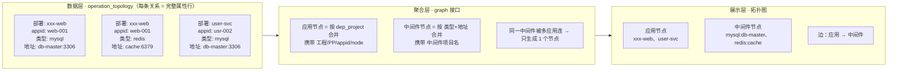
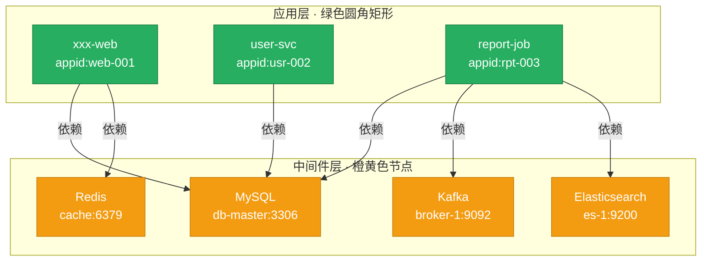

# 运维关系拓扑图 · 设计方案

> **目标**：展示服务器节点上「应用」与「中间件」的关联关系，数据源为 Apollo 配置中心，每日定时同步，以拓扑图形式呈现于运维平台。
>
> **定位**：本模块的**设计与规划**文档——需求、核心决策、数据模型、展示与前端设计。
> 接口实现逻辑（各接口数据流/处理步骤/采集链路/上游接口规格/排障）见配套文档《[接口逻辑说明.md](接口逻辑说明.md)》。
>
> **配套文档**：
> - 《[接口逻辑说明.md](接口逻辑说明.md)》— 接口实现逻辑、采集链路、上游 EasyOps 接口规格
> - 《[拓扑查询总体逻辑.md](拓扑查询总体逻辑.md)》— 采集 → 落库 → 查询 → 降级 的总体逻辑（开发实现索引）
> - 《[运维拓扑.md](运维拓扑.md)》— 三表 DDL（主表/ADR 自动建、DPR 运维自建）、两跳关联、诊断 SQL、实施结论
> - 《[前端对接说明.md](前端对接说明.md)》— 前端对接（请求/响应/鉴权/渲染指引）
> - 《[curl-接口测试文档.md](curl-接口测试文档.md)》— curl 联调命令与实测结果
> - [业务数据/](业务数据/) — 上游关系接口结构与 DPR 表导出的真实样本
> - 《[部署与上线文档.md](部署与上线文档.md)》— 部署与上线步骤
>
> *版本：v1.2（2026-09-16：同步「跳① 关系采集期落库 + 查询期只读库/镜像」最新实现，`appid_owner_map` 旧口径降级为可选；v1.1（2026-09-11）由《接口逻辑与设计方案.md》拆出设计部分，该文档现已拆为本文档与《[接口逻辑说明.md](接口逻辑说明.md)》）*

## 目录

| 章节 | 内容 |
|---|---|
| §1 需求与核心决策 | 展示目标、已定决策 |
| §2 总体架构 | 四层职责与数据流 |
| §3 数据模型（单表） | DDL、核心业务字段、**字段转换来源**、快照语义 |
| §4 数据获取与采集 | 外部接口概要、采集流程、并发预算、解析规则、appId 映射（两跳关联） |
| §5 定时同步 | cron 注册与日志要求（含跳① 关系同步与报错口径） |
| §6 拓扑展示 | API 一览、聚合规则、视觉与交互规范、前端原型、效果示意 |
| §7 配置设计 | `config/apollo.go` yaml 段 |
| §8 代码落地 | 目录结构、联动修改、本地联调 |
| §9 待确认事项 | 索引 |
| 附录 A | EasyOps 外部接口概要 |
| 附录 B | 待确认事项与关键决策清单 |
| 附录 C | 行业标准拓扑效果参考 |

---

## 1. 需求与核心决策

| 项 | 说明 |
|---|---|
| 展示对象 | 服务器节点上，哪些应用连接了哪些中间件 |
| 数据来源 | Apollo 配置中心（经 EasyOps 外部接口获取）+ 「appId ↔ 部署项目」关系接口（跳①，采集期全量落库） |
| 刷新方式 | 每日定时全量刷新，保留每日快照 |
| 展示形式 | 拓扑图，视图可切换：两层 / 三层（含服务器层）/ 力导向总览 |
| 落库 | 单表 `operation_topology`（当前为**本地文件快照**，数据库版为后续能力，见 §3.4） |

**已定核心决策**（评审确认，后续实现以此为准）：

| # | 决策 | 说明 |
|---|---|---|
| 1 | 后端直调 EasyOps 3 个接口 | 不经 MCP 层，替代 apollo-mcp-server（接口规格见《[接口逻辑说明.md](接口逻辑说明.md)》§15） |
| 2 | 单表 + 每日快照 | 全量刷新 + 保留历史，支持对比/回滚 |
| 3 | 只存 host:port | 连接地址不含密码等敏感值，不落库 |
| 4 | 三视图切换 | 两层（应用→中间件）为默认视图；三层（服务器→应用→中间件）与力导向总览为可切换视图；三层需部署关系数据源（原型已用 Mock 演示，见 §6.6） |
| 5 | 应用节点按 `dep_project` 合并 | 中间件节点按 `middleware_type + connect_addr` 合并 |
| 6 | 采集并发 8 + 总预算默认 60s（含全名单猜测自动放大至 5m） | 超时返回 partial，不阻塞定时任务；快照**分档落盘**：整批成功/个别应用失败（继承旧行）→ 原子替换；**预算截断或空产物**且已有旧快照 → **保留旧快照不覆盖**（见《[接口逻辑说明.md](接口逻辑说明.md)》§11.6） |

## 2. 总体架构

```
Apollo 配置中心（10+ 套）
        ▲
EasyOps 代理层 https://easyops.tech.ctseelink.cn
  接口1 getApolloHostInfo（套列表）  接口2 apollo/apps（应用列表）  接口3 apollo/namespace（配置项）
        │                                                    │
        │                                       关系接口 appId ↔ 部署项目
        ▼                                                    ▼
采集同步服务（每日 01:30 / 手动 /sync）  ── 解析规则 ──▶  关系记录
        │                                    ── 跳① 关系同步（有变化才替换落库 + 回写镜像）
        ▼
快照存储：本地文件 operation_topology.json 当日桶（原子替换）
        │          数据库：MySQL 表 operation_topology / app_dp_relation（均已启用）
        ▼
查询期两跳关联（内存 join：OT → app_dp_relation → deploy_pinpoint_relation）
        ▼
拓扑图 API（nodes + edges）  ──▶  运维平台前端渲染
```

四层职责：

- **采集层**：调 EasyOps 三接口 → 按解析规则提取「应用 → 中间件」关系；调关系接口拉全量 appId ↔ 部署项目关系
- **存储层**：每日全量快照（本地文件镜像 + MySQL `operation_topology`，按 `sync_date` 保留最近 `topology_snapshot_keep` 份，默认 3）+ 关系表 `app_dp_relation`（有变化才整表替换）
- **关联层**：查询期两跳内存关联（`app_dp_relation` → `deploy_pinpoint_relation`）作为 appId **属性补充** `node`/`eng_project`/`dep_project`/`pp_application`（多值聚合为列表，单值列取列表首值，不扩行），详见《[拓扑查询总体逻辑.md](拓扑查询总体逻辑.md)》§4
- **展示层**：聚合元数据为拓扑图结构，供前端渲染

## 3. 数据模型（单表）

### 3.1 建表语句（DDL）

> 📌 **三表 DDL（主表/ADR 自动建、DPR 运维自建）统一维护在《[运维拓扑.md](运维拓扑.md)》§2**（`SHOW CREATE TABLE` 原样输出；其中 DPR 表由运维按该节 DDL 自建/导入），本节不再重复。

- 主表 `operation_topology` 与 [model/operation_topology.go](../model/operation_topology.go) 的 GORM 模型对齐（26 列），由 AutoMigrate 建表（表已存在时只补缺失列/索引，不重建、不删列），唯一索引列序由 `EnsureOperationTopologyIndex()` 幂等校正（见 §3.4）。
- 跳① `app_dp_relation` **与主表一致纳入 AutoMigrate**（[initialize/gorm.go](../../initialize/gorm.go) 的 `MysqlTables` 注册 `operation_topology` + `app_dp_relation`），启动即自动建表，无需运维预建；**跳② `deploy_pinpoint_relation` 不纳入 AutoMigrate**，由运维按 [业务数据/deploy_pinpoint_relation.sql](业务数据/deploy_pinpoint_relation.sql) 自建/导入（程序绝不反向改 DPR 表结构），[业务数据/app_dp_relation.sql](业务数据/app_dp_relation.sql) 仅供本地建档/导数据参考。

### 3.2 核心业务字段（需求定义 8 项）与聚合用途

| 字段 | 作用 | 拓扑聚合用途 |
|---|---|---|
| `node` 节点 | 机房/地域 | 应用节点归属/过滤（快照不写入，**查询期由两跳关联作为 appId 属性补充**：单值取首值 + `nodes` 列表） |
| `eng_project` 工程项目名 | 工程归属 | 应用节点详情（快照不写入，**查询期由两跳关联作为 appId 属性补充**：单值取首值 + `engProjects` 列表） |
| `dep_project` 部署项目名 | 部署项目 | appId 的属性（快照不写入，**查询期由两跳关联作为 appId 属性补充**：单值取首值 + `depProjects` 列表） |
| `pp_application` PP应用名 | PP 应用 | appId 的属性（采集期占位，**查询期命中作为属性补充**：单值取首值 + `ppApplications` 列表，列表为空时保留占位值） |
| `apollo_app_id` | Apollo 应用标识 | **应用节点合并键**（**折叠口径** `expandDepNode=0`；**默认展开**时合并键为 `apollo_app_id\|部署项目\|节点`，见《[运维拓扑.md](运维拓扑.md)》§4.5） / 详情 / 搜索 |
| `middleware_type` 中间件类型 | 类型 | **中间件节点合并键①** |
| `connect_addr` 连接地址 | host:port | **中间件节点合并键②** |
| `middleware_project` 中间件项目名 | 中间件归属 | 中间件节点详情 |

**辅助字段**：`env`（环境）、`sync_date`（每日快照，查询默认取最新）、`namespace` / `config_key`（溯源）、`source`（数据源预留）。

> ⚠️ **四字段补充方式（2026-09-17 更新）**：`node` / `eng_project` / `dep_project` 三列采集期预留空值，`pp_application` 采集期写入占位值（`appid_owner_map` 命中值，否则回退 `app.Name`）；四列均**不回写快照**，改由**查询期两跳关联作为 appId 属性补充**（多值聚合为列表、单值列取列表首值，**折叠口径**下不扩行）：
> `OT.apollo_app_id` ──① 采集期已落库的 `app_dp_relation`（来源「app_id 与部署项目关系接口」全量；本地库实况 **1426 行 / 260 个 appId**）──②`deploy_project_name = dep_project`──▶ `deploy_pinpoint_relation` ──▶ 取四列作为 appId 属性（去重升序为 `depProjects`/`engProjects`/`nodes`/`ppApplications` 列表，单值列取首值；跳① 未命中时保留采集期占位值）。
> 完整链路、SQL 与实施结论见《[运维拓扑.md](运维拓扑.md)》§3.3、§4、§5；采集/查询细节见《[拓扑查询总体逻辑.md](拓扑查询总体逻辑.md)》§2.4、§4；补数交付见《[业务数据/运维关系拓扑图待补充数据说明.xlsx](业务数据/运维关系拓扑图待补充数据说明.xlsx)》。

### 3.3 字段转换来源（上游接口 / 本地规则 → 表列）

一条快照行 = 「某实例下的某应用」×「一条中间件地址」。26 个列的取值来源如下（与 model / service 实现逐字段对齐；装配位置与流程细节见《[接口逻辑说明.md](接口逻辑说明.md)》§11.4）。

```
接口1 getApolloHostInfo ──┐
                          ├─→ ① 实例层 5 列（行级冗余，每行都带）
接口2 apollo/apps ────────┼─→ ② 应用层 8 列
                          │
接口3 apollo/namespace ───┴─→ ③ 中间件层 6 列（items[].key/value → 规则解析）
运行时 / 本地配置 / 常量 ────────→ ④ 快照通用 6 列 + 主键 1 列
```

| 层 | 列 | 来源 | 转换方式 |
|---|---|---|---|
| **① 实例层** | `apollo_host_id` | 接口1 `list[].id` | 直取（`instanceMeta.hostId`；上游同名的 `apolloHostId` 冗余字段未使用） |
| | `apollo_host_name` | 接口1 `list[].name` | 直取 |
| | `apollo_host_addr` | 接口1 `list[].host` | 直取（完整 URL，如 `https://…:8154`） |
| | `second_product_id` | 接口1 `list[].secondProductId` | **数组 → 标量**：`strings.Join(…, ",")`，如 `"705,532"` |
| | `host_app_count` | 接口1 `list[].appCount` | 直取 |
| **② 应用层** | `apollo_app_id` | 接口2 `appId` | 直取 |
| | `apollo_app_name` | 接口2 `name` | 直取 |
| | `app_dept` | 接口2 | **三别名兜底**：`deptName` > `department` > `orgName`，取首个非空并 `TrimSpace` |
| | `app_owner` | 接口2 | **三别名兜底**：`ownerName` > `owner` > `appOwner`，取首个非空并 `TrimSpace` |
| | `node` | **采集期空值 + 查询期属性补充** | 采集期不赋值（预留空）；查询期由「`app_dp_relation` → `deploy_pinpoint_relation`」取 `node` 作为 appId 属性补充（单值取列表首值，多值走 `nodes` 列表）（见 §3.2 注、[运维拓扑.md](运维拓扑.md)§3.3） |
| | `eng_project` | **采集期空值 + 查询期属性补充** | 采集期不赋值（预留空）；查询期由 DPR 的 `eg_project` 作为 appId 属性补充（单值取首值 + `engProjects` 列表） |
| | `dep_project` | **采集期空值 + 查询期属性补充** | 采集期不赋值（预留空）；查询期由 DPR 的 `dep_project` 作为 appId 属性补充（单值取首值 + `depProjects` 列表；appId 的属性，不参与节点合并） |
| | `pp_application` | **采集期占位 + 查询期属性补充** | 采集期 `ownerFor()` 写占位值（`appid_owner_map` 命中值，否则回退 `app.Name`）；查询期链上命中时作为 appId 属性补充（单值取首值 + `ppApplications` 列表，列表为空时保留占位值） |
| **③ 中间件层** | `namespace` | 本轮请求参数 | 直取 `namespaceName` |
| | `config_key` | 接口3 `items[].key` | 直取（命中规则的那个 key） |
| | `middleware_type` | **本地规则表** | 命中规则的 `Type`（`middlewareRules` key 路径 / `valueRules` value 路径） |
| | `connect_addr` | 接口3 `items[].value` | `extractAddrs()` 解出 host:port（丢弃用户名/密码） |
| | `middleware_db` | 接口3 `items[].value` | `extractDbName()` 正则取 `host:port` 后第一个路径段；纯数字段（redis db 下标）丢弃 |
| | `middleware_project` | **本地规则表** | 命中规则的 `Project` |
| **④ 快照通用** | `env` | 配置 `apollo.envs` | 循环变量；未配置默认 `["PRO"]` |
| | `sync_date` | 运行时 | `time.Now().Format("2006-01-02")` |
| | `source` | — | **字面常量** `"apollo"` |
| | `remark` | — | **从未赋值**，恒空 |
| | `id` | DB | GORM `auto_increment`（**file 模式恒为 0**） |
| | `create_time` | DB | GORM `autoCreateTime`（file 模式为零值 `0001-01-01T00:00:00Z`） |
| | `update_time` | DB | GORM `autoUpdateTime`（同上） |

**八类转换方式速查**：

| 类型 | 涉及列 | 说明 |
|---|---|---|
| 直取 | `apollo_host_id/name/addr`、`host_app_count`、`apollo_app_id/app_name`、`namespace`、`config_key` | 上游字段 1:1 落库 |
| 别名兜底 | `app_dept`、`app_owner` | 不同 EasyOps 版本字段名不一，按优先级取首个非空；**溯源时不能假定来自某一个固定字段** |
| 数组→标量 | `second_product_id` | 逗号拼接 |
| 规则表派生 | `middleware_type`、`middleware_project` | 非上游字段，来自本地 `middlewareRules`/`valueRules` |
| 正则提取 | `connect_addr`、`middleware_db` | 从配置 value 中抽取 |
| 配置/常量 | `env`、`sync_date`、`source` | 配置 + 运行时字面量 |
| 采集期占位 + 查询期属性补充 | `pp_application` | 采集期由 `ownerFor()` 写占位值；查询期链上命中时作为属性补充（单值取首值 + `ppApplications` 列表，为空时保留占位值），**不写回快照** |
| **采集期空值 + 查询期属性补充** | `node`、`eng_project`、`dep_project` | 采集期不赋值（预留空）；查询期由「`app_dp_relation` → `deploy_pinpoint_relation`」关联作为 appId 属性补充（多值聚合为列表、单值取首值，不扩行），**不写回快照** |
| 预留恒空 | `remark` | 代码显式注释「暂不赋值」，字段保留待启用 |
| 框架维护 | `id`、`create_time`、`update_time` | GORM/DB 生成；file 模式下为 0 / 零值 |

**实测对照（本地文件快照 `data/operation_topology.json`，2026-09-14 / PRO / 1418 行；DB `operation_topology` 同为 1418 行）**：

| 列 | 实测 | 说明 |
|---|---|---|
| `apollo_host_*` | 5 个实例取值 | ✅ 正常 |
| `app_dept` | 3 种取值：`部门2`(1372)、`样例部门1`(40)、`部门1`(6) | ✅ **生产真实值**（生产实测同为 90/17/1 的量级分布），非脏数据 |
| `app_owner` | 36 种取值，非空 1418/1418 | ✅ 正常 |
| `pp_application` | 最新快照（2026-09-16）：**1418/1418 非空**，为 `ownerFor()` 占位值（`appid_owner_map` 命中值，否则回退 `app.Name`）；早期 2026-09-10 快照为 1418/1418 空（改造前产物） | 采集期即写占位值；查询期链上命中时由 DPR 的 `pp_application` 覆盖（见 §3.2 注） |
| `middleware_project` | **恒等于 `middleware_type`**（1418/1418） | 当前规则表每条规则的 `Project` 都等于 `Type`，本列暂无额外信息量，为「同类型不同项目」预留 |
| `second_product_id` | 全部空 | mock 缺口（`GraphHost` 结构仅 id/name/host/appCount 四字段，无 `secondProductId` 可还原）；真实接口1 有该数组 |
| `host_app_count` | 全部 0 | **生产同样为 0**（生产实测 `apolloHosts.appCount` 即 0，上游未填）。前端「实例应用总数」若直接展示会为 0，建议改用「该实例实际扫描到的应用数」兜底 |
| `middleware_db` | 全部空 | mock 缺口：mock 的 value 形如 `jdbc:mysql://host:3301`，**无库名路径段**；生产 value 通常带 `/dbname`，届时 `extractDbName` 正常产出 |
| `namespace` | 仅 `application` 一种 | ✅ 与生产一致（真实命中全部集中在 application） |
| `create_time`/`update_time` | 零值 `0001-01-01T00:00:00Z` | ✅ file 模式预期行为，入库时由 DB/GORM 填 |

**代码位置索引**：

| 内容 | 位置 |
|---|---|
| 模型字段与 gorm tag | [model/operation_topology.go](../model/operation_topology.go) `OperationTopology` |
| 行装配 | [service/operation_topology.go](../service/operation_topology.go) `parseItemsToRelations()` |
| 实例层元数据 | 同上 `instanceMeta`（按 hostId 预计算） |
| 别名兜底方法 | [service/apollo_client.go](../service/apollo_client.go) `ApolloApp.Dept()` / `ApolloApp.Leader()` |
| 库名提取 | [service/operation_topology.go](../service/operation_topology.go) `extractDbName()` |
| 规则表 | 同上 `middlewareRules` / `valueRules` |
| owner 映射（遗留） | 同上 `ownerFor()`——`pp_application` 占位逻辑，已由跳② 属性补充取代，待收敛（见《[拓扑查询总体逻辑.md](拓扑查询总体逻辑.md)》§9.1） |

### 3.4 设计要点与快照语义

- **每日全量刷新**：数据库版 = 事务内 `DELETE WHERE sync_date=今天` → 批量 INSERT（每批 500），天然去重；**当前文件版** = 当日 `sync_date` 桶**整桶原子替换**（tmp + rename），旧版数据在落盘前保持可查
- **历史快照保留最近 N 份**（`topology_snapshot_keep`，默认 3）：每次同步替换当日桶后，DB 表与本地文件同口径只保留最近 3 个 `sync_date` 桶、更早的整桶清理，避免表/文件随每日同步无限堆积；保留 3 份即可拿到「上一版」做前后对比（`PreviousSnapshot`）与差集（`newRelations` / `lostRelations`）
- `sync_date` 用字符串 `VARCHAR(10)`（YYYY-MM-DD）而非 `DATE`，方便 GORM 字符串比较
- `dep_project` 建 `idx_dep_proj` 索引：仅用于关系链不可用时的兜底列过滤（正常路径把条件翻译成 `apollo_app_id` 集合下推）
- `create_time`/`update_time` 由 GORM `autoCreateTime`/`autoUpdateTime` 维护（在应用层写值；DDL 为 `DATETIME NOT NULL DEFAULT CURRENT_TIMESTAMP`，**不含** `ON UPDATE CURRENT_TIMESTAMP`——GORM tag 无法表达该子句，故《[运维拓扑.md](运维拓扑.md)》§2.1 的 DDL 与实际 AutoMigrate 产物一致，不会漂移）
- **唯一键列序由代码校正**：`uk_snapshot_relation` 需为 `(sync_date, apollo_app_id, apollo_host_id, env, middleware_type, connect_addr)`。AutoMigrate 只按结构体字段声明顺序建索引，旧版 5 列（无 `apollo_host_id`）不会被自动改造，故 `EnsureOperationTopologyIndex()` 在启动后比对 `information_schema.statistics` 列集，缺列则 `DROP INDEX` + `ADD UNIQUE INDEX` 幂等重建。MySQL 8.0 下该 6 列索引总长 < 3072 字节，可全列建索引。**当前文件模式不建索引**，去重依赖 `relationKey()`
- **文件版 vs 数据库版**：`id`/`create_time`/`update_time` 在文件模式恒为 0 / 零值；数据库版已启用（`InitDatastoreWithDB` 注入连接后生效，落库 `operation_topology` / `app_dp_relation`）

## 4. 数据获取与采集

### 4.1 外部接口概要

| 接口 | 用途 | 关键参数 | 关键返回 |
|---|---|---|---|
| 1 `GET /thirdApi/getApolloHostInfo` | 获取全部 Apollo 套 | `paginator=false` | `list[].id`(=apolloHostId)、name、host、secondProductId、token |
| 2 `GET /thirdApi/apollo/apps` | 获取套下应用列表 | `apolloHostId` | `appId`、name、部门/负责人（data 有数组/items 两种结构） |
| 3 `GET /thirdApi/apollo/namespace` | 查单个 namespace 配置 | `apolloHostId`+`env`+`appId`+`clusterName`+`namespaceName` | `items[].key/value` |
| 4 `GET /thirdApi/apolloApp/list` | 拉 appId ↔ 部署项目 关系（跳①） | `paginator=false` + `pageSize=-1`（**不分页、一次取全量**） | `list[]`：apolloAppId、apolloAppEnv、deployProjectName 等（结构见 [业务数据/apolloApp_list.json](业务数据/apolloApp_list.json)，真实全量 1426 行）；`pageTotal` 为**总记录数**（非页数） |

公共约定：基础地址 `https://easyops.tech.ctseelink.cn`；鉴权 `Cookie: sessionId={值}`；跳过 HTTPS 证书校验；接口1 超时 8s 重试 1 次，接口2/3 超时 6s 不重试。关系接口路径已核实为 `/thirdApi/apolloApp/list`（与 Apollo 采集共用 EasyOps 代理 base URL；`paginator=false` 时上游直接返回全表，故无需分页），本地联调指向 Mock 服务同路径占位接口，见附录 B.1-7。

详细请求/响应样例、字段说明、Token 加解密与鉴权权限配置见《[接口逻辑说明.md](接口逻辑说明.md)》§15（附录 A 为速查表）。

### 4.2 采集流程（5 阶段）

```
阶段1 套列表   接口1 获取全部可用套（全失败则本次同步中止）
阶段2 应用列表 对每个套调接口2（单套异常跳过，不影响其他套）
阶段3 抓配置   对每个 appId × namespace × env 调接口3，按规则解析
阶段4 落盘     当日 sync_date 桶整桶原子替换（DB 版：事务 DELETE + 批量 INSERT）
阶段5 关系同步 跳①：关系接口一次拉全量（paginator=false + pageSize=-1）→ 与库内比对，有变化才整表替换落库 app_dp_relation（无变化跳过）+ 回写本地镜像 → 失效内存索引
```

> 阶段5（跳① 关系同步）**失败不阻塞主表同步**：上游拉取失败 / 关系表缺失 / 写库失败 → `/sync` 结果显式报错（`relationErr=true`）；接口未启用 / 0 行 / 无 DB 连接 → 正常降级（保留上一版数据、走本地镜像），不报错。详见《[拓扑查询总体逻辑.md](拓扑查询总体逻辑.md)》§2.4、§7。

**待扫描 namespace 列表**（配置化 `scan_namespaces`，作为**固定全名单猜测名单**）：`application`（必扫）+ 常见中间件特征 namespace（`datasource / redis / logging / common / kafka / rocketmq / mq / elasticsearch / mongodb / mysql / cache / config / middleware`）。全量覆盖策略下，未配置时默认覆盖上述 14 个；`max_ns_per_app` 默认放开至 15（每 app 最多扫 15 个 namespace）。

**ns 学习定向（2026-09-09 落地 · 同步优化 D+A 组合）**：上述全名单不再每次全量猜测——默认（`ns_learn_enable` 缺省=true）每「套×环境×应用」三元组按学习状态定向扫描：无记录 → 全名单首扫建立基线（bootstrap）；有记录 → 只扫「历史命中集 + application」定向（targeted，请求量收敛到真实存在的 ns）；超过 `ns_guess_days` 未全量 → 全名单兜底重猜（recheck，防新增/改名 ns 漂移）。学习状态独立落盘 `data/operation_topology_learned.json`（键 `hostId|env|appId`、tmp+rename 原子写、读取失败按空集继续不阻断同步）。显式 `ns_learn_enable: false` 即退回固定名单猜测。方案对比见《[部署与上线文档.md](部署与上线文档.md)》§13–§18，决策/存储/观测细节见《[接口逻辑说明.md](接口逻辑说明.md)》§14。

**env 与 cluster**：`env` 必填，配置待扫描环境列表（初版 `["PRO"]`）；`clusterName` 默认 `default`。

### 4.3 并发与预算

| 参数 | 建议值 |
|---|---|
| 阶段3 并发 worker | 8 |
| 单请求超时（接口3） | 6s |
| 全量扫描总预算 | 默认 60s；**含全名单猜测（首扫 bootstrap/兜底重猜 recheck）自动放大至 5m**，定向扫描回归默认（超时记 partial + 未完成应用，不阻塞） |
| 套探活 | 并发 8 worker + 30s 硬预算 + 60s 结果缓存；不可用套跳过 |

### 4.4 解析规则（key/value → 中间件类型 + 连接地址）

> 双路径融合解析：优先按 **key 特征**命中；key 不标准（如 `db.url`）时，回退按 **value 内容**兜底识别（如 `jdbc:mysql://`、`redis://`、`amqp://`），尽力覆盖全量配置。key/value 匹配均**大小写不敏感**，规则内置常见别名/简写写法（kafka 的 `bootstrap.servers`(点) 与 `bootstrap-servers`(横线)、redisson、`spring.data.mongo`、memcache、`zk.`、rabbit/裸 amqp 等），value 兜底协议变体收全（`rediss://`、`amqps://`、`mongodb+srv://`、`memcache://` 等）；完整关键词清单以代码 `middlewareRules`/`valueRules` 为准，并有对应规则回归单测。

| key/value 特征 | 中间件类型 | 地址取值 |
|---|---|---|
| `spring.datasource.url` / `jdbc:mysql` | mysql | url 解析 host:port |
| `spring.redis.host` / `redis://` / `:6379` | redis | host:port |
| `bootstrap-servers` | kafka | 多地址逗号拼接 |
| `rocketmq.name-server` | rocketmq | 多地址逗号拼接 |
| `elasticsearch` / `es.cluster` | elasticsearch | host:port |
| `spring.data.mongodb.uri` / `mongodb://` | mongodb | uri 解析 |
| `memcached` | memcached | host:port |
| `zookeeper.address` / `zookeeper://` | zookeeper | 地址列表 |
| `nacos.server-addr` | nacos | host:port |
| `spring.rabbitmq.host` / `amqp://` | rabbitmq | host:port |

处理细节：

- `connect_addr` 只留 host:port，value 中的用户名/密码一律丢弃（敏感 key 在解析前置阶段直接跳过）
- `middleware_project` 取自命中规则的 `Project` 字段（当前规则表中恒等于 `Type`）
- 同一 key 命中多条规则按优先级取第一个；同一 appId+实例+环境+类型+地址去重
- 全量扫描单次抓取即完成 key + value 双匹配，不发起重复请求，结果天然去重
- 解析日志记录命中 key 与 value 摘要（敏感部分打码）

> 完整的四步解析流水（建索引+前置过滤 → 双路径定类型 → 地址提取 → 成行/溯源/去重）、地址提取示例与并发消费健壮性设计，见《[接口逻辑说明.md](接口逻辑说明.md)》§11.3。

### 4.5 appId → 运维对象映射（关键点）

Apollo 配置**不含** `node / eng_project / dep_project / pp_application`，必须外部映射带入：

```
appId ──①──▶ 【采集期】调「app_id 与部署项目关系接口」一次拉全量（paginator=false + pageSize=-1）──▶ 与库内比对，有变化才整表替换落库 app_dp_relation
                                                              （+ 回写本地镜像）
      ──②──▶ 查询期只读 app_dp_relation ──▶ deploy_pinpoint_relation ──▶ 作为 appId 属性补充 { node, eng_project, dep_project, pp_application }
```

**来源已定稿（2026-09-16）**：

- **跳①**：**采集期**（cron 每日 01:30 / 手动 `/sync`）调关系接口一次拉全量（`paginator=false` + `pageSize=-1`）→ 与库内数据比对，**有变化才整表替换落库** `app_dp_relation` + 回写本地镜像（无变化跳过替换，不删不写）；**查询期只读「库 → 本地镜像」**，接口仅在前两者均无数据时兜底。
- **跳②**：拿 `deploy_project_name` 关联 `deploy_pinpoint_relation`（本地表 → 内存映射），取回四列。
- **落库方式**：四列**不写回 OT 快照**（`node`/`eng_project`/`dep_project` 采集期预留空值，`pp_application` 采集期写占位值），查询期由两跳关联作为 appId 属性补充（多值聚合为列表、单值列取首值，不扩行）。

> ⚠️ **历史设计作废**：早期设想的「来源三选一（CMDB 接口 / 手工映射表 `appid_owner_map` / 接口2 `name` 兜底填充 `dep_project`）」**不再采用**——`node`/`eng_project`/`dep_project` 改由两跳关联作为 appId 属性补充；`appid_owner_map` 降级为 `pp_application` 采集期占位值的可选覆盖（未配置则回退应用名），不再承担工程/部署维度映射。
> 「`app_dp_relation` 只有 100 行、是接口样本」仅适用于**首次同步之前**（`app_dp_relation.sql` 里的 100 行样本）；同步一次后本表即为全量关系表（2026-09-17 真实全量实测 **1426 行 / 260 个 appId**，OT 侧 108 个 appId 命中 **83 个**、行命中 1305/1418），可直接 JOIN OT 使用。
> 链路细节、诊断 SQL、实测基线与待协同项见《[运维拓扑.md](运维拓扑.md)》§3.3、§4、§5；运维补充清单见《[待运维补充/运维补充说明.md](待运维补充/运维补充说明.md)》。

## 5. 定时同步

```go
// core/server.go 追加（robfig/cron 秒级表达式）
c.AddFunc("0 30 1 * * * ?", cronTask.SyncOperationTopology) // 每天 01:30
```

流程：接口1 查套 → 并发接口2 查应用 → 并发接口3 抓配置解析 → 快照原子替换（按 `topology_snapshot_keep` 保留最近 N 份桶）→ **跳① 关系同步**（关系接口一次拉全量（`paginator=false` + `pageSize=-1`）→ 与库内比对，有变化才整表替换落库 `app_dp_relation` + 回写镜像 → 失效内存索引）→ 输出统计日志。

日志要求（模块标识 `[operation_topology]` / `[dp_relation]`）：

- 每阶段记录：请求 URL（脱敏）、耗时、返回 code、条数
- partial 场景输出未完成应用列表
- 落盘后输出本次新增/消失关系对比，便于排查
- 存在「无中间件应用」（已扫描但未发现任何中间件关系，不含未完成/未执行应用）时，打印整块日志「本次同步 · 无中间件应用清单（已扫描未发现中间件关系）共 N 个（不含未完成/未执行应用）」，逐行输出 appId + 应用名
- 日志末尾「本次同步 · 结果总览」块新增一行汇总：「无中间件应用 N 个（已扫描未发现中间件关系）：appId1（名1）, …」（最多示例 5 个），以及「关系同步」一行（正常为「整表替换落库 N 行（app_dp_relation）」；数据无变化时为「关系数据无变化，跳过替换落库（表内 N 行）」；异常为 `【异常】…` 前缀）
- 同步日志按天落盘 `api/tprel/logs/YYYY-MM-DD.log`（默认目录，环境变量 `TPREL_LOG_DIR` 可覆盖；同一天多次同步累积写入同一文件，自动只保留最近 5 个），并经 `GET /sync/logs` 读取/下载

> 完整日志链路与关键字检索表见《[接口逻辑说明.md](接口逻辑说明.md)》§8.1、日志规范见 §9；端到端验证归档日志见 [logs/README.md](../logs/README.md)。
> **报错口径**：跳① 异常（上游拉取失败 / 关系表缺失 / 写库失败）在 `/sync` 结果（`relationErr=true`）与日志总览**显式报错**，不阻断主表同步；接口未启用 / 0 行 / 无 DB 连接属**正常降级**（走本地镜像），不报错。

## 6. 拓扑展示

### 6.1 API 一览（路由前缀 `/api/external/operationTopology`）

| 接口 | 方法/路径 | 说明 |
|---|---|---|
| 关系列表 | `GET /list` | 分页 + 条件查询（node/env/middleware_type/dep_project/appid/sync_date） |
| 拓扑图 | `GET /graph` | 返回 nodes+edges，支持 node/env/middleware_type 过滤 |
| 节点详情 | `GET /detail` | 单节点完整元数据（应用 / 中间件） |
| 手动同步 | `POST /sync` | **异步提交**一次全量采集（分钟级长任务，走网关会 504）；结果经 `GET /sync/status` 轮询 |
| 同步状态 | `GET /sync/status` | 同步任务进度/结果轮询（含 `stageText`/`percent` 进度与 `stats` 规模统计，前端可做进度条 + 统计卡） |
| 同步日志 | `GET /sync/logs` | 读取最近同步日志（默认 JSON 返回内容+文件列表，`?date=` 指定日期、`?download=1` 直接以附件下载完整日志） |
| 类型枚举 | `GET /middlewareTypes` | 中间件类型下拉 |

> 各接口的请求参数、响应结构、进度字段与排障说明见《[接口逻辑说明.md](接口逻辑说明.md)》§3–§7；同步结果（`/sync/status` → `data.result`）除计数/进度/差异字段外，另含 `nodeStats`（按类型+地址去重的**节点数**分布）、`typeStats`（各类型**关系数**分布）、`noMiddlewareCount` + `noMiddlewareApps`（无中间件应用数量与清单，口径见《[接口逻辑说明.md](接口逻辑说明.md)》§5.2），以及跳① 关系同步明细 `relationRows` / `relationWrote` / `relationErr` / `relationMsg`。

### 6.2 graph 响应结构与聚合规则

```json
{
  "syncDate": "2026-08-31",
  "counts": { "apolloHosts": 1, "application": 1, "middleware": 1, "edges": 1, "nodes": 2 },
  "nodes": [
    { "id": "app:rule-engine", "name": "xxx-web-deploy", "category": "application",
      "engProject": "xxx", "depProject": "xxx-web-deploy", "ppApplication": "xxx-web",
      "apolloAppId": "rule-engine", "node": "su-zh" },
    { "id": "mw:mysql:db-master:3306", "name": "xxx-mysql", "category": "middleware",
      "middlewareType": "mysql", "connectAddr": "db-master:3306", "middlewareProject": "xxx-mysql" }
  ],
  "edges": [
    { "source": "app:rule-engine", "target": "mw:mysql:db-master:3306" }
  ]
}
```

聚合规则：

- 应用节点：按 `dep_project` 聚合，携带 eng_project / pp_application / appid / node
- 中间件节点：按 `middleware_type + connect_addr` 聚合，携带 middleware_project
- 边：应用 → 中间件；同一中间件被多应用连接 → 只生成 1 个节点、自动扇入
- `counts`：与**当前过滤条件一致**的规模汇总（`apolloHosts`=返回 apolloHosts 数组长度；`application`/`middleware`=返回 nodes 中对应 category 个数；`edges`=返回 edges 条数；`nodes`=返回节点总数=application+middleware）。**仅 `/graph` 返回该字段**；无数据（空图）时全部为 0（示例数值与上方 nodes/edges 一一对应）

### 6.3 展示与交互要点（简表）

| 项 | 要点 |
|---|---|
| 取数 | 默认取最新 `sync_date` 快照；无快照返回“今日未同步”空态 |
| 视图 | **三视图切换**：两层（默认）/ 三层（含服务器层）/ 力导向总览；节点多时画布宽度自适应 + 横向滚动 |
| 节点 | 应用=绿色圆角矩形（标题 dep_project）、中间件=橙黄（标题类型+地址）、服务器=蓝（三层视图），角标显示被 N 个应用依赖 |
| 连线 | 依赖=实线箭头，部署=虚线箭头；多应用连同一中间件汇聚到同一节点 |
| 交互 | 缩放/平移、点击弹窗（中间件弹窗列出依赖它的应用清单）、**搜索高亮式**（命中橙色 + 一跳关联蓝色 + 其余淡化，不隐藏）、环境/节点（机房）/服务器/中间件类型多条件过滤、同步时间提示、图例 |

### 6.4 节点视觉与连线规范

| 节点类型 | 形状 | 主色调 | 节点内展示 | 右上角角标 |
|---|---|---|---|---|
| 服务器节点（扩展） | 圆角矩形 | `#2b7bdd` 蓝 | IP/hostname，小字环境 | 部署 N 个应用 |
| 应用节点 | 圆角矩形 | `#27ae60` 绿 | 部署项目名，小字 appid/PP 应用名 | - |
| 中间件节点 | 圆角矩形 | `#f39c12` 橙黄 | 类型 + 连接地址，小字中间件项目名 | 被 N 个应用依赖 |

- 连线：实线、浅灰、带箭头指向被依赖方；应用 → 中间件标注【依赖】；多应用引用同一中间件**汇聚到同一节点**（防拓扑爆炸关键）
- 长地址（如长 jdbc url）节点只展示缩写，完整地址放详情弹窗

### 6.5 画布交互规范

| 交互 | 说明 | 落地 |
|---|---|---|
| 画布操作 | 滚轮缩放、拖拽平移 | 采用 |
| 点击弹窗 | 应用：工程/部署/PP/appid/同步批次 + 依赖中间件清单；中间件：类型/地址/项目名 + **依赖它的应用清单** | 采用（字段已齐备） |
| 搜索定位 | 输入 appid/中间件地址/应用名：**命中节点橙色高亮，一跳关联节点蓝色高亮、关联边加粗，其余淡化（保留上下文）** | 采用 |
| 过滤器 | 环境切换、节点（机房）、服务器、中间件类型，可多条件叠加 | 采用（对应 graph 的 node/env/middlewareType + 部署关系） |
| 状态提示 | 顶部「数据来源：Apollo 定时同步｜最近同步时间」 | 采用 |
| 图例 | 画布角落说明蓝/绿/橙含义 | 采用 |
| 导出 | 图片 PNG / CSV 关系报表 | 扩展 |

### 6.6 前端原型（可运行 HTML）

原型目录 `api/tprel/prototype/`：

| 文件 | 说明 |
|---|---|
| `topology_prototype.html` | 纯原生 HTML/CSS/JS + SVG，**无外部依赖**，双击或经本地静态服务即可运行；内置 Mock 数据（9 服务器 / 20 应用 / 14 中间件 / 10 种类型 / 70 条依赖 / 22 条部署，覆盖 5 个机房，PRO/SIT 双快照），支持「Mock / 后端 API」数据源切换（切到后端 API 即用真实 `/graph` 数据） |
| `topology_g6.html` | AntV G6 对接骨架（消费 `/graph` 的 nodes/edges：三层视图切换、搜索高亮、筛选、空态、详情面板）；同步弹窗已接入「无中间件应用」清单与日志入口（查看/下载，`sync/logs`） |
| `topology_dagre.html` | 在 G6 骨架基础上叠加「归聚弹窗」：主画布保持不变，选中/搜索/双击节点时把「节点 + 一跳邻居」抽到独立 G6 实例并自适应铺满，支持跳数（1/2 跳）与粒度切换、点击下钻 + 面包屑返回 |
| `api_docs_panel.js` | 「API 对接文档」面板（本地联调）：在线查看/下载《[前端对接说明.md](前端对接说明.md)》+ 8 个接口在线调试（走本地专用 GET `/doc`） |

**已实现功能与文档对应**：

| 功能 | 依据 |
|---|---|
| 数据源切换：Mock（内置）/ 后端 API（字段自动适配） | §8 本地前后端联调 |
| 视图切换：两层 / 三层 / 全局总览（按机房分区）/ 力导向总览 | §6.3、附录 C.1 |
| 部署（虚线）/ 依赖（实线）边区分 | §6.4 |
| hover 链式高亮整棵子树 | §6.5 |
| 点击弹窗完整元数据（含被依赖应用清单） | §6.5、§6.8 |
| 搜索高亮式：命中橙色 + 一跳关联蓝色 + 其余淡化（不隐藏） | §6.5 |
| 环境 / 节点（机房）/ 服务器 / 中间件类型多条件过滤叠加 | §6.1 |
| 中间件被依赖数角标、长名称截断、画布宽度自适应 + 横向滚动 | §6.4 |
| 数据统计、图例、空态提示、重置 | §6.3 |

**前端实现建议**：正式页面由运维平台前端用图库渲染（AntV G6 / ECharts），数据来自 `GET /graph`；原型的前端数据结构与接口对齐（nodes/edges 双层 + 可选 deploys 部署层），可作为前端开发参考。

### 6.7 展示效果示意（Mermaid）

**图 1：关系数据 → 聚合 → 拓扑图**



**图 2：最终拓扑图效果（分层 DAG）**



> 图中 `db-master:3306` 被 3 个应用连接，只生成 1 个 MySQL 节点（扇入效果）。Mermaid 在 GitHub、GitLab、VS Code Markdown 预览、Typora、语雀等渲染器中可预览。

### 6.8 最终网页效果图（页面呈现目标）

> 说明：§6.7 的 Mermaid 图为「效果示意」；**最终网页由运维平台前端渲染**（AntV G6 / ECharts 等图库），数据来自 §6.2 的 `graph` 接口，真实节点数可能达几十上百。

**主界面（加载最新快照后的完整页面）**：

```
┌────────────────────────────────────────────────────────────────────┐
│ 运维关系拓扑图                                                       │
│ 数据来源: Apollo 定时同步 │ 最近同步: 2026-08-31 01:30:15            │
│ [两层|三层|力导向] [环境: PRO ▾] [节点: 全部▾] [服务器: 全部▾]       │
│ [搜索节点...      ] [中间件类型: 全部 ▾] [导出▾]                    │
├────────────────────────────────────────────────────────────────────┤
│                               应用层                                │
│    ┌────────────┐      ┌────────────┐      ┌────────────┐          │
│    │  xxx-web   │      │  user-svc  │      │ report-job │          │
│    │  web-001   │      │  usr-002   │      │  rpt-003   │          │
│    └─┬────────┬─┘      └─────┬──────┘      └─┬────┬────┬─┘         │
│      │        │              │               │    │    │           │
│      ▼        ▼              ▼               ▼    ▼    ▼           │
│                             中间件层                                │
│    ┌────────────┐   ┌────────────┐   ┌────────────┐   ┌─────────┐  │
│    │  MySQL     │   │   Redis    │   │   Kafka    │   │   ES    │  │
│    │ db-master  │   │ cache:6379 │   │ broker-1   │   │ es-1    │  │
│    │ :3306  ③   │   │            │   │ :9092      │   │ :9200   │  │
│    └────────────┘   └────────────┘   └────────────┘   └─────────┘  │
│     （③ = 被 3 个应用依赖的角标，三条实线箭头线汇聚到此节点）          │
│              [画布：可缩放 / 拖拽 / 双视图切换]                       │
├────────────────────────────────────────────────────────────────────┤
│ 图例:  ■绿 = 应用节点    ■橙 = 中间件节点    → 依赖方向              │
└────────────────────────────────────────────────────────────────────┘
```

**点击中间件节点后的弹窗效果（核心排查场景）**：

```
┌────────────────────────────────────────────────────────────────────┐
│               应用层                                                 │
│    ┌────────────┐        ┌──────────────────────────────┐          │
│    │  xxx-web   │        │  MySQL 详情                   │          │
│    │  web-001   │        │  ─────────────────────────   │          │
│    └─┬────────┬─┘        │  类型: mysql                  │          │
│      │        │          │  地址: db-master:3306         │          │
│      ▼        ▼          │  项目: xxx-mysql              │          │
│              ┌────────┐  │  环境: PRO │ 同步: 2026-08-31 │          │
│              │ MySQL  │◀─│  ─────────────────────────   │          │
│              │db-master│  │  被 3 个应用依赖:             │          │
│              └────────┘  │   · xxx-web    (web-001)     │          │
│                           │   · user-svc   (usr-002)     │          │
│                           │   · report-job (rpt-003)     │          │
│                           └──────────────────────────────┘          │
│              中间件层其余节点与连线在此弹窗打开时自动淡化               │
└────────────────────────────────────────────────────────────────────┘
```

## 7. 配置设计（config/apollo.go）

> ✅ **已实现**。配置结构体见 `config/apollo.go`；解析规则并入代码 `service/operation_topology.go` 的 `middlewareRules`，无需在配置中维护。
>
> **`apollo` 段整段为可选**：配置加载后（`core/viper.go`）会调用 `config.Apollo.Effective()` 补全代码内建的生产默认值（`base_url` / `session_id` / `relation_api_path` / 三个开关的缺省 true），因此部署配置**不写 apollo 段也能直连真实接口**。下方仅为**全量可选项**示例（与本地开发配置 `config_local.yaml` 对齐，本地才会指向 Mock）：

```yaml
apollo:
  base_url: 'https://easyops.tech.ctseelink.cn'   # 可省：代码内建生产地址 DefaultApolloBaseUrl（可用环境变量 APOLLO_HOST_API_BASE 覆盖）
  session_id: 'e5e27a7d1805758400287ae86741f889'  # 可省：代码内建 DefaultApolloSessionId（可用环境变量 APOLLO_HOST_SESSION_ID 覆盖）
  envs: ['PRO']                            # 待扫描环境列表（B.1-3：只扫 PRO）
  scan_namespaces:                         # 每应用扫描的 namespace 列表（按序）
    - 'application'
    - 'datasource'
    - 'redis'
  host_timeout: 8                          # 接口1（host 列表）超时秒数
  request_timeout: 6                       # 接口2/3 单请求超时秒数
  max_retries: 0                           # 接口1 失败重试次数
  workers: 8                               # 阶段3 并发扫描数
  scan_budget_sec: 30                      # 定向扫描总预算秒数（超时返回 partial；含全名单猜测任务时自动放大至 5m）
  max_ns_per_app: 3                        # 每 app 最多扫描的 namespace 数
  ns_learn_enable: true                    # ns 学习定向开关（缺省 nil=true：无记录全名单首扫→有记录只扫“命中集+application”定向；false=固定名单猜测）
  ns_guess_days: 7                         # 学习后周期全名单兜底重猜（天）：<=0 仅首扫一次、不做周期重猜（防新增/改名 ns 漂移）
  sync_cron: '0 30 1 * * * ?'              # 定时同步 cron（每天 01:30；实际注册见 core/server.go）
  sync_enable: true                        # 可省：缺省即 true 启用定时同步；显式 false 则定时到点跳过
  insecure_verify: true                    # 可省：缺省即 true（HTTPS 跳过证书校验，EasyOps 自签证书）
  exclude_app_ids: [easyops-test-api1, easyops-test-api2]   # 采集排除名单（占位/无效测试应用：上游 meta server 为 fill-in 占位地址，每次拉取必 500；任务组装前剔除）
  # appId → 部署项目 关系接口（B.1-4 / §4.5：node/工程/部署/PP 不在 Apollo 配置中，改由关系接口两跳关联带入）
  relation_api_enable: true                # 可省：缺省即 true 启用关系接口；显式 false 时直接走 app_dp_relation 表兜底
  relation_api_path: '/thirdApi/apolloApp/list'   # 可省：缺省即 DefaultApolloRelationApiPath；与 Apollo 采集共用 EasyOps 代理 base URL（显式置空 = 不启用）
  relation_api_page_size: -1               # 每页条数：<=0 = 不分页、一次取全量（上游 paginator=false 直接返回全表）
  relation_api_ttl: 60                     # 查询期内存索引 TTL 秒数（默认 60）
  relation_api_max_pages: 200              # 分页兜底上限（仅上游未一次返回全量时生效，默认 200）
  # 拓扑快照保留策略：operation_topology 按 sync_date 分桶，每次同步替换当日桶并清理更早的桶，
  # 只保留最近 N 份供前后对比（DB 表与本地文件同口径），避免表/文件无限堆积。默认 3。
  topology_snapshot_keep: 3
```

> 关系接口完整配置项说明见《[拓扑查询总体逻辑.md](拓扑查询总体逻辑.md)》§8.2。
> 历史配置 `appid_owner_map`（手工映射表）**降级为可选**：B.1-4 原计划用其带入 node/工程/部署/PP，现改由关系接口两跳关联（详见 §4.5）；该配置仅保留为 `pp_application` 采集期占位值的覆盖来源，未配置则回退应用名。

`Server` 结构体增加 `Apollo Apollo \`mapstructure:"apollo"\`` 字段（`config/config.go`，✅ 已完成）。

## 8. 代码落地

> ✅ **已实现（2026-08-31）**。实际落地目录如下（解析规则并入 `operation_topology.go`，model 请求/响应结构合并为一个文件）：

```
api/tprel/
├── docs/
│   ├── 运维关系拓扑图方案.md     # 本文档（设计与展示）
│   ├── 运维拓扑.md               # 三表 DDL（主表/ADR 自动建、DPR 运维自建）+ 两跳关联 + 诊断 SQL + 实施结论
│   ├── 拓扑查询总体逻辑.md       # 采集 → 落库 → 查询 → 降级 的总体逻辑（开发实现索引）
│   ├── 接口逻辑说明.md           # 后端接口实现逻辑（接口/采集链路/上游接口规格/日志）
│   ├── 前端对接说明.md           # 前端对接接口文档（请求/响应/鉴权/渲染指引）
│   ├── curl-接口测试文档.md      # curl 联调命令与实测结果
│   ├── 部署与上线文档.md         # 部署实施 + 上线准备 + 同步接口优化评估
│   ├── 业务数据/                 # 上游接口返回 / 两跳维表导出 / 建表 SQL（真实样本）
│   └── 待运维补充/运维补充说明.md # 运维侧补数清单与校验 SQL
├── prototype/
│   ├── topology_prototype.html  # 可运行交互原型（内置 Mock，原生 SVG 自绘）
│   ├── topology_g6.html         # AntV G6 对接骨架（消费 /graph；同步弹窗含无中间件清单与日志入口）
│   ├── topology_dagre.html      # G6 骨架 + 「归聚弹窗」（子图抽取放大、跳数/粒度、下钻面包屑）
│   ├── api_docs_panel.js        # 「API 对接文档」面板（在线查看/下载 + 8 接口在线调试）
│   └── lib/g6.min.js            # G6 本地依赖
├── mock/
│   └── mock_server.py           # Mock EasyOps 3 接口（本地测试，Python 标准库）
├── model/
│   ├── operation_topology.go       # GORM model + 请求/响应结构（GraphQuery/GraphResp/SyncResult）
│   ├── app_dp_relation.go          # 跳① 关系表 model（app_dp_relation，纳入 AutoMigrate 自动建表）
│   └── deploy_pinpoint_relation.go # 跳② DPR 表 model（deploy_pinpoint_relation，不纳入 AutoMigrate，由运维自建/导入）
├── service/
│   ├── apollo_client.go         # EasyOps 3 接口 + 关系接口 HTTP 调用封装（Cookie 鉴权/超时/响应兼容）
│   ├── datastore.go             # 数据源路由（file 本地快照 / DB）+ 快照原子替换
│   ├── pinpoint_relation.go     # 跳② DPR 整表内存映射（TTL + 文件镜像兜底 + 过滤下推）
│   ├── dp_relation.go           # 跳① 关系同步（一次拉全量 → 有变化才整表替换落库 → 回写镜像）+ 两跳 join 索引
│   ├── ns_learn_store.go        # ns 学习定向状态存储（原子读写/合并/清理/兜底重猜判定）
│   └── operation_topology.go    # 解析规则 + 采集同步（含 planNs 学习定向决策）+ 查询 + 拓扑聚合
├── api/
│   └── operation_topology_api.go  # handler（list/graph/detail/sync/status/logs/middlewareTypes）
├── router/
│   └── operation_topology.go      # 路由注册
├── cronTask/
│   └── operation_topology.go      # 定时任务入口（sync_enable 开关控制）
├── tplog/
│   └── tplog.go                   # 模块专用按天落盘 logger（保留最近 5 个文件）
├── data/                          # 本地快照镜像（operation_topology / app_dp_relation / deploy_pinpoint_relation）
└── logs/                          # 按天日志 + 归档的端到端验证日志（见 logs/README.md）
```

联动修改（✅ 已完成）：

```
config/apollo.go        # Apollo 配置结构体（含关系接口 5 项 relation_api_*）
config/config.go        # Server 结构体加 Apollo 字段
initialize/gorm.go      # AutoMigrate 注册 operation_topology + app_dp_relation（DPR 表不纳入，由运维自建/导入）
initialize/router.go    # ExternalApiGroup 注册 InitOperationTopologyRouter
core/server.go          # cron 注册每日同步（0 30 1 * * * ?）
config_test.yaml        # apollo 配置段示例（可整段省略，缺省即启用）
config_local.yaml       # 本地开发配置（Mock Apollo + Mock 关系接口 + 本地 Docker MySQL）
docker-compose.yml      # 本地 Docker：MySQL(3306) + Mock Apollo(18080)
```

**本地前后端联调**（无需真实 Apollo / 生产库）：

```bash
docker compose up -d                                      # ① 启动 Docker MySQL + Mock Apollo
CGO_ENABLED=0 go build -o /tmp/tprel_server .             # ② 构建（CGO 关闭，避开 clang 探测卡住）
/tmp/tprel_server -c config_local.yaml                    # ③ 启动主服务（:8867，启动时自动同步一次）
# ④ 浏览器打开 http://127.0.0.1:8867/prototype/topology_prototype.html
#    页面左上角「数据源」下拉切到「后端API」即可用真实后端数据交互
```

> 服务挂载 `/api/external/operationTopology/{graph,list,detail,sync,sync/status,sync/logs,middlewareTypes}` 7 个接口，并静态托管 `prototype/`。
> 端到端验证（含降级与报错升级）的完整日志见 [logs/README.md](../logs/README.md)。

## 9. 待确认事项

> 待确认事项与关键决策点已集中整理至「附录 B」（含需确认对象、对应章节、状态），便于逐项找人确认。此处保留索引：

| # | 事项 | 详情 |
|---|---|---|
| 1 | EasyOps `sessionId` 获取方式 | 附录 B.1 |
| 2 | 后端出口 IP 白名单 | 附录 B.1 |
| 3 | 待扫描环境列表 | 附录 B.1 |
| 4 | appId → 运维对象映射来源 | 附录 B.1 |
| 5 | 中间件特征规则收敛 | 附录 B.1 |
| 6 | 是否需要「服务器 → 应用」第三层 | 附录 B.1 |
| 7 | 部署项目关系接口接入细节（真实路径/鉴权/全量拉取） | 附录 B.1 |

---

## 附录 A：EasyOps 外部接口概要

### A.1 公共约定

| 项 | 值 |
|---|---|
| 基础地址 | `https://easyops.tech.ctseelink.cn`（环境变量 `APOLLO_HOST_API_BASE` 覆盖） |
| 鉴权 | `Cookie: sessionId={值}`（校验 sessionId、路径、方法、来源 IP） |
| 超时 | 接口1 8s 重试 1 次；接口2/3 6s 不重试 |
| HTTPS | 自签证书，`InsecureSkipVerify` |

### A.2 接口速查

| 接口 | 请求 | 成功响应要点 |
|---|---|---|
| 1 套列表 | `GET /thirdApi/getApolloHostInfo?paginator=false&pageIndex=1&pageSize=100` | `code` 为字符串 `"success"`；`list[].id` 即 `apolloHostId`；`secondProductId` 数组、`token` 加密值 |
| 2 应用列表 | `GET /thirdApi/apollo/apps?apolloHostId={id}` | `code` 为数字 `200`；`data` 有两种结构（直接数组 / `{total,items}`），均需兼容 |
| 3 Namespace 配置 | `GET /thirdApi/apollo/namespace?apolloHostId={id}&env={env}&appId={appId}&clusterName={cluster}&namespaceName={ns}` | `data.items[].key/value`；一次只能查 1 个 namespace |

> ⚠️ `items[].value` 可能含敏感信息，采集侧只提取连接地址（host:port），绝不落库敏感值。接口 3 全量扫描成本 = 套 × 应用 × namespace × 环境，须并发 + 预算控制（§4.3）。
>
> 完整请求/响应样例、字段说明、失败码与处理建议、Token 加解密、鉴权权限配置（`t_ops_middleware_third_party_access`）见《[接口逻辑说明.md](接口逻辑说明.md)》§15。

## 附录 B：待确认事项与关键决策清单（对接确认用）

> 汇总全文所有待确认项与关键决策点，供与对应人员逐项确认。确认后请更新「状态」并标注日期。

### B.1 待确认事项清单

| # | 待确认事项 | 影响 / 依赖 | 需确认对象 | 对应章节 | 状态 |
|---|---|---|---|---|---|
| 1 | EasyOps `sessionId` 获取方式（固定配置 or 登录接口动态获取） | 鉴权实现 | EasyOps / 运维平台负责人 | §4.1、附录 A.1 | 已确认-运维平台到api接口端要通 |
| 2 | 后端出口 IP 是否已加入 EasyOps 白名单（`ip_allow`） | 接口可用性（否则认证失败） | EasyOps 负责人 | 附录 A.1 | 待确认 |
| 3 | 待扫描环境列表（初版是否只扫 `PRO`） | 采集范围与数据量 | 需求方 / 产品 | §4.2 | 待确认 |
| 4 | appId → node/eng_project/dep_project/pp_application 映射来源 | 表数据完整性 | 平台 / CMDB 负责人 | §4.5 | ✅ 已定稿（2026-09-16）：采集期调「app_id 与部署项目关系接口」一次拉全量（`paginator=false` + `pageSize=-1`）→ 与库内比对，有变化才整表替换落库 `app_dp_relation`（无变化跳过替换；查询期只读库/镜像）→ 与 `deploy_pinpoint_relation` 关联作为 appId 属性补充四列；`appid_owner_map` 不再承担工程/部署维度映射 |
| 5 | 中间件特征规则是否按线上配置收敛（避免误命中） | 解析准确性 | 各应用负责人 / 运维 | §4.4 | 待确认（本地规则表约 30 条、含别名/简写与大小写不敏感匹配，已跑通 Mock 并有回归单测） |
| 6 | 是否需要「服务器 → 应用」第三层（需部署关系数据源） | 拓扑升级为三层 / 全局总览视图 | 需求方 | §6、附录 C.1、§6.6 | ✅ 原型已实现（Mock 部署关系）；生产部署数据源待确认 |
| 7 | 部署项目关系接口接入细节（真实路径与鉴权方式、能否全量/批量拉取、`apolloAppId` 口径是否与 OT 一致、`del_flag` 与 `env`/`apolloAppEnv` 取哪个为准） | 跳① 命中率与实现形态 | 平台 / 关系接口负责人 | §4.5、《[运维拓扑.md](运维拓扑.md)》§5.1 | ⏳ 部分确认（2026-09-17）：路径已核实为 `GET /thirdApi/apolloApp/list`（与 Apollo 采集共用 EasyOps 代理 base URL）；`paginator=false` + `pageSize=-1` 时上游**直接返回全表**（`pageTotal` 为总记录数，实测 1426 行），无需再分页；生产侧 `sessionId` 获取方式待平台确认（本地联调指向 Mock 服务） |

### B.2 关键决策点清单（已决策）

| # | 关键决策点 | 决策内容 | 依据 |
|---|---|---|---|
| 1 | 拓扑层级 | 两层（应用→中间件）为核心范围；三层 / 全局总览依赖部署数据源 | §1 决策 1、4 |
| 2 | 视图形态 | 四视图可切换：两层 / 三层 / 全局总览（按机房分区）/ 力导向 | §1 决策 4、§6.3 |
| 3 | 中间件节点合并 | 按「类型 + 地址」合并，防拓扑爆炸，多应用扇入 | §6.2 |
| 4 | 敏感信息不落库 | 连接只存 host:port，丢弃用户名 / 密码 | §4.4 |
| 5 | 数据快照策略 | 每日全量 + `sync_date` 快照，当日桶原子替换，按 `topology_snapshot_keep`（默认 3）只保留最近 3 份（DB 表与本地文件同口径，更早的桶清理），支持历史对比 | §3、§5 |
| 6 | 搜索交互 | 高亮式（命中橙 + 一跳关联蓝 + 其余淡化），不隐藏 | §6.5、附录 C.1 |
| 7 | 多条件过滤 | 环境 / 节点（机房）/ 服务器 / 中间件类型可叠加 | §6.1、§6.6 |
| 8 | 采集容错 | 并发 8 + 总预算默认 60s（含全名单猜测自动放大至 5m），失败不阻塞；快照**分档落盘**：整批成功/个别应用失败（失败应用继承旧行后仍替换）→ 原子替换；**预算截断或空产物**且已有旧快照 → **保留旧快照不覆盖**（见《[接口逻辑说明.md](接口逻辑说明.md)》§11.6） | §4.2 |

### B.3 关键风险点

| # | 风险点 | 说明 | 缓解措施 |
|---|---|---|---|
| 1 | 全量扫描量大 | 套 × 应用 × namespace × 环境，可能数百上千请求 | 并发 + 预算 + partial（§4.2、§4.3） |
| 2 | EasyOps 鉴权变更 | sessionId / IP 白名单任一变化即不可用 | 配置化 + 日志告警（§7） |
| 3 | 规则误命中 | 特征关键字可能误匹配普通配置 | 规则收敛确认（B.1-5）+ 落库抽验 |

## 附录 C：行业标准拓扑效果参考

> 综合阿里云 ARMS、观测云 DataFlux、自研运维平台（AntV-G6）等主流实现。**[采用]** = 本方案推荐落地项；**[扩展]** = 需额外数据支持的可选增强。

**1. 布局形态**：`[采用]` **三视图可切换**——① 两层 DAG（应用 → 中间件，默认，层级清晰）；② 三层 DAG（服务器 → 应用 → 中间件，含【部署】虚线边，需部署关系数据源）；③ 力导向总览（全局浏览，机器多时较乱，作备选）。节点量大时画布宽度自适应 + 横向滚动。

标准三层结构（自上而下）：

```
┌──────────┐        ┌──────────┐
│服务器1   │        │服务器2   │   第一层：服务器节点
└────┬─────┘        └────┬─────┘
     │                   │        （【部署】关系）
┌────▼─────┐      ┌──────▼────┐
│应用A     │      │应用B      │   第二层：应用节点
└───┬──┬───┘      └───┬───────┘
    │  │               │
┌───▼──┐  ┌────▼──┐ ┌─▼─────┐     第三层：中间件节点
│MySQL │  │Redis  │ │Kafka  │     （【依赖】关系）
└──────┘  └───────┘ └───────┘
```

> ⚠️ 与当前方案差异：本方案目前**两层**（应用 → 中间件）。服务器层需「服务器 IP → 应用」部署关系数据（Apollo 拿不到），列为 [扩展] 待数据源支持后升级三层。

**2. 视觉与交互标准**：节点形状/配色/角标见 §6.4，画布交互见 §6.5。

**3. 常见踩坑对照**：

| 坑 | 规避措施 |
|---|---|
| 同一中间件地址生成 N 份节点导致图爆炸 | 按「类型+连接地址」节点合并 |
| 用力导向图做默认视图，层次混乱 | 默认 DAG 分层，力导向仅备选 |
| 无同步时间提示，用户误以为实时 | graph 返回 syncDate，页面顶部展示 |
| 弹窗信息太少 | 弹窗展示元数据表完整字段 |
| 长 jdbc url 撑爆节点 | 节点只展示缩写地址，完整地址放弹窗详情 |

**4. 与当前方案映射**：

| 标准能力 | 当前方案覆盖 |
|---|---|
| 应用 → 中间件两层拓扑 | ✅ 核心范围 |
| 服务器 → 应用层 | ⏳ 待部署关系数据源（[扩展]） |
| 节点合并 / 分类 / 过滤 / 同步时间提示 | ✅ 已实现（§6） |
| 节点弹窗完整元数据 | ✅ 元数据表字段齐备 |
| 导出 PNG / CSV | ⏳ 后续增强 |

---

## 变更记录

| 日期 | 版本 | 变更 |
|---|---|---|
| 2026-09-16 | v1.2 | 同步最新实现：§2 架构补跳① 关系同步与查询期两跳关联（三层→四层）；§3.2/§3.3 四列回填口径改为「不写回快照、查询期由 `app_dp_relation` → DPR 内存关联回填」；§4.5 两跳链路改「采集期落库 + 查询期只读库/镜像」；§5 日志要求补跳① 关系同步与 `relationErr` 报错口径；§7 配置清理 `appid_owner_map`（降级为可选）、补 `relation_api_*` 5 项；§8 目录树同步新增文件（`dp_relation.go`/`pinpoint_relation.go`/`model` 两表/`data`/`logs`）与 `CGO_ENABLED=0` 构建方式 |
| 2026-09-11 | v1.1 | 文档拆分重构：本文档承载**设计与展示**，接口实现逻辑移入《[接口逻辑说明.md](接口逻辑说明.md)》；修正 §3.1 DDL（补齐 9 列、唯一索引、`sync_date` 改 VARCHAR(10)）；`§3.3 字段转换来源` 由原「接口逻辑说明 §4.6」迁入；压缩附录（原「Apollo MCP 外部接口文档」→ 指向《接口逻辑说明》§15；删「数据收集过程图解」与交互 Mermaid 图，避免与正文重复） |
| 2026-09-09 | v1.0 | 采集段新增 **ns 学习定向**（`ns_learn_enable` + `ns_guess_days`，学习状态落 `data/operation_topology_learned.json`，`/sync` 结果新增 nsTargeted/nsBootstrap/nsRecheck）；§4.4 解析规则扩充（大小写不敏感 + 别名/简写 + value 协议变体） |
| 2026-09-08 | v0.9 | 手动同步 `/sync` 改为异步提交 + `/sync/status` 轮询，接口一览新增同步状态接口与进度字段说明 |
| 2026-09-01 | v0.11 | 新增本地前后端联调：独立测试服务 `test/server` + 原型数据源切换 Mock/API |
| 2026-08-31 | — | 初版设计方案：数据模型、采集流程、展示与交互、配置与代码落地；详见 git 提交历史 |

