# 现场演示脚本：讲解词与预期数据

> 用途：现场照着念、照着点，不依赖临场发挥
> 时长：主线 20 分钟 / 精简版 10 分钟
> 环境：Docker 全栈（前端 `http://127.0.0.1:5173`，后端 `:8080`，mock 四端口）
> 数据口径：`seed_demo.py` 重置 + 清空运行时 store 后首次运行（2026-11-11 实测）
> 配套：[Mock数据演示说明.md](file:///Users/a666/Documents/trae_projects/opencode_skill/ai-ops/doc/Mock数据演示说明.md) §5.5 / §6

---

## 0. 演示前检查（开场前 5 分钟）

```bash
cd ai-ops/platform
docker compose ps                       # mock-mcp / backend / frontend 全部 Up
curl -s http://127.0.0.1:8080/api/health
curl -s http://127.0.0.1:8080/api/mcp/probe | python3 -m json.tool
```

推荐重置到干净态（只删运行时状态，不动 mockdata / 拓扑 / 任务与规则）：

```bash
python3 backend/scripts/seed_demo.py
rm -rf backend/data/{alarm_event,diagnosis_session,ticket,inspection_run,inspection_report,audit_run,audit_finding,change_plan,degradation_scan,biz_scan,quality_report,quality_scan,relation_*}
docker compose restart mock-mcp backend
```

打开并固定这些标签页（按顺序，避免现场找页面）：

1. `/dashboard`
2. `/alert-center`
3. `/diagnosis`
4. `/tickets`
5. `/op-topology`
6. `/inspection`
7. `/audit`
8. `/biz-monitor`、`/degradation`、`/quality`
9. `/relations`、`/knowledge`、`/metrics`

> 关键提醒：**先点「手动轮询」，再点「扫描劣化」**。首轮轮询拿到 4 条 Prometheus 基线告警（HighErrorRate、TargetDown 两条严重，MySQLReplicationDelay、HostHighCPU 两条告警）；告警中心的 54 条是巡检 37 + 劣化 9 + Prometheus 4 + 业务 3 + 质差 1 的合计。页面每 15 秒自动刷新，重复扫描会继续增长，现场只对照量级。

---

## 1. 开场（30 秒，站在 `/dashboard`）

**讲解词：**

> "今天演示的不是一个看板，而是一条闭环：四个上游系统的数据，怎么变成风险、变成根因、变成工单，最后变成可度量的效率。整个过程本地就能跑，断网也能演示。"

---

## 2. 第一幕｜全局认知（2 分钟）

### 2.1 `/dashboard`

**操作**：打开即讲，鼠标指一下 KPI 卡和右上角上游探针。

**预期数据**：上游探针 **4/4 在线**（17 / 36 / 5 / 5）；KPI「当前告警 53 条（严重 10 · 告警 43）」「近 24h 自动建单 15 张」；拓扑快照 2026-10-08、245 应用 / 341 中间件 / 1418 行依赖；健康检查 `storage / topo / mcp / now` 全部正常。

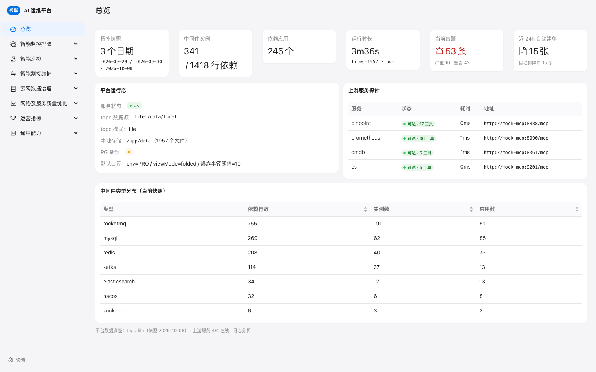

**看哪里**：① 右上「上游服务探针」四个绿点 + 17/36/5/5；② 左下当前告警 53 条；③ 近 24h 自动建单 15 张；④ 底部中间件类型分布。

**讲解词：**

> "左上角是业务结果：告警量、排障量、工单量、自动化率；右上角是底座健康度——4 个上游全部在线，说明后面的每个结论都有真实数据来源。"

### 2.2 `/mcp` 切换上游下拉

**操作**：依次切 pinpoint / prometheus / cmdb / es。

**预期数据**：**17 / 36 / 5 / 5，共 63 个工具**，全部 `reachable`；pinpoint 工具分 3 页，右侧调用审计有 `search` / `range_query` 记录。

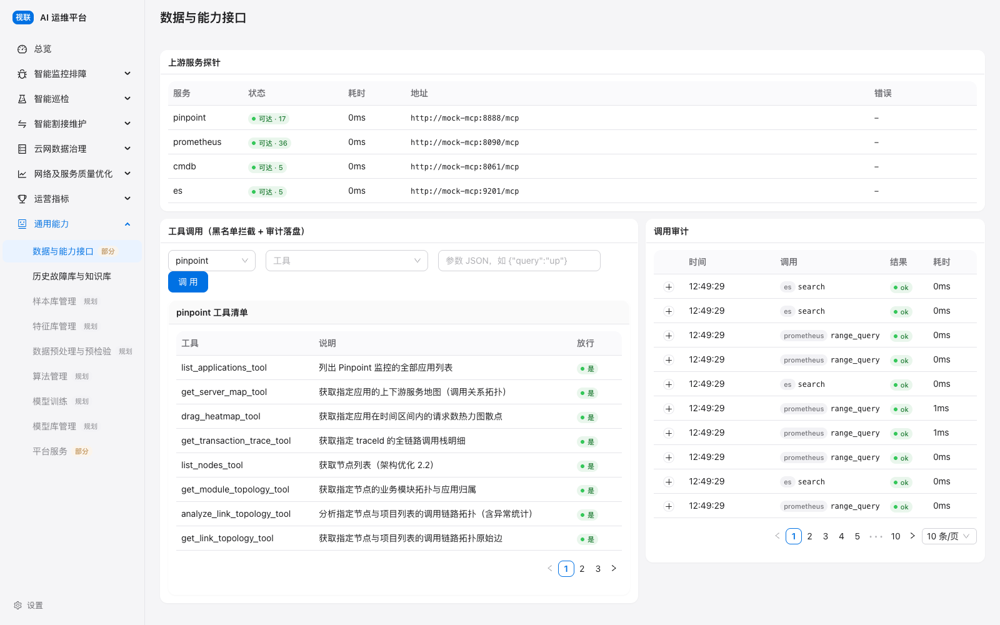

**看哪里**：① 顶部四个探针耗时 0 ms；② 中间工具清单按上游切换；③ 右侧调用审计有时间和结果。

**讲解词：**

> "平台没有把能力写死。生产环境这四个服务有多少接口，这里就展示多少——pinpoint 做调用链、Prometheus 做指标、CMDB 做资产、ES 做日志。演示环境只是把这四个地址指向了本地 mock。"

---

## 3. 第二幕｜主动发现（6 分钟）

### 3.1 告警采集（`/alert-center`，2 分钟）

**操作**：点右上角「**手动轮询**」，等 2–3 秒；再点开 `HighErrorRate` 或 `TargetDown` 那条告警的抽屉。

**预期数据**：

- 首轮新增 **4 条**：`HighErrorRate`、`TargetDown`（critical），`MySQLReplicationDelay`、`HostHighCPU`（warning）
- 总量 **54 条** = 巡检 37 + 劣化 9 + Prometheus 4 + 业务 3 + 质差 1；顶部统计：严重 10 / 告警 43 / 已恢复 1 / 自动排障中 15
- 每行带「排障状态」「置信度」，已建单的行显示 `已建单` + 优先级
- 抽屉时间线：入库 → 准入 → 自动排障 → 工单

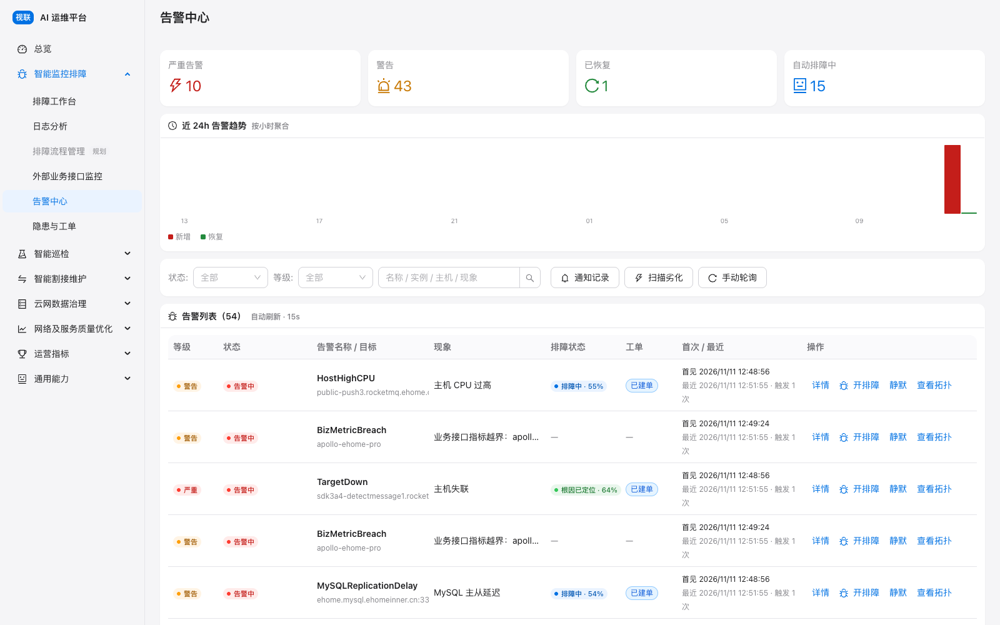

**看哪里**：① 顶部四张统计卡；② 右上「手动轮询」「扫描劣化」，旁边小字「自动刷新 · 15s」；③ TargetDown 行的「根因已定位 64%」「已建单 P2」；④ 右上角「通知记录」。

**讲解词：**

> "点一次手动轮询，后台做了五件事：拉取、按指纹入库、四道准入过滤、自动开排障、达到阈值自动建单。注意 TargetDown 指向的主机，和后面稽核查出来的是同一批——告警和稽核能互相印证。"

> "这一屏有 54 条，不是轮询造出来的：Prometheus 只贡献 4 条，其余 50 条是巡检、劣化、业务监控、质差分析回流的。平台把四类信号汇到了一个入口。"

### 3.2 主动巡检（`/inspection`，2 分钟）

**操作**：点「运行」，场景选 `topo`、环境 `PRO`；跑完打开批次详情，看风险明细抽屉。

**预期数据**：

- **102 个检查项 / 37 项风险 / 62 项正常 / 2 项无数据 / 1 项不适用**
- 风险项回流告警中心，发布 **37 条 inspection 告警**
- 抽屉按「规则 × 对象」分页：`TOP0_T10 日志错误（ES）`、`TOP0_T11 主机指标阈值` 等，P1 / P2

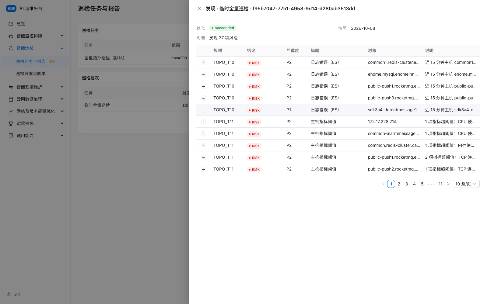

**看哪里**：① 抽屉标题与「共 37 项风险」；② 每条风险的规则名、对象、级别；③ 底部分页共 11 页。

**讲解词：**

> "告警是被动等来的，巡检是主动找出来的。11 条规则覆盖拓扑、主机、中间件、日志，跑一次 102 项，37 项有风险。这些风险不是停在报表里，而是继续走排障和建单。"

### 3.3 资源稽核（`/audit`，2 分钟）

**操作**：点「执行稽核」，默认 `maxHosts=20`；打开批次详情，重点讲 C1 / C4。

**预期数据**：**29 项发现 / 12 项风险 / 17 项正常**

| 检查项 | 结果 |
|---|---|
| C1 存在性（拓扑有、CMDB 无） | 2 条 P1 |
| C2 状态一致性（CMDB 非在线但仍有依赖） | 2 条 P1 + 16 条一致 |
| C3 反向孤儿（CMDB 在线、拓扑没引用） | 7 条 P3 |
| C4 指标佐证 | 1 条 P1 + 1 条一致 |

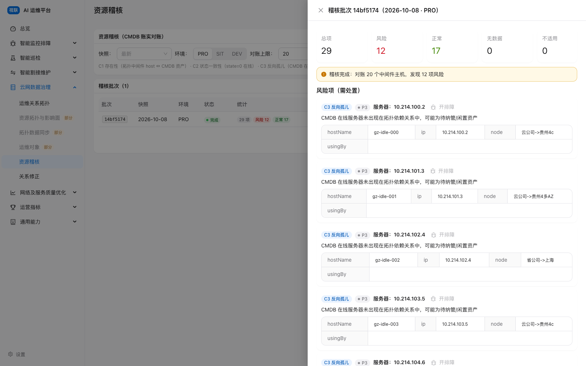

**看哪里**：① 顶部「总项 29 / 风险 12 / 正常 17」；② 风险列表里的 `C3 反向孤儿 P3`（10.214.100.2 / .3 / .4 / .5 / .6）；③ 每行的归属与修复建议。

**讲解词：**

> "稽核解决的是账实不符。C1 是拓扑引用了、CMDB 查不到；C2 是 CMDB 说报废了、应用还在依赖。最有说服力的是 C4：CMDB 标了报废，Prometheus 还在采心跳——两个系统互相打脸，这时候不是改数据，而是要人去确认到底哪边是真的。"

> "这 12 项风险里，C3 占了 7 项——CMDB 里在线、拓扑里没人引用。这类资产要么是漏纳管，要么是该清退，机器只能指出来，不能替人决定。"

### 3.4 三类更早信号（可选，2 分钟）

按 `/biz-monitor` → `/degradation` → `/quality` 顺序各点一次「扫描 / 分析」。

**预期数据**：

- 业务监控：3 条规则全部越界（错误率 8.0% > 5%、请求量 1200 < 2000、TP99 1.6s > 1s），首轮 `breaches=3, created=3`；再扫一次「本轮新建 0 条」
- 指标劣化：`scanned=10, degraded=9`，生成 9 条隐患告警，本轮自动排障 5
- 质差分析：页面默认展示最近一次报告 `apollo-ehome-pro`，`degraded=true`、质量分 **100.0%**、根因 `database / ehome-pro.mysql.ehomeinner.cn:13303`

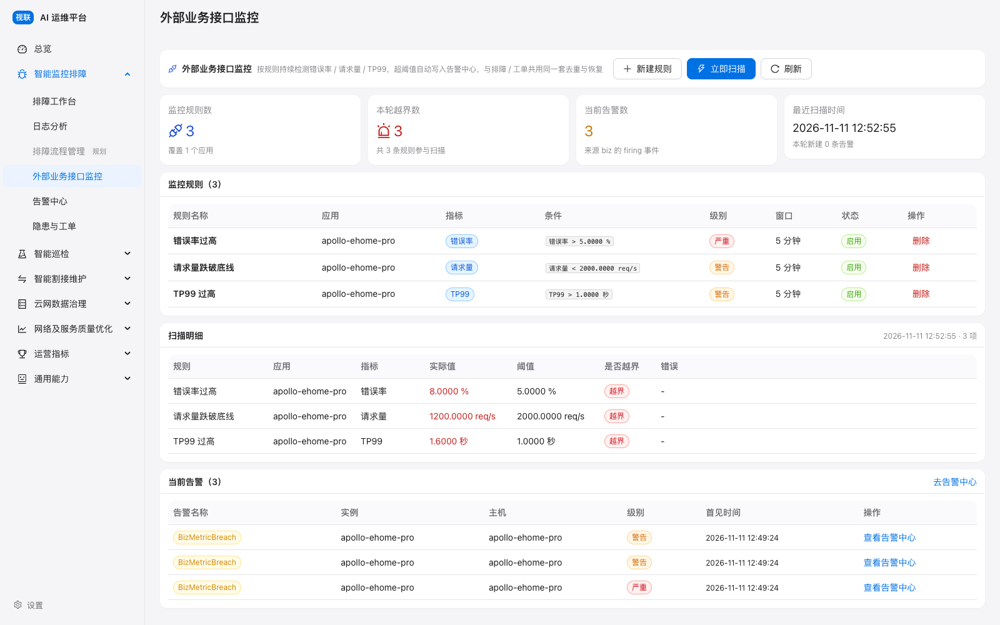

**看哪里**：顶部「规则 3 / 越界 3 / 当前告警 3」；规则阈值；扫描明细三条实际值全部越界。

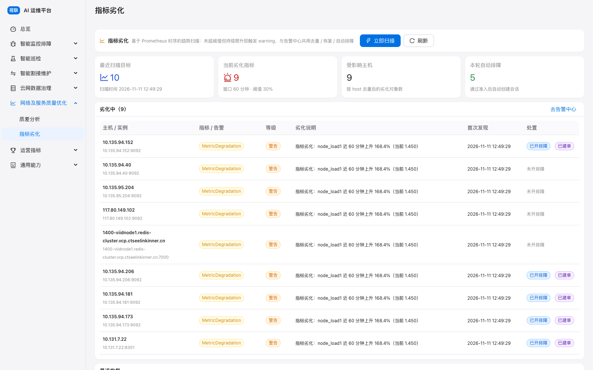

**看哪里**：顶部「扫描目标 10 / 当前劣化 9 / 受影响主机 9 / 本轮自动排障 5」；每条劣化的指标与幅度（如 `node_load1 +168.4%`）。

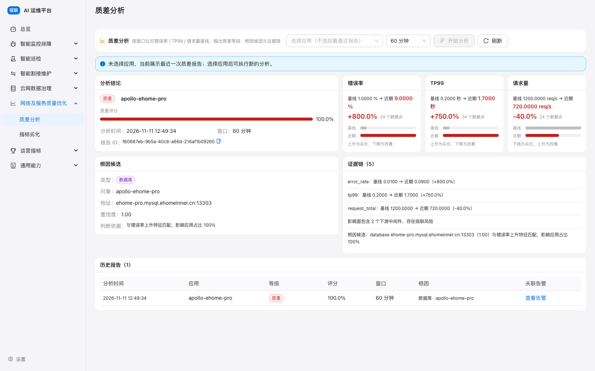

**看哪里**：顶部提示「当前展示最近一次质差报告」；错误率 1% → 9%、TP99 0.2s → 1.7s；根因候选「数据库 / ehome-pro.mysql...:13303 / 1.00」。

**讲解词：**

> "除了阈值告警，还有三类更早的信号：业务指标越界、指标趋势劣化、质量分下降。它们的共同点是——在用户投诉之前就能发现。"

> "业务监控看的是'现在越没越线'，劣化看的是'趋势是不是在变坏'，质差看的是'用户体感已经差到什么程度、该找谁'。"

---

## 4. 第三幕｜定位根因（`/diagnosis`，4 分钟）

**操作**：打开刚自动创建的 `HighErrorRate` 会话，保持「折叠视图」，逐段展开证据；鼠标停在来源健康度上。

**预期数据**：

- 状态 `root_caused`，**11 步全部 ok**
- 来源健康度 **4 条**：Prometheus ×3 + ES ×1
- 置信度 **0.85**（讲"0.8 以上"即可，随上游告警条数浮动）
- 根因：`存在与目标相关的活跃告警（待人工确认）`
- 顶部横幅「当前目标存在 4 条活跃告警」，目标应用 `apollo-ehome-pro`
- 工单：已自动创建，严重级 `warning`

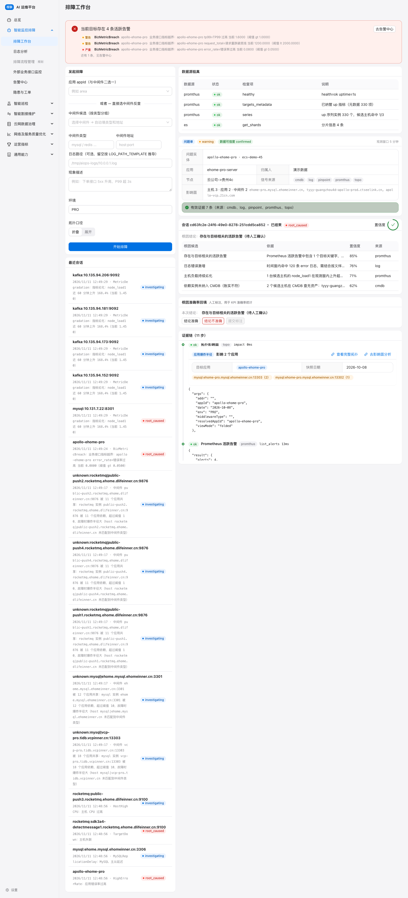

**看哪里**：① 左侧证据链 11 步全部打勾；② 右侧「结论」卡 `root_caused` + 0.85；③ 来源健康度 4 条；④ 顶部 4 条活跃告警。长图只展示上半部分，现场可向下滚动看每条证据的原始返回。

**讲解词：**

> "这 11 步不是动画。每一步都是一次真实的 MCP 调用：先看拓扑影响面，再查 Prometheus 指标和主机存活，然后去 CMDB 核对资产状态，接着拉 Pinpoint 调用链，最后用 ES 日志做取证，规则引擎给结论。每一步都有来源、有数据、有健康度，所以结论可以被人复核，而不是大模型一句话。"

> "置信度 0.85 不是拍脑袋，是证据覆盖度和来源健康度算出来的。低于阈值会停在 investigating，不会硬给结论。"

---

## 5. 第四幕｜处置闭环（4 分钟）

### 5.1 `/tickets`（1 分钟）

**操作**：打开自动生成的工单，展示证据链引用、状态流转按钮。

**预期数据**：工单总数 **15 张**（P1 1 张 + P2 14 张），全部 `待处理`，置信度 42%–60%；来源列是告警指纹前缀，「去原会话」可跳回证据链。

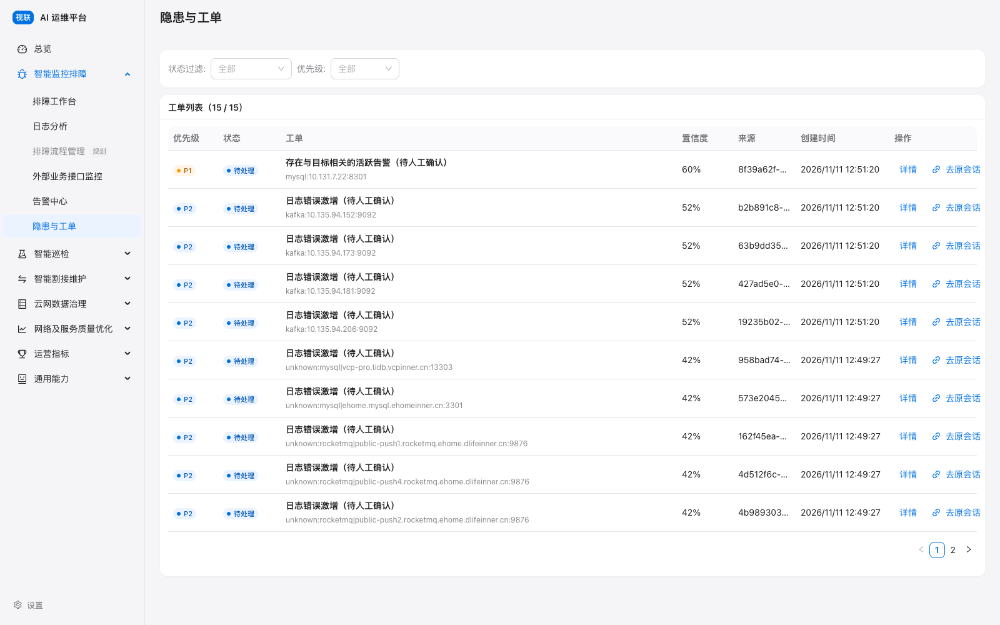

**看哪里**：① 标题「15 / 15」；② 第一行唯一的 `P1 · 待处理`；③ 置信度列；④「去原会话」。

**讲解词：**

> "根因一出，工单自动带着证据链生成，处理人不用再去问'你依据什么'。状态从 open 到处理中到已解决，全程留痕。"

### 5.2 `/op-topology`（1 分钟）

**操作**：看全局图例，指出橙色中间件节点和底部状态统计。

**预期数据**：**108 应用 / 341 中间件 / 756 依赖边**；快照 2026-10-08；底部「排障中 7 / 工单待处理 3」。

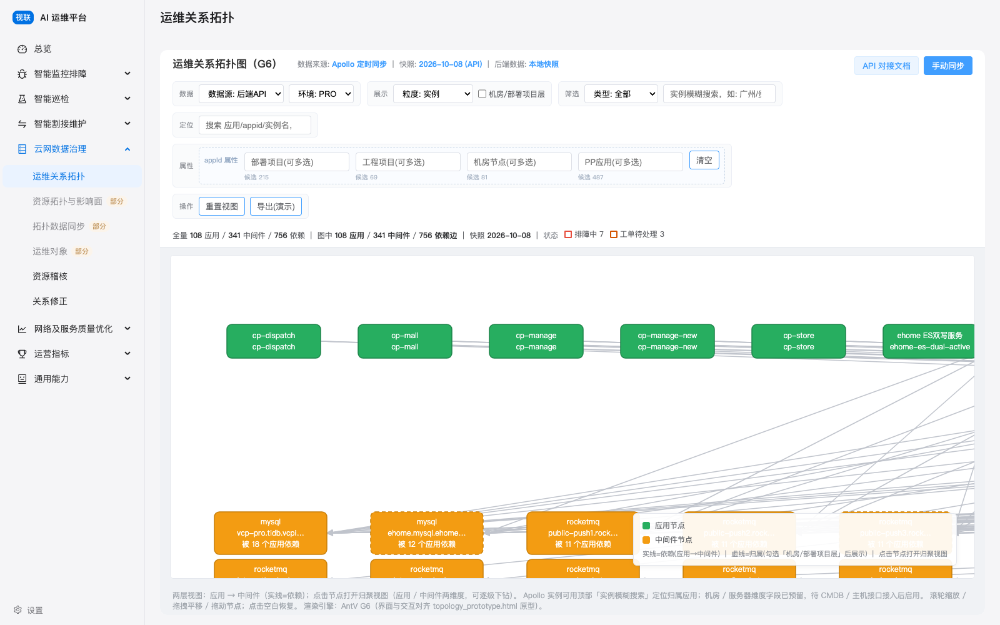

**看哪里**：① 顶部汇总和快照日期；② 橙色中间件节点旁的「被 N 个应用依赖」；③ 右上筛选；④ 底部状态条。

**讲解词：**

> "排障中和工单待处理，直接反映在全局拓扑上。看到的不再是一张静态架构图，而是一张'哪里有事、影响到谁'的动态图。中间件节点旁边的依赖数，就是故障的爆炸半径。"

### 5.3 `/relations`（1 分钟）

**操作**：点「扫描」→ 看 7 条孤儿建议 → 任选一条点「通过」→ 把鼠标停在被禁用的「执行修正」上。

**预期数据**：

- 首轮 `orphans=7, created=7`
- 二次扫描 `created=0, skipped=7`
- 统计条：待处理 7 / 已通过 0 / 已执行 0 / 已驳回 0；**可自动修正 0 / 仅人工 7**
- 审批通过后「执行修正」置灰，提示「该建议无法自动修正，请人工确认纳管或清退」
- 强行调 `POST /api/relations/suggestions/:id/apply` 返回 **400**；修正留痕为空（没有自动改底座）

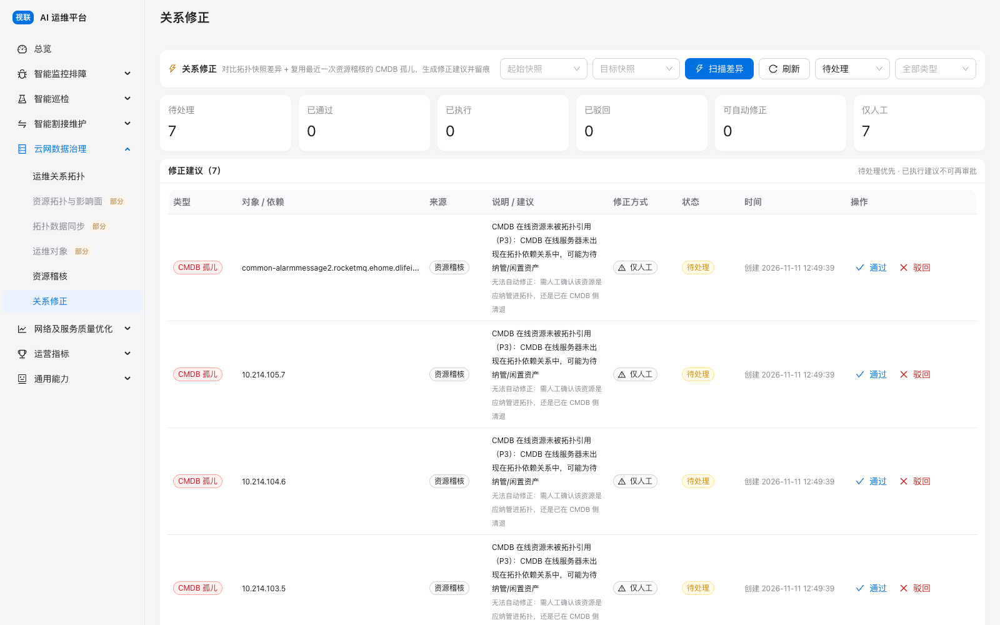

**看哪里**：① 顶部「可自动修正 0 / 仅人工 7」；② 7 行全部 `CMDB 孤儿` + 「仅人工」；③ 操作列只有「通过 / 驳回」。

**讲解词：**

> "这里刻意不让机器自动改关系。机器只负责给建议，人审批后才能执行；孤儿资产连自动执行都不允许，必须人工确认纳管还是清退。刚才按钮变灰不是功能坏了，是治理边界。"

> "可自动修正 0、仅人工 7，这个数字比'自动修了 7 条'更值得讲——平台知道哪些能自动做、哪些必须人来做。"

### 5.4 `/knowledge`（1 分钟）

**操作**：搜「告警」，打开一条案例，展示根因、置信度、证据链；再演示相似案例。

**预期数据**：`total=14, apps=1, reviewed=1, accuracy=100.0`；`q=告警&limit=5` 命中 5 条；列表置信度 0.60–0.86；相似案例按分数排序。

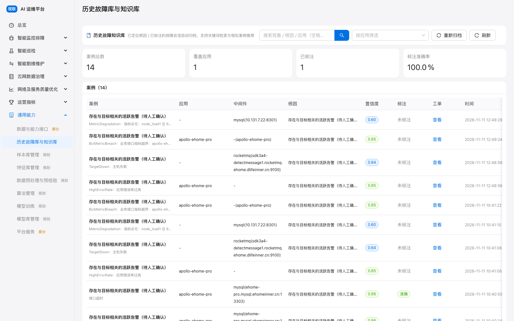

**看哪里**：① 四张统计「14 / 1 / 1 / 100.0%」；② 搜索「告警」的结果；③ 每行的根因、置信度、标注状态、关联工单。

**讲解词：**

> "一次排障结束，经验自动归档。下次遇到相似症状，先看历史案例和证据链，不用从零查起。知识不是靠人写文档，是从闭环里长出来的。"

---

## 6. 第五幕｜度量与收尾（`/metrics`，2 分钟）

**操作**：看 1 / 5 / 10 分钟达标率、自动化率、每日趋势。

**预期数据**：

- 三张达标率卡全部 **100.0%**：1 分钟发现（15 个样本）、5 分钟定位、10 分钟闭环
- 自动化率：告警自动开排障 **27.8%**（15 / 54）、自动建单 **100%**（15 / 15）、定位成功率 **100%**
- 巡检自动化执行率 **0.0%**：本次是手动临时巡检，不属于 cron 计划任务
- 根因准确率 **0.0%**：口径是「已标注样本的准确率」，当前已标注 0 个；知识库那条标注不计入该口径

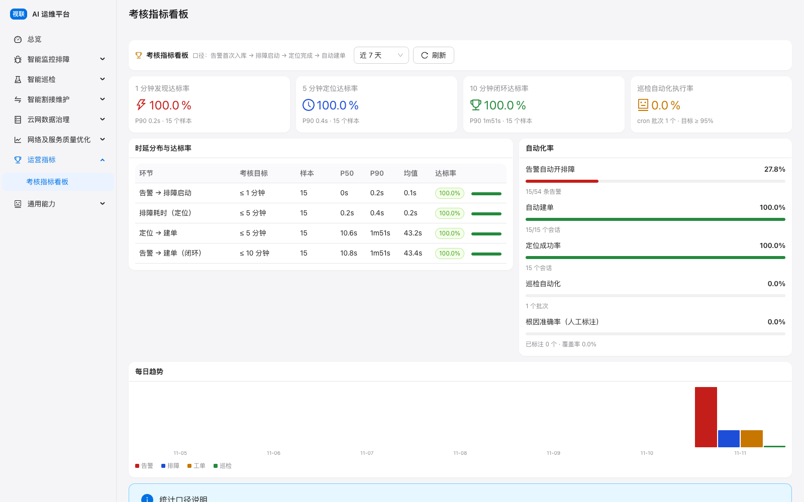

**看哪里**：① 顶部三张卡「1 分钟发现 100.0% / 5 分钟定位 100.0% / 10 分钟闭环 100.0%」，括号里是样本数 15；② 中间「时延分布」四条每档都写样本数和占比；③ 下方「自动化率」：告警自动开排障 27.8%（15/54）、自动建单 100%（15/15）、定位成功率 100%；④ 巡检自动化 0.0% 和根因准确率 0.0% 都标了原因。

**讲解词：**

> "最后回答一个问题：这套东西到底有没有用。1/5/10 分钟达标率看发现和定位速度，自动化率看机器替人做了多少，每日趋势看是在变好还是变差。到这里，'发现—定位—处置—度量'就闭环了。"

> "两个 0% 要主动说明：巡检执行率是计划任务口径，这次演示跑的是临时巡检，所以不计入；根因准确率只算人工标注过的样本，现在样本还是 0，等标注起来才会变成真实数字。"

**收尾一句话：**

> "平台的价值不是多了一个页面，而是把四个上游的数据变成了可执行、可审计、可度量的动作。"

---

## 7. 10 分钟精简版

| 序 | 页面 | 操作 | 讲解重点 | 预期数据 |
|---|---|---|---|---|
| 1 | `/dashboard` | 打开 | 4/4 上游在线 | 探针 4/4 / 告警 53 |
| 2 | `/alert-center` | 手动轮询 + 开抽屉 | 五件事一次完成 | 新增 4 条 / 总量 54 |
| 3 | `/diagnosis` | 开 `HighErrorRate` | 11 步真实取证 | 0.85 / 11 步 / 4 来源 |
| 4 | `/tickets` + `/op-topology` | 看工单与拓扑 | 处置与影响面 | 15 张 / 108 应用 341 中间件 |
| 5 | `/metrics` | 看达标率 | 闭环效率 | 1/5/10 分钟达标率 |

巡检、稽核、业务监控、劣化、质差、关系修正、知识库只在被追问时补，不主动展开。

---

## 8. 附录 A｜预期数据总表

| 环节 | 预期数据 | 说明 |
|---|---|---|
| 上游探针 | 17 / 36 / 5 / 5，共 63 工具 | 全部 reachable |
| 告警采集 | 首轮新增 4 条（2 critical + 2 warning） | 来自 `list_alerts.json`；总量见末行 |
| 巡检 | 102 项 / 37 风险 | 62 正常 / 2 无数据 / 1 不适用；回流 37 条 |
| 资源稽核 | 29 项 / 12 风险 | C1 2、C2 2+16、C3 7、C4 1+1 |
| 指标劣化 | scanned=10 / degraded=9 | 9 条隐患告警，自动排障 5 |
| 业务监控 | breaches=3 / created=3（首轮） | 二次 created=0 |
| 质差分析 | degraded=true / score=100.0% | 根因 database |
| 排障会话 | 11 步 ok / 0.85 / 4 条来源健康度 | ticket warning |
| 工单 | 15 张（P1 1 + P2 14） | 随步骤浮动 |
| 关系修正 | orphans=7 / created=7 | 仅人工 7、可自动修正 0 |
| 知识库 | 14 条 / 1 应用 / 已标注 1 / 100% | 随运行次数累积 |
| 运维拓扑 | 108 应用 / 341 中间件 / 756 边 | 排障中 7、工单待处理 3 |
| 告警总量 | 54 条 | 巡检 37 + 劣化 9 + Prometheus 4 + 业务 3 + 质差 1 |

> 数据口径：上表是 `seed_demo.py` 重置 + 清空运行时 store 后的首次运行快照（2026-11-11 实测）。页面每 15 秒自动刷新、后台巡检/劣化/关系扫描会持续回流，现场只对照量级和比例。

---

## 9. 附录 B｜现场兜底话术

| 现象 | 真实原因 | 现场怎么说 |
|---|---|---|
| 首轮采集只有 4 条 | `list_alerts.json` 基线就是 4 条 | "4 条是 Prometheus 基线；告警中心的 54 条是巡检、劣化、业务、质差回流的合计。" |
| 置信度 0.85，不是文档的 0.75 | 上游 firing 告警条数不同 | "置信度是算出来的，随证据多少浮动，0.8 以上都属高置信。" |
| 质差分析报错 | 接口没带 `appId` | 页面默认展示最近一次报告；也可用「开始分析」，或带 `{"appId":"apollo-ehome-pro","windowMin":60}`。 |
| 日志证据某一步 skipped | `log_analyzer`（:8020）未启动 | "日志服务未接入时自动跳过，不影响其他证据。" |
| 「执行修正」点不动 | 孤儿建议不允许自动修 | "这是治理边界：机器只建议，人确认才执行。强行调接口会返回 400。" |
| 知识库条数不是 14 | 前面多跑 / 少跑了步骤 | "知识库是累积的，条数随运行次数增长。" |
| 页面数据比预期多 | 每 15 秒自动刷新 + 后台扫描持续回流 | "列表按事件累计，现场只对照量级和比例，不逐条对数字。" |
| 度量页出现 0.0% | 巡检执行率按 cron 口径、根因准确率按已标注样本口径 | "这两个都是分母口径问题：临时巡检不计入计划任务，根因准确率还没有人工标注样本。" |

---

## 10. 附录 C｜现场可能被追问的 8 个问题

1. **数据是真的吗？**
   拓扑来自 10-08 生产快照，资产/主机/应用都是真实结构；指标数值是确定性模拟，但工具调用、入库、排障、建单全是真实链路。

2. **告警会不会误报？**
   指纹幂等 + 四道准入 + 抑制 + 人工确认。演示里的 C4 就是双向印证：一条提示 CMDB 过期，一条确认一致。

3. **根因凭什么信？**
   11 步证据链，每步有来源、数据、健康度，结论可复核；置信度低于阈值会停在调查中。

4. **会不会自动改生产？**
   不会。关系修正只给建议，执行需审批；孤儿资产只能人工纳管或清退。

5. **接真实环境要改代码吗？**
   不用。改 4 个 MCP 地址即可，平台没有 mock 分支。

6. **能接现有告警系统吗？**
   支持 webhook 接入：firing 时 `ingested=1` 并自动排障，resolved 时自动关单（`resolved=1`）。

7. **大模型在哪里？**
   本轮定位结论由规则引擎 + 证据链给出，不依赖大模型黑盒；大模型只用于日志摘要等辅助环节，可关闭。

8. **下一步做什么？**
   全量稽核、告警抑制联动 Alertmanager、通知出站（邮件/IM）配置、更多业务监控规则。
